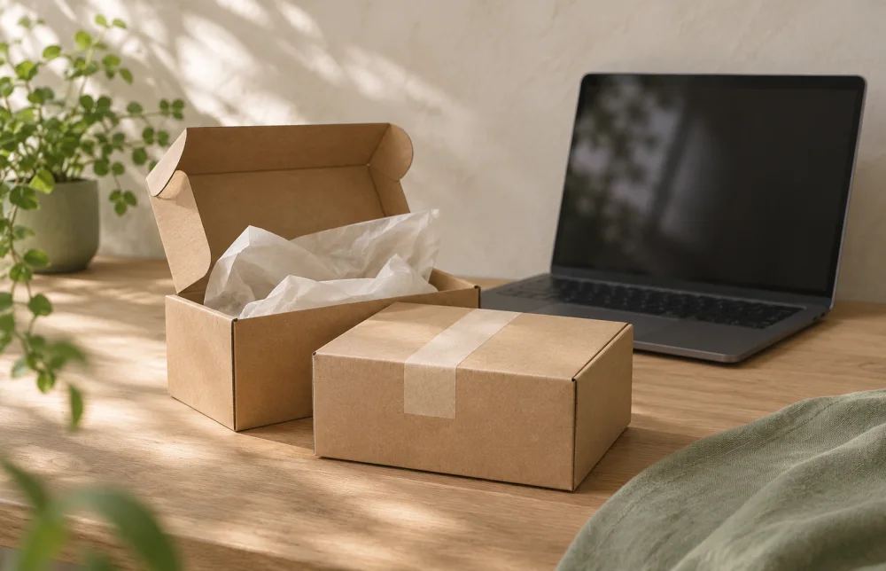
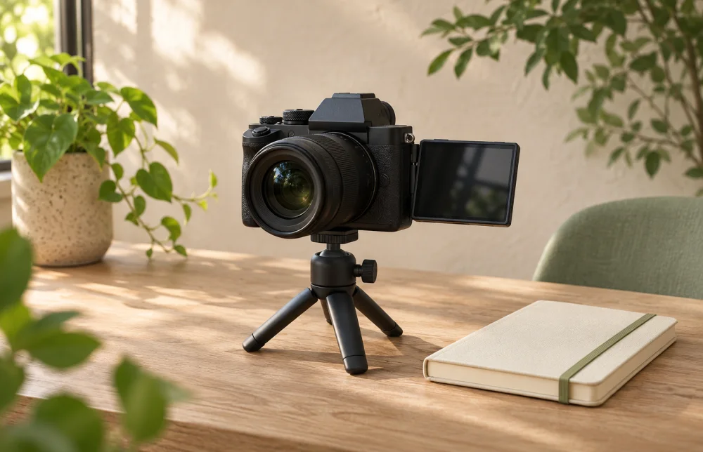
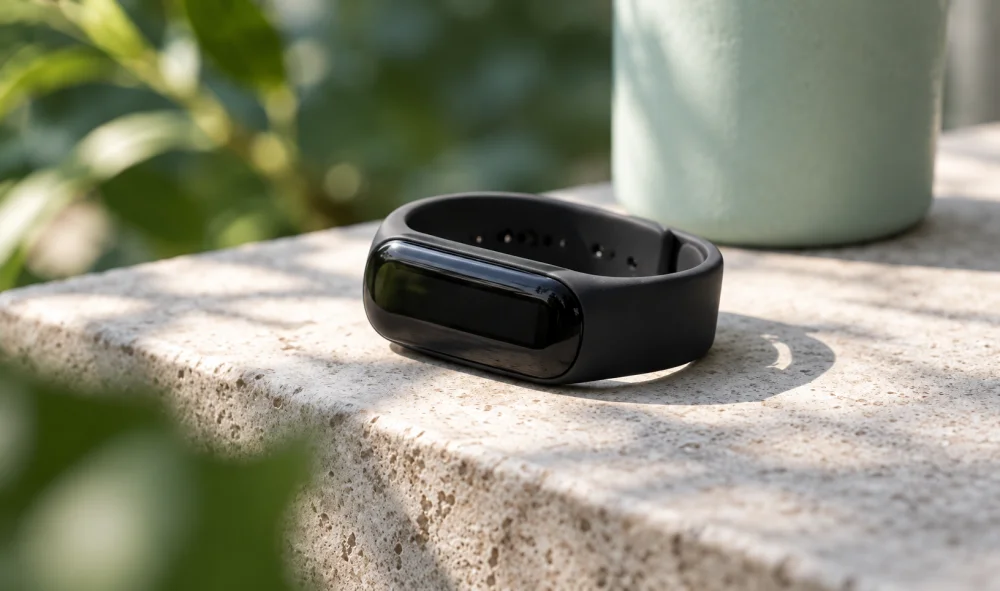

::: {.portal-layout}
::: {.portal-main}
# Projects, ideas and technology.

::: {.portal-intro}
I'm Tales Gomes. This is my space to share projects and learning about data science and technology.
:::

::: {#projetos .project-list aria-label="Projects"}
::: {.project-row}

::: {.project-copy}
## [E-Commerce Sales & Customer Analytics](../posts/ecommerce/en.qmd)

[Sales, customer segmentation and margin simulation]{.project-subtitle}

[Python · Polars · LightGBM · Streamlit · 2026]{.project-meta}

An analytics pipeline using synthetic e-commerce data, with data contracts, RFM segmentation and risk modeling. Includes a margin and discount simulator with executive PDF report export.

[Read study [→]{aria-hidden=true}](../posts/ecommerce/en.qmd){.text-link} [Code on GitHub [→]{aria-hidden=true}](https://github.com/talesgomes27/ecommerce_sales_customer_analytics){.text-link}
:::
:::

::: {.project-row}

::: {.project-copy}
## [Sherlock Document Search](../posts/sherlock/en.qmd)

[Document search with traceable references]{.project-subtitle}

[Python · scikit-learn · TF-IDF · BM25 · 2026]{.project-meta}

Literal and relevance-based search over Sherlock Holmes texts, with results pointing to source files and lines. Compares three search methods and also evaluates queries with no answer in the examined context.

[Read study [→]{aria-hidden=true}](../posts/sherlock/en.qmd){.text-link} [Code on GitHub [→]{aria-hidden=true}](https://github.com/talesgomes27/sherlock-document-search){.text-link}
:::
:::

::: {.project-row}

::: {.project-copy}
## [Banking fraud detection and analysis](../posts/fraud/en.qmd)

[Detection, fraud types and financial loss estimation]{.project-subtitle}

[Python · pandas · LightGBM · scikit-learn · 2026]{.project-meta}

A study using a public dataset and a three-stage pipeline: fraud detection, fraud-type classification and financial loss estimation. Uses temporal splitting and cost-based decision thresholds.

[Read study [→]{aria-hidden=true}](../posts/fraud/en.qmd){.text-link} [Code on GitHub [→]{aria-hidden=true}](https://github.com/talesgomes27/credit_card_fraud_detection){.text-link}
:::
:::

::: {.project-row}

::: {.project-copy}
## [YouTube viral video prediction](../posts/youtube/en.qmd)

[Reach, virality and the influence of channel size]{.project-subtitle}

[Python · scikit-learn · LightGBM · Quarto · 2026]{.project-meta}

Classification and regression using synthetic video data, comparing features available before and after publication. Includes data leakage controls and analysis of the influence of subscriber counts.

[Read study [→]{aria-hidden=true}](../posts/youtube/en.qmd){.text-link} [Code on GitHub [→]{aria-hidden=true}](https://github.com/talesgomes27/youtube_viral_video_prediction){.text-link}
:::
:::

::: {.project-row}

::: {.project-copy}
## [Bike-share / Cyclistic](../posts/bike-share-navigate/index.qmd)

[Usage patterns and conversion strategies]{.project-subtitle}

[R · 2026]{.project-meta}

An updated study with descriptive statistics, logistic regression and trip segmentation to inform conversion strategies.

[Read study [→]{aria-hidden=true}](../posts/bike-share-navigate/index.qmd){.text-link} [Browse the archive [→]{aria-hidden=true}](textos.qmd){.text-link}
:::
:::

::: {.project-row}

::: {.project-copy}
## [Bellabeat](../posts/bellabeat/en.qmd)

[Fitness tracker usage]{.project-subtitle}

[R · 2021]{.project-meta}

An exploratory analysis of activity, sleep and fitness tracker data, focusing on usage patterns.

[Read study [→]{aria-hidden=true}](../posts/bellabeat/en.qmd){.text-link} [Browse the archive [→]{aria-hidden=true}](textos.qmd){.text-link}
:::
:::
:::
:::

::: {.portal-aside role=complementary aria-label="Writing and about the author"}
::: {.aside-section}
## Writing

Projects, learning and perspectives on data science and technology.

[Browse the archive [→]{aria-hidden=true}](textos.qmd){.text-link}
:::

::: {.aside-section}
## About me

I'm Tales Gomes. This is my space to share projects and learning.

[About me [→]{aria-hidden=true}](about.qmd){.text-link}
:::

:::
:::

::: {#contato .contact-section}
## Let's talk.

Interested in exchanging ideas, discussing opportunities or collaborating on projects? I'd be happy to talk.

[Get in touch](mailto:talesgomes27@gmail.com){.btn .btn-primary}
:::
