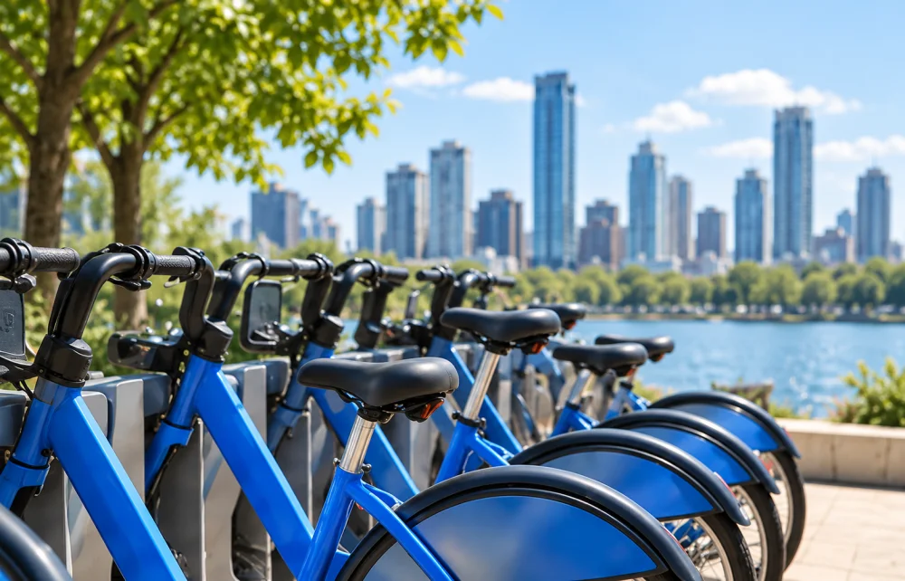
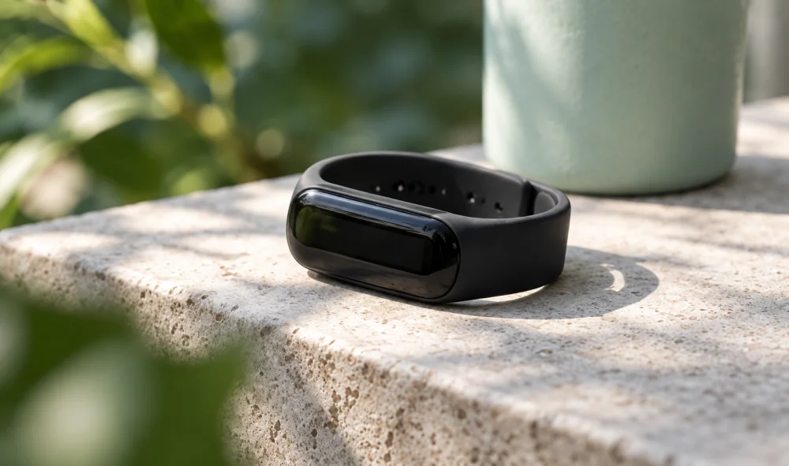
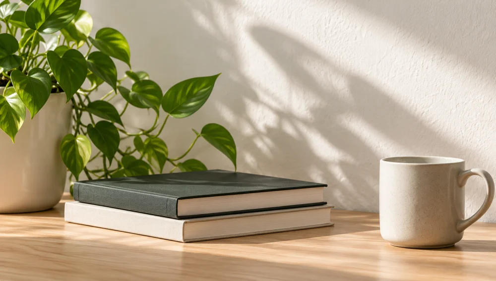

::: {.portal-layout}
::: {.portal-main}
# Projetos, ideias e tecnologia.

::: {.portal-intro}
Sou Tales Gomes. Este é meu espaço para compartilhar projetos e aprendizados em ciência de dados e tecnologia.
:::

::: {#projetos .project-list aria-label="Projetos"}
::: {.project-row}

::: {.project-copy}
## [Bike-share / Cyclistic](posts/bike-share-navigate/pt.qmd)

[Padrões de uso e estratégias de conversão]{.project-subtitle}

[R · 2026]{.project-meta}

Estudo atualizado com estatística descritiva, regressão logística e segmentação de viagens para orientar estratégias de conversão.

[Ver estudo [→]{aria-hidden=true}](posts/bike-share-navigate/pt.qmd){.text-link} [Explorar o arquivo [→]{aria-hidden=true}](textos.qmd){.text-link}
:::
:::

::: {.project-row}

::: {.project-copy}
## [Bellabeat](posts/bellabeat/index.qmd)

[Uso de dispositivos fitness]{.project-subtitle}

[R · 2021]{.project-meta}

Análise exploratória de dados de atividade física, sono e uso de dispositivos fitness, com foco em padrões de uso.

[Ver estudo [→]{aria-hidden=true}](posts/bellabeat/index.qmd){.text-link} [Explorar o arquivo [→]{aria-hidden=true}](textos.qmd){.text-link}
:::
:::
:::
:::

::: {.portal-aside role=complementary aria-label="Textos e sobre o autor"}
::: {.aside-section}
## Textos

Projetos, aprendizados e perspectivas sobre ciência de dados e tecnologia.

[Explorar o arquivo [→]{aria-hidden=true}](textos.qmd){.text-link}
:::

::: {.aside-section}
## Sobre mim

Sou Tales Gomes. Este é meu espaço para compartilhar projetos e aprendizados.

[Sobre mim [→]{aria-hidden=true}](about.qmd){.text-link}
:::

:::
:::

::: {#contato .contact-section}
## Vamos conversar?

Você tem interesse em trocar ideias, falar sobre oportunidades ou colaborar em projetos? Será um prazer conversar.

[Entrar em contato](mailto:talesgomes27@gmail.com){.btn .btn-primary}
:::
