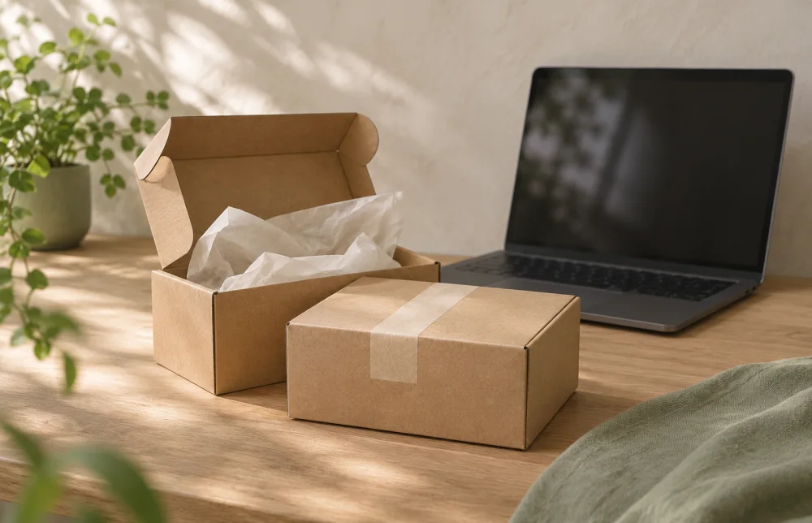
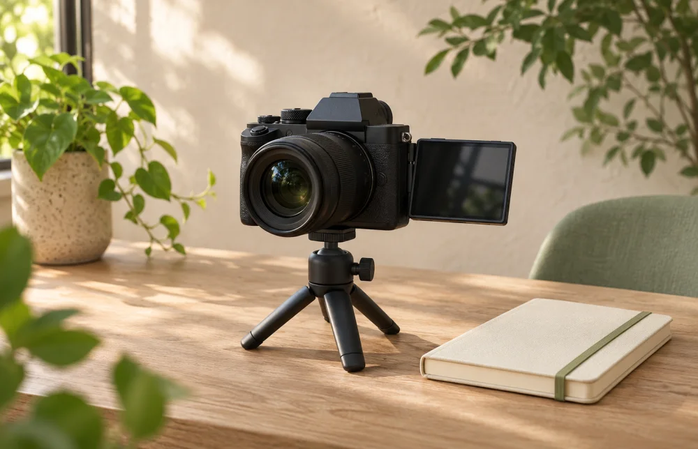
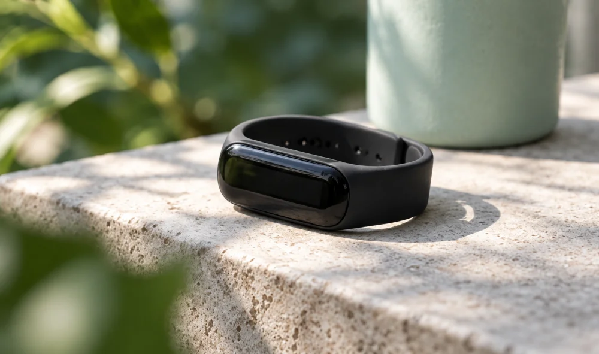

::: {.portal-layout}
::: {.portal-main}
# Projetos, ideias e tecnologia.

::: {.portal-intro}
Sou Tales Gomes. Este é meu espaço para compartilhar projetos e aprendizados em ciência de dados e tecnologia.
:::

::: {#projetos .project-list aria-label="Projetos"}
::: {.project-row}

::: {.project-copy}
## [E-Commerce Sales & Customer Analytics](posts/ecommerce/index.qmd)

[Vendas, segmentação de clientes e simulação de margem]{.project-subtitle}

[Python · Polars · LightGBM · Streamlit · 2026]{.project-meta}

Pipeline com dados sintéticos de comércio eletrônico, contratos de dados, segmentação RFM e modelagem de risco. Inclui um simulador de margem e descontos, com exportação de relatório executivo em PDF.

[Ver estudo [→]{aria-hidden=true}](posts/ecommerce/index.qmd){.text-link} [Código no GitHub [→]{aria-hidden=true}](https://github.com/talesgomes27/ecommerce_sales_customer_analytics){.text-link}
:::
:::

::: {.project-row}

::: {.project-copy}
## [Sherlock Document Search](posts/sherlock/index.qmd)

[Busca em documentos com referências rastreáveis]{.project-subtitle}

[Python · scikit-learn · TF-IDF · BM25 · 2026]{.project-meta}

Busca literal e por relevância em textos de Sherlock Holmes, com resultados que indicam o arquivo e as linhas de origem. Compara três métodos de busca e avalia também consultas sem resposta no contexto examinado.

[Ver estudo [→]{aria-hidden=true}](posts/sherlock/index.qmd){.text-link} [Código no GitHub [→]{aria-hidden=true}](https://github.com/talesgomes27/sherlock-document-search){.text-link}
:::
:::

::: {.project-row}

::: {.project-copy}
## [Detecção e análise de fraudes bancárias](posts/fraud/index.qmd)

[Detecção, modalidades e estimativa de perda financeira]{.project-subtitle}

[Python · pandas · LightGBM · scikit-learn · 2026]{.project-meta}

Estudo com dataset público e pipeline de três estágios: detecção de fraude, classificação da modalidade e estimativa de perda financeira. Emprega particionamento temporal e limiares de decisão orientados a custo.

[Ver estudo [→]{aria-hidden=true}](posts/fraud/index.qmd){.text-link} [Código no GitHub [→]{aria-hidden=true}](https://github.com/talesgomes27/credit_card_fraud_detection){.text-link}
:::
:::

::: {.project-row}

::: {.project-copy}
## [Predição de vídeos virais no YouTube](posts/youtube/index.qmd)

[Alcance, viralidade e influência do tamanho do canal]{.project-subtitle}

[Python · scikit-learn · LightGBM · Quarto · 2026]{.project-meta}

Classificação e regressão com dados sintéticos de vídeos, comparando atributos disponíveis antes e depois da publicação. Inclui controles de vazamento de informação e análise da influência do número de inscritos.

[Ver estudo [→]{aria-hidden=true}](posts/youtube/index.qmd){.text-link} [Código no GitHub [→]{aria-hidden=true}](https://github.com/talesgomes27/youtube_viral_video_prediction){.text-link}
:::
:::

::: {.project-row}

::: {.project-copy}
## [Bike-share / Cyclistic](posts/bike-share-navigate/pt.qmd)

[Padrões de uso e estratégias de conversão]{.project-subtitle}

[R · 2026]{.project-meta}

Estudo atualizado com estatística descritiva, regressão logística e segmentação de viagens para orientar estratégias de conversão.

[Ver estudo [→]{aria-hidden=true}](posts/bike-share-navigate/pt.qmd){.text-link} [Explorar o arquivo [→]{aria-hidden=true}](textos.qmd){.text-link}
:::
:::

::: {.project-row}

::: {.project-copy}
## [Bellabeat](posts/bellabeat/index.qmd)

[Uso de dispositivos fitness]{.project-subtitle}

[R · 2021]{.project-meta}

Análise exploratória de dados de atividade física, sono e uso de dispositivos fitness, com foco em padrões de uso.

[Ver estudo [→]{aria-hidden=true}](posts/bellabeat/index.qmd){.text-link} [Explorar o arquivo [→]{aria-hidden=true}](textos.qmd){.text-link}
:::
:::
:::
:::

::: {.portal-aside role=complementary aria-label="Textos e sobre o autor"}
::: {.aside-section}
## Textos

Projetos, aprendizados e perspectivas sobre ciência de dados e tecnologia.

[Explorar o arquivo [→]{aria-hidden=true}](textos.qmd){.text-link}
:::

::: {.aside-section}
## Sobre mim

Sou Tales Gomes. Este é meu espaço para compartilhar projetos e aprendizados.

[Sobre mim [→]{aria-hidden=true}](about.qmd){.text-link}
:::

:::
:::

::: {#contato .contact-section}
## Vamos conversar?

Você tem interesse em trocar ideias, falar sobre oportunidades ou colaborar em projetos? Será um prazer conversar.

[Entrar em contato](mailto:talesgomes27@gmail.com){.btn .btn-primary}
:::
