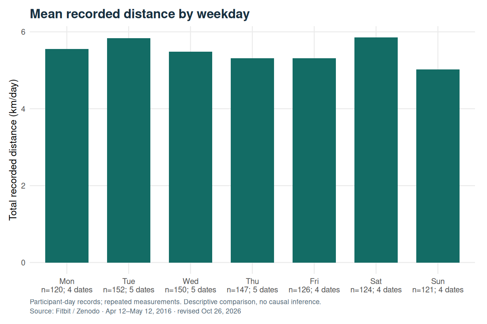
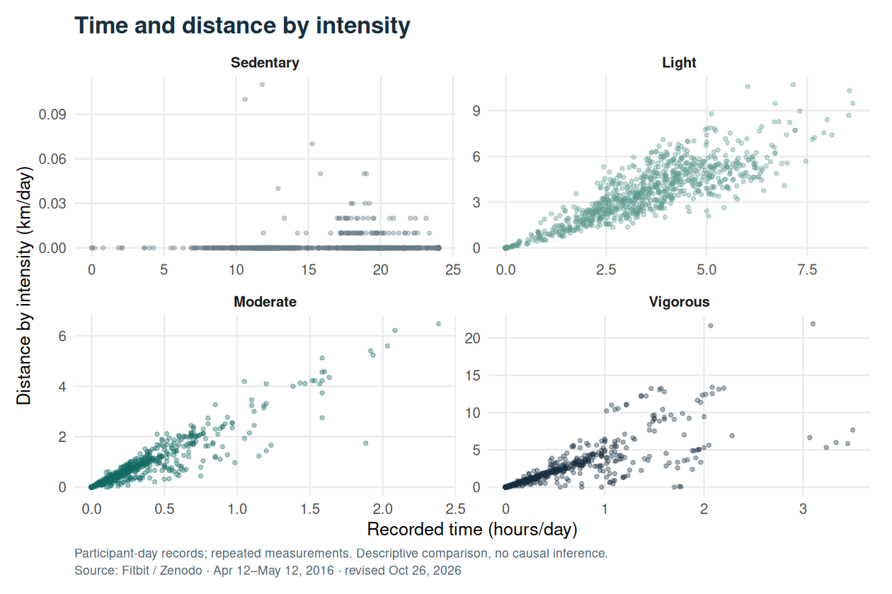
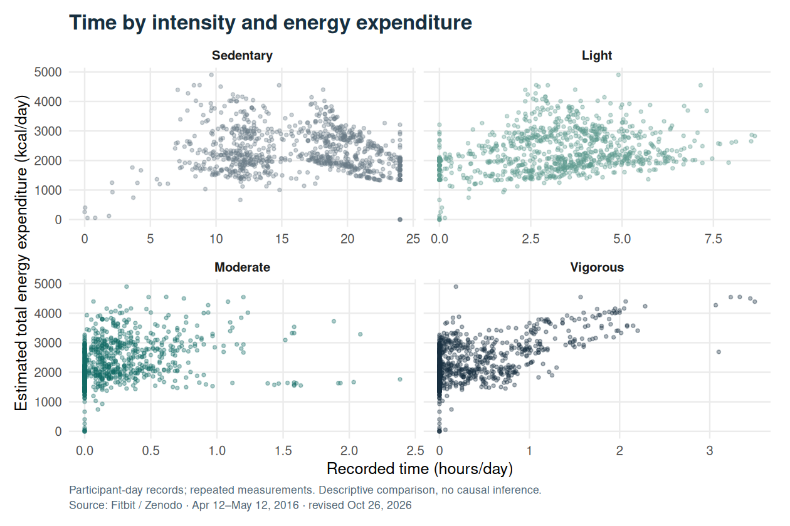
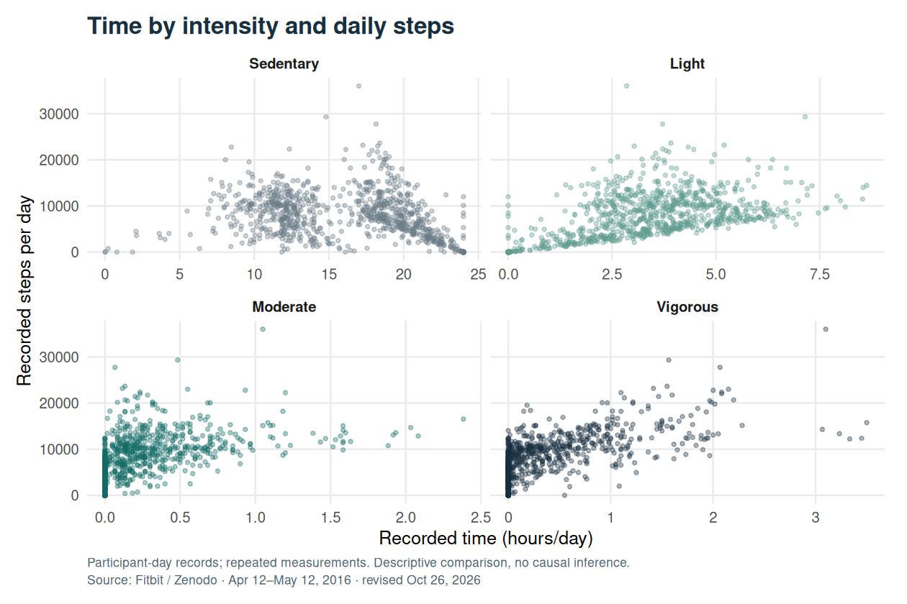
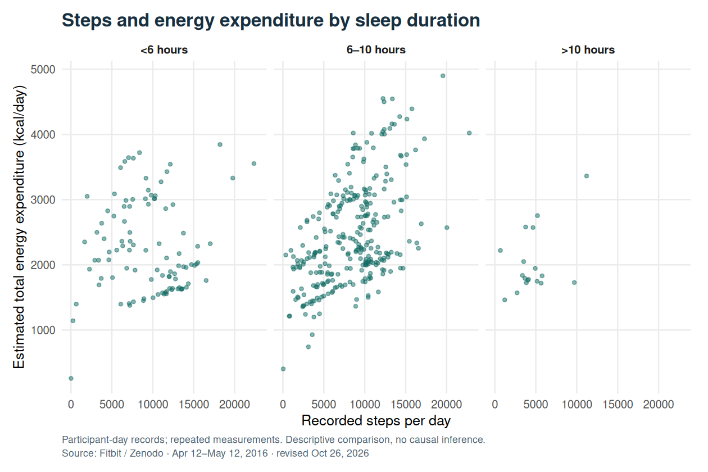
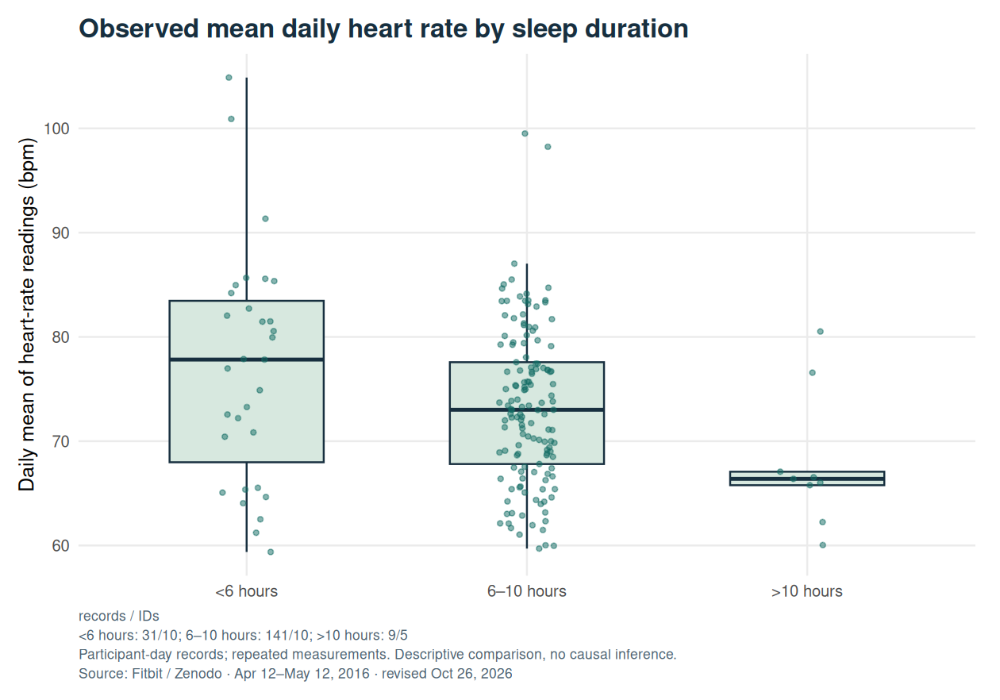

::: {.callout-note title="Revision of October 26, 2026"}
This version was recalculated in R using the original April–May 2016 archive. Three exact duplicate sleep records were removed before joining the tables. The narrative and figures were updated in both languages; previous sources and results remain available in the traceability section.
:::

## Question and scope

How do activity, sleep and heart-rate records vary within this sample of Fitbit users? The study uses these data as an exploratory exercise in a Bellabeat business context. Fitbit is not a Bellabeat product, and the dataset does not identify that company's customers.

The unit of analysis is the **participant-day**. One person contributes multiple days and may appear in different sleep categories. Comparisons describe available records; they do not identify causal effects of sleep, activity or commercial interventions.

## Data source and coverage

The supplied source is [FitBit Fitness Tracker Data on Kaggle](https://www.kaggle.com/datasets/arashnic/fitbit). This revision uses the **April 12–May 12, 2016** archive available from the [original Zenodo record by Furberg, Brinton, Keating and Ortiz](https://zenodo.org/records/53894).

The daily activity file contains **33 distinct identifiers**, while the dataset description reports 30 participants. This documentary discrepancy remains unexplained. Sex, age and customer profiles were not inferred from identifiers. These historical data do not necessarily represent current fitness tracker users.

::: {.table-responsive tabindex="0" role="region" aria-label="Table: Data source and coverage"}

| Source table | Records | Distinct IDs | Treatment |
| --- | ---: | ---: | --- |
| Daily activity | 940 | 33 | One row per participant-day |
| Sleep | 413 | 24 | Three exact duplicates removed; 410 rows retained |
| Heart rate | 2,483,658 | 14 | Mean of readings per participant-day; 334 daily rows |
| Weight and BMI | 67 | 8 | Participant-day uniqueness verified; limited coverage |

:::

Fields follow the [Fitabase data dictionary](https://www.fitabase.com/resources/knowledge-base/exporting-data/data-dictionaries/). `TotalDistance` records total distance in kilometers and `Calories` estimates total energy expenditure in kilocalories, including components beyond exercise.

## Corrected processing

The [R script for this revision](../../scripts/rebuild_bellabeat.R) verifies the ZIP identity before reading the files and applies these rules:

1. Standardizes dates and verifies the participant-day key in each table.
2. Removes only exact duplicate sleep records. Distinct records sharing the same key fail validation rather than being discarded arbitrarily.
3. Aggregates heart-rate readings by participant-day and left-joins the tables to daily activity. The resulting table has **940 rows and 940 unique keys**.
4. Converts minutes to hours, retaining total time in bed and creating a separate variable for time in bed minus time asleep.
5. Builds the long-form table directly, producing **3,760 rows** without the previous many-to-many join.
6. Retains zeros and missing values. A zero is not assumed to prove actual inactivity, nor is missingness assumed to be random.

The previous version contained 943 rows; its long-form join implied 3,796 rows. The new summaries and figures use the corrected table rather than duplicated days.

## Comparison with the previous result

The historical means below belong to the preserved 943-row table. The corrected column uses 940 unique participant-days; both versions remain identified and available.

::: {.table-responsive tabindex="0" role="region" aria-label="Results table: comparison"}



:::

## Summary with explicit denominators

::: {.table-responsive tabindex="0" role="region" aria-label="Results table: summary"}



:::

Each mean uses the variable's non-missing records, weighting observed days equally. People contributing more days receive more weight in this summary. BMI, sleep and heart-rate coverage is lower than activity coverage; their values do not describe 33 equally observed participants.

Heart rate is the mean of available readings throughout each day, without weighting by the duration between readings. It is not resting heart rate. Recorded sedentary minutes also depend on device coverage and classification; they do not independently establish how long a person was physiologically inactive.

## Activity by weekday

The period contains five Tuesdays, Wednesdays and Thursdays, and four occurrences of each other weekday. Summing all observations favors categories with more exposure. This revision uses **means per observed participant-day**, accompanied by coverage counts.

::: {.table-responsive tabindex="0" role="region" aria-label="Results table: weekday"}



:::

{fig-alt="Bar chart of mean daily distance by weekday, using observed participant-days and reporting coverage."}

Differences are descriptive. Normalization addresses unequal totals, but does not automatically balance participant composition or establish a persistent individual pattern.

## Intensity, time, steps and energy expenditure

{fig-alt="Points showing distance in kilometers versus time in hours, separated by activity intensity."}

{fig-alt="Points showing estimated energy expenditure in kilocalories versus time in hours by intensity."}

{fig-alt="Points showing daily steps versus time in hours, separated by activity intensity."}

These plots describe the joint distribution of measurements recorded on the same day. The variables come from the same monitoring and estimation system; their association is not an independent validation of device accuracy. No confidence bands are presented as though different days from the same person were independent observations.

## Sleep: exploratory associations

Sleep categories are below six hours, six to ten hours inclusive, and above ten hours. Denominators vary with the joint availability of sleep and the other variable.

::: {.table-responsive tabindex="0" role="region" aria-label="Results table: sleep"}



:::

{fig-alt="Points showing daily steps versus estimated energy expenditure in panels for three sleep-duration categories."}

{fig-alt="Boxplots and points of daily mean heart rate by sleep category, reporting group sizes."}

The heart-rate comparison includes only records with both variables available. Differences across categories can also reflect participant composition, activity, measurement coverage and other uncontrolled characteristics. The above-ten-hour category contains few records, and participants do not form independent groups across sleep categories.

This analysis does not measure heart disease or estimate the effect of increasing sleep. The preventive claim in the previous version has been removed.

## What the study supports

- Coverage varies across variables; reporting missingness is part of interpretation.
- Weekday activity comparisons must account for available dates and records.
- Activity, sleep and heart-rate records show descriptive patterns that can motivate further questions without establishing causality.
- Product decisions would require checking these patterns with suitable target-population data and evaluating proposed interventions.

Figures were regenerated from corrected data with Portuguese and English labels. Conclusions remain limited to this 2016 sample.

## Traceability and reproduction

- [Corrected aggregate results](revision-2026-10-26/results.json).
- [Provenance, versions and file hashes](revision-2026-10-26/provenance.json).
- [Reproducible R script](../../scripts/rebuild_bellabeat.R).
- [Original ZIP source](https://zenodo.org/records/53894/files/mturkfitbit_export_4.12.16-5.12.16.zip).
- [Portuguese article before correction, compressed Quarto source](../../docs/revisions/2026-10-26/before/posts/bellabeat/index.qmd.gz).
- [English article before correction, compressed Quarto source](../../docs/revisions/2026-10-26/before/posts/bellabeat/en.qmd.gz).
- [Preserved original computational output](../../docs/revisions/2026-10-26/before/_freeze/posts/bellabeat/index/execute-results/html.json.gz).
- [Manifest of the six preserved inputs](../../docs/revisions/2026-10-26/before-manifest.json).

The verified ZIP has MD5 `7afbecdce29814e1be2e9a7c94f8f165` and SHA-256 `4741dfabd18453de19b6dd0a7204e8fea6e45e70bc9ddbe396956c8e4fde02f8`. Binary identity with the original local Kaggle download was not established; the earlier review checked the old joins against the archived result in seven fields.

```bash
Rscript --vanilla scripts/rebuild_bellabeat.R /path/to/mturkfitbit_export_4.12.16-5.12.16.zip
quarto render
python3 tests/test_localize.py _site
```

Site rendering consumes the script's generated results without downloading data or automatically rerunning the analysis. Individual-level records were not added to the published revision files.
