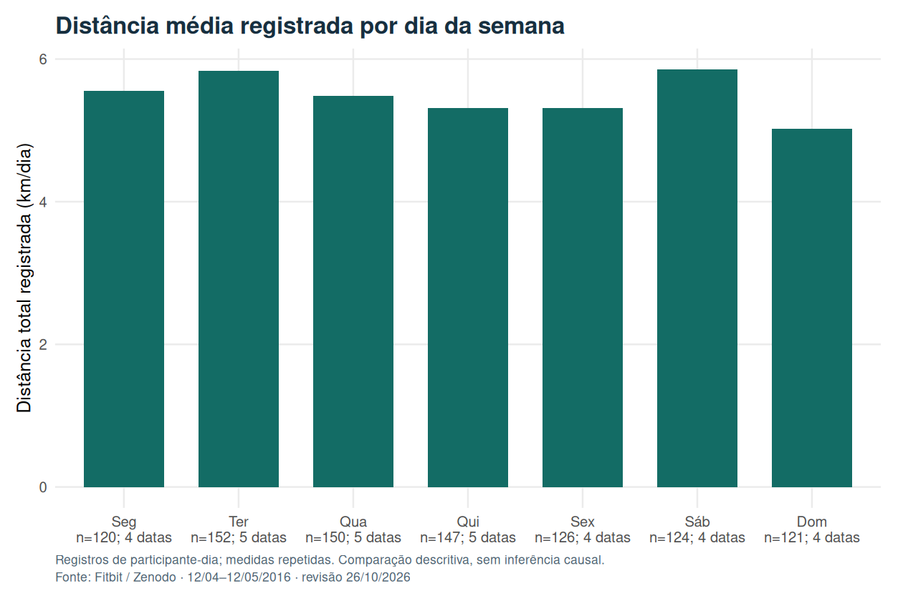
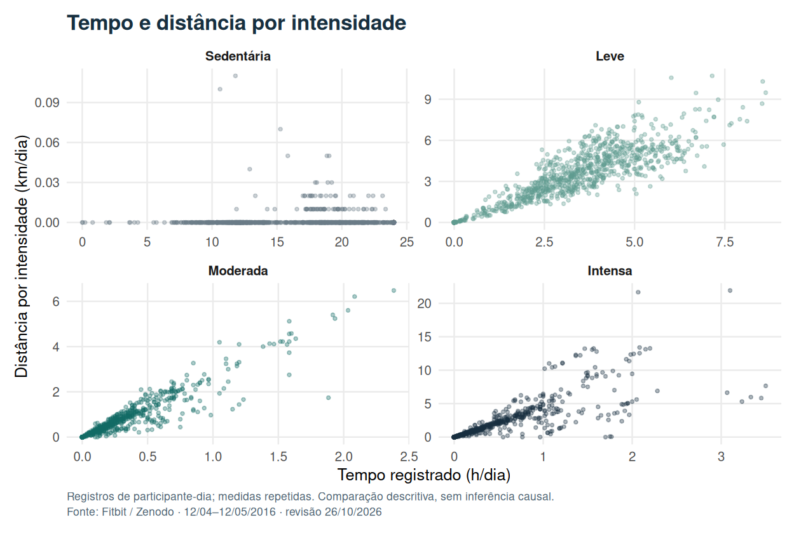
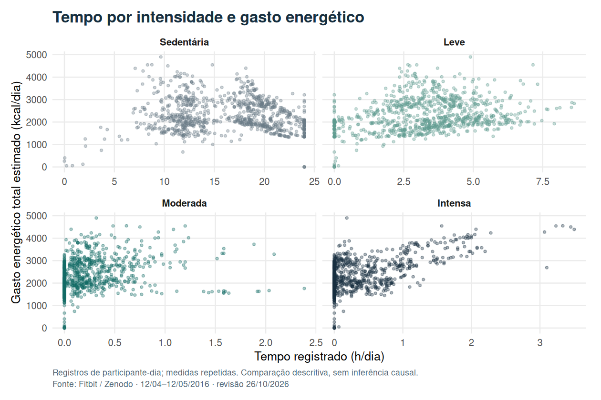
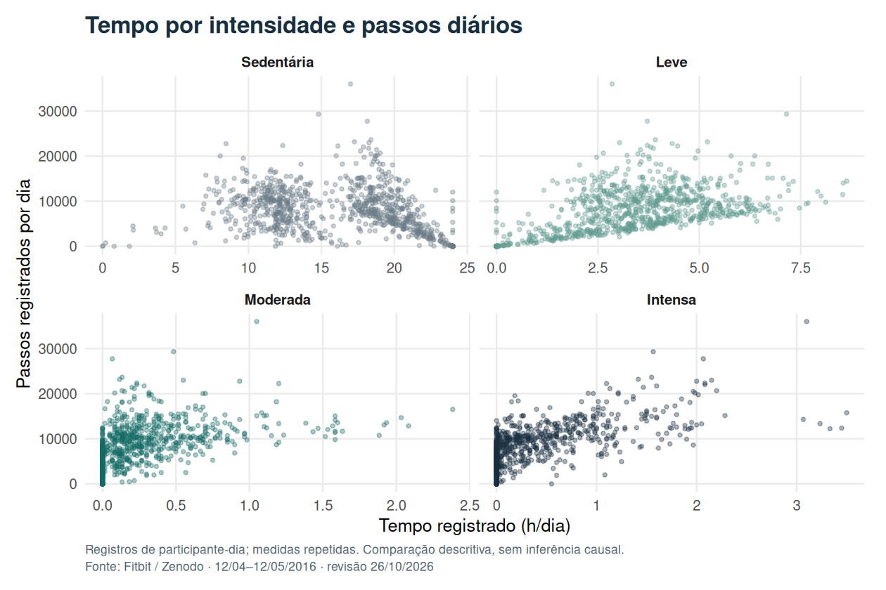
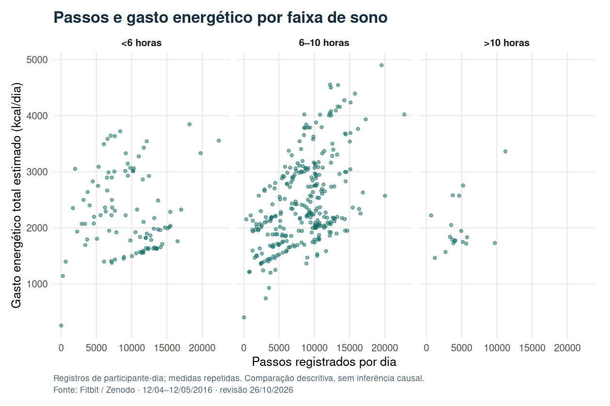
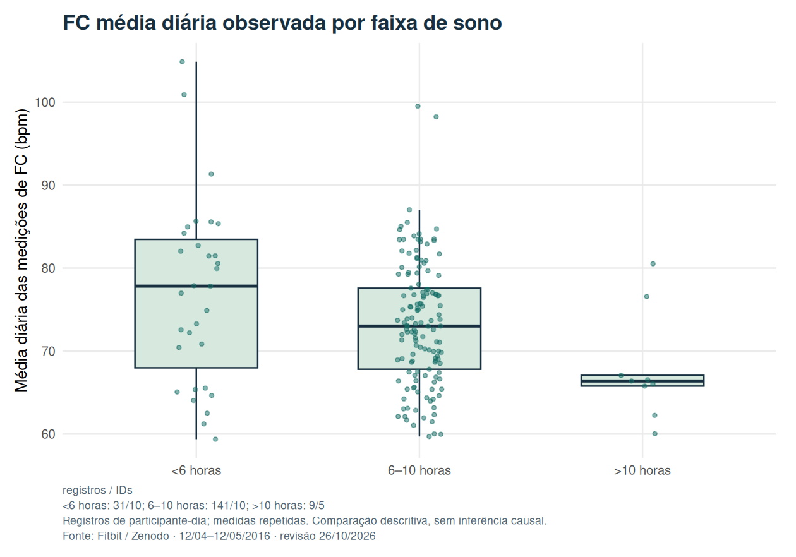

::: {.callout-note title="Revisão de 26/10/2026"}
Esta versão foi recalculada em R a partir do arquivo original de abril–maio de 2016. Três duplicatas exatas de sono foram removidas antes das junções. A narrativa e os gráficos foram atualizados nos dois idiomas; as fontes e os resultados anteriores permanecem disponíveis na seção de rastreabilidade.
:::

## Pergunta e alcance

Como os registros de atividade, sono e frequência cardíaca variam nesta amostra de usuários Fitbit? O estudo usa esses dados como exercício exploratório no contexto de Bellabeat. Fitbit não é um produto Bellabeat, e o conjunto não identifica clientes dessa empresa.

A unidade de análise é o **participante-dia**. Uma mesma pessoa contribui com vários dias e pode aparecer em diferentes faixas de sono. As comparações descrevem os registros disponíveis; não identificam efeitos causais de sono, atividade ou intervenções comerciais.

## Origem e cobertura dos dados

A fonte indicada é [FitBit Fitness Tracker Data, no Kaggle](https://www.kaggle.com/datasets/arashnic/fitbit). Para esta revisão, foi usada a parcela de **12 de abril a 12 de maio de 2016**, disponível no [registro original de Furberg, Brinton, Keating e Ortiz no Zenodo](https://zenodo.org/records/53894).

O arquivo de atividade contém **33 identificadores distintos**; a descrição do dataset declara 30 participantes. Essa divergência documental permanece sem explicação. Não foi inferido sexo, idade ou perfil de cliente a partir dos identificadores. Os dados são históricos e não representam necessariamente os usuários atuais de dispositivos fitness.

::: {.table-responsive tabindex="0" role="region" aria-label="Tabela: Origem e cobertura dos dados"}

| Tabela de origem | Registros | IDs distintos | Tratamento |
| --- | ---: | ---: | --- |
| Atividade diária | 940 | 33 | Uma linha por participante-dia |
| Sono | 413 | 24 | Remoção de três duplicatas exatas; 410 linhas restantes |
| Frequência cardíaca | 2.483.658 | 14 | Média dos registros por participante-dia; 334 linhas diárias |
| Peso e IMC | 67 | 8 | Chave participante-dia verificada; cobertura restrita |

:::

Os campos seguem o [dicionário Fitabase](https://www.fitabase.com/resources/knowledge-base/exporting-data/data-dictionaries/). `TotalDistance` registra distância total em quilômetros e `Calories` estima o gasto energético total em quilocalorias, incluindo componentes além do exercício.

## Processamento corrigido

O [script R desta revisão](../../scripts/rebuild_bellabeat.R) verifica a identidade do ZIP antes da leitura e aplica as seguintes regras:

1. Padroniza datas e verifica a chave participante-dia em cada tabela.
2. Remove somente duplicatas exatas de sono. Registros distintos com a mesma chave provocam falha de validação, em vez de serem descartados arbitrariamente.
3. Agrega as leituras de frequência cardíaca por participante-dia e faz junções à esquerda a partir da atividade diária. A tabela final tem **940 linhas e 940 chaves únicas**.
4. Converte minutos em horas, mantendo o tempo total na cama e criando uma variável separada para tempo na cama menos tempo dormido.
5. Constrói o formato longo diretamente, com **3.760 linhas**, sem a junção muitos-para-muitos usada anteriormente.
6. Preserva zeros e valores ausentes. Não supõe que um zero comprove inatividade real ou que a ausência de registro seja aleatória.

A versão anterior tinha 943 linhas; sua junção em formato longo implicava 3.796 linhas. As novas médias e figuras usam a tabela corrigida, e não a versão com dias duplicados.

## Comparação com o resultado anterior

As médias históricas abaixo pertencem à tabela de 943 linhas preservada. A coluna corrigida usa 940 participantes-dias únicos; nenhuma das duas séries foi sobrescrita pela outra.

::: {.table-responsive tabindex="0" role="region" aria-label="Tabela de resultados: comparison"}



:::

## Resumo com denominadores explícitos

::: {.table-responsive tabindex="0" role="region" aria-label="Tabela de resultados: summary"}



:::

Cada média usa os registros não ausentes da variável correspondente, com peso igual por dia observado. Pessoas com mais dias contribuem mais para esse resumo. A cobertura de IMC, sono e frequência cardíaca é menor que a de atividade; seus valores não descrevem 33 participantes igualmente observados.

A frequência cardíaca é a média das leituras disponíveis ao longo do dia, sem ponderação pela duração entre leituras. Não é uma medida de frequência cardíaca de repouso. Os minutos classificados como sedentários também dependem da cobertura e da classificação do dispositivo; não permitem concluir isoladamente quanto tempo a pessoa permaneceu fisiologicamente inativa.

## Atividade por dia da semana

O período contém cinco terças, quartas e quintas e quatro ocorrências dos demais dias. Por isso, somar todas as observações de cada dia da semana favorece categorias com maior exposição. A revisão usa **médias por participante-dia observado**, acompanhadas de contagens.

::: {.table-responsive tabindex="0" role="region" aria-label="Tabela de resultados: weekday"}



:::

{fig-alt="Gráfico da distância média diária por dia da semana; cada barra usa os dias observados e informa sua cobertura."}

As diferenças são descritivas. A normalização resolve a comparação desigual por totais, mas não equilibra automaticamente a composição dos participantes nem demonstra um padrão individual persistente.

## Intensidade, tempo, passos e gasto energético

{fig-alt="Pontos de distância em quilômetros versus tempo em horas, separados por intensidade da atividade."}

{fig-alt="Pontos de gasto energético estimado em quilocalorias versus tempo em horas por intensidade."}

{fig-alt="Pontos do total de passos diários versus tempo em horas, separados pela intensidade."}

Os gráficos mostram como medidas registradas no mesmo dia se distribuem conjuntamente. Essas variáveis vêm do mesmo sistema de monitoramento e estimação; sua associação não constitui uma validação independente da precisão do dispositivo. Nenhuma faixa de confiança foi apresentada como se os vários dias de uma mesma pessoa fossem observações independentes.

## Sono: associações exploratórias

As faixas de sono são inferiores a seis horas, de seis a dez horas inclusive e superiores a dez horas. Os denominadores variam conforme a disponibilidade simultânea de sono e da outra variável.

::: {.table-responsive tabindex="0" role="region" aria-label="Tabela de resultados: sleep"}



:::

{fig-alt="Pontos de passos diários versus gasto energético estimado, com painéis para três faixas de duração do sono."}

{fig-alt="Boxplots e pontos das médias diárias de frequência cardíaca, por faixa de sono, com tamanho dos grupos."}

A comparação de frequência cardíaca usa apenas registros em que as duas variáveis estão disponíveis. Uma diferença entre faixas pode refletir também composição dos participantes, atividade, cobertura das medições e outras características não controladas. A faixa acima de dez horas tem poucos registros, e os participantes das faixas não formam grupos independentes.

A análise não mede doenças cardíacas nem estima o efeito de aumentar o sono. A conclusão preventiva presente na versão anterior foi retirada.

## O que o estudo permite concluir

- A cobertura varia muito entre variáveis; registrar sua ausência é parte da interpretação.
- Comparações de atividade por dia da semana precisam considerar a quantidade de dias e registros disponíveis.
- Atividade, sono e frequência cardíaca apresentam padrões descritivos que podem orientar perguntas futuras, sem estabelecer causalidade.
- Para orientar decisões de produto, seria necessário verificar esses padrões com dados adequados do público-alvo e avaliar as intervenções propostas.

As figuras foram refeitas com os dados corrigidos e rótulos em português e inglês. As conclusões se limitam a esta amostra de 2016.

## Rastreabilidade e reprodução

- [Resultados agregados corrigidos](revision-2026-10-26/results.json).
- [Proveniência, versões e hashes dos arquivos](revision-2026-10-26/provenance.json).
- [Script R reproduzível](../../scripts/rebuild_bellabeat.R).
- [Fonte original do ZIP](https://zenodo.org/records/53894/files/mturkfitbit_export_4.12.16-5.12.16.zip).
- [Artigo em português antes da correção, fonte Quarto comprimida](../../docs/revisions/2026-10-26/before/posts/bellabeat/index.qmd.gz).
- [Artigo em inglês antes da correção, fonte Quarto comprimida](../../docs/revisions/2026-10-26/before/posts/bellabeat/en.qmd.gz).
- [Resultado computacional original preservado](../../docs/revisions/2026-10-26/before/_freeze/posts/bellabeat/index/execute-results/html.json.gz).
- [Manifesto das seis entradas preservadas](../../docs/revisions/2026-10-26/before-manifest.json).

O ZIP validado tem MD5 `7afbecdce29814e1be2e9a7c94f8f165` e SHA-256 `4741dfabd18453de19b6dd0a7204e8fea6e45e70bc9ddbe396956c8e4fde02f8`. Não foi comprovada sua identidade binária com o download local do Kaggle usado originalmente; a revisão anterior verificou a correspondência das junções antigas com o resultado arquivado em sete campos.

```bash
Rscript --vanilla scripts/rebuild_bellabeat.R /caminho/mturkfitbit_export_4.12.16-5.12.16.zip
quarto render
python3 tests/test_localize.py _site
```

A renderização do site usa os resultados gerados pelo script, sem baixar dados ou reexecutar a análise automaticamente. Os dados individuais não foram acrescentados aos arquivos publicados da revisão.
