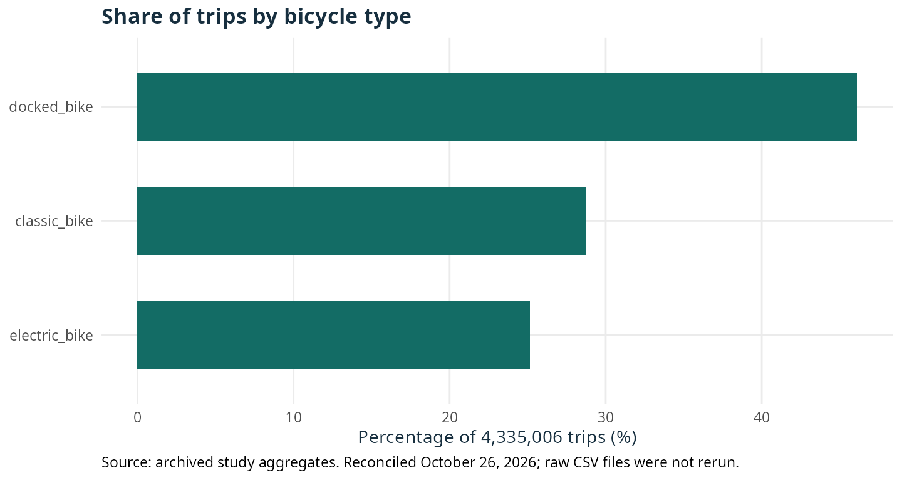
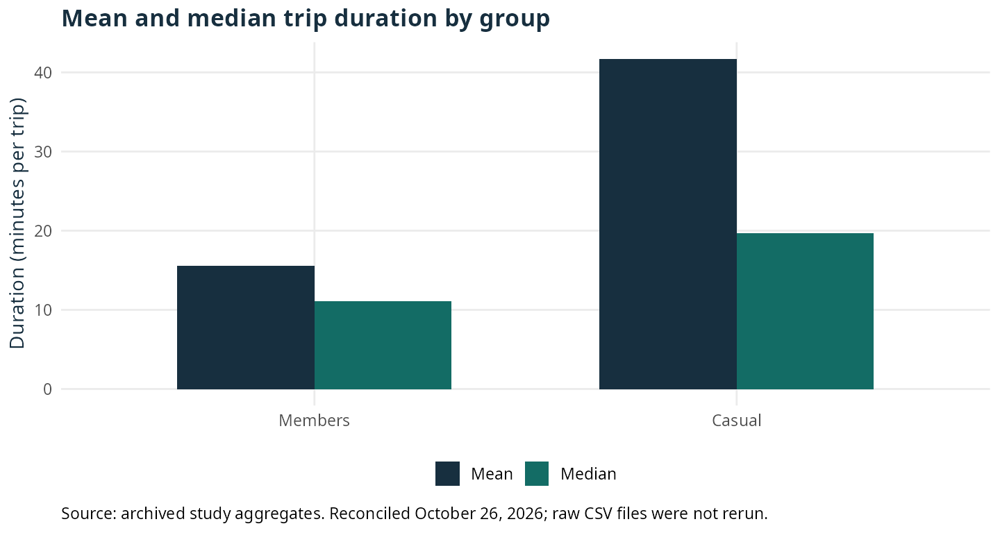
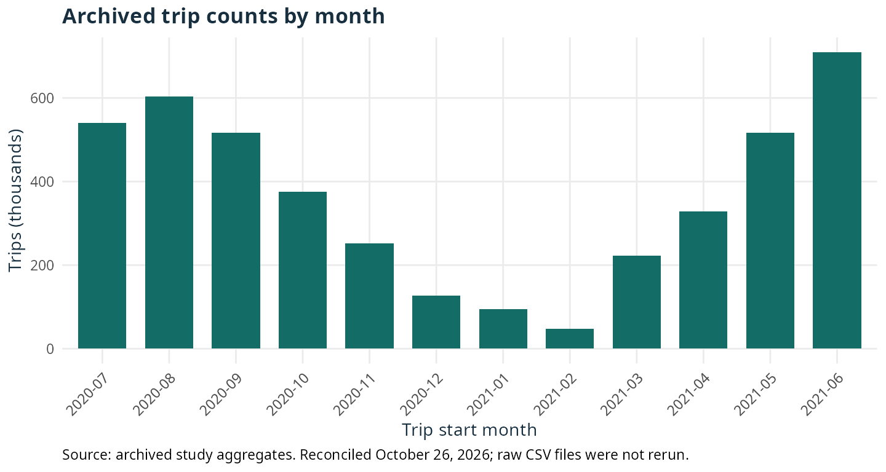

::: {.callout-note}
**October 26, 2026 revision** of the study published in 2021. The narrative and charts below were reconciled with archived aggregates; the original CSV files were not rerun. The previous version, original code and hashes are available in the traceability section. Historical values were preserved while their presentation and interpretation were corrected.
:::

## Question and context

How do member and casual trips differ in a bike-sharing system? This study was developed for the Cyclistic case in the Google Data Analytics certificate. Its commercial question was to identify patterns that could inform hypotheses about membership campaigns.

The observed unit is a **trip**. The record does not contain a persistent person identifier for measuring individual frequency, return visits or subscription conversion. This analysis therefore describes differences between trip categories and does not explain why a person chooses to subscribe.

## Data and historical processing

The declared source is the [public Divvy trip archive](https://divvy-tripdata.s3.amazonaws.com/index.html), covering **July 2020 through June 2021**. The archived output records 4,460,151 loaded rows and **4,335,006 trips** after the filter `trip_duration > 2`, in minutes. Exactly two-minute trips were also excluded. This threshold was an analytical choice; it does not establish that every shorter trip was erroneous.

Historical processing derived duration, month, weekday, hour, part of day and origin/destination station pairs. Missing location fields were retained in the general dataset. The old station/pair rankings used only records with observed locations; their missingness cannot be assumed to have had no effect on representativeness. Using R and RStudio is not itself a file-integrity check.

This revision uses aggregates preserved in the computational output, whose SHA-256 hash is checked by the reconciliation script. Individual trip records are absent from this checkout. Duplicate checks, losses by group and other controls requiring the complete CSV files were not rerun. Results are not mixed with the newer repository version: it uses different filters, including a duration ceiling and coordinate handling, and offers a synthetic execution fallback.

## Trip categories and bicycle types

Of the retained trips, **56.46%** are member trips and **43.54%** are casual trips. `docked_bike` leads overall, followed by `classic_bike` and `electric_bike`.

::: {.table-responsive tabindex="0" role="region" aria-label="Table: Trip categories and bicycle types"}

| Type | Trips | Share (%) |
| --- | --- | --- |
| docked_bike | 1,998,627 | 46.10 |
| classic_bike | 1,247,162 | 28.77 |
| electric_bike | 1,089,217 | 25.13 |

:::

{fig-alt="Bars: docked 46.10%, classic 28.77% and electric 25.13% of trips."}

Composition must also be compared within each group:

::: {.table-responsive tabindex="0" role="region" aria-label="Table: Trip categories and bicycle types"}

| Group | Type | Trips | Percentage within group (%) |
| --- | --- | --- | --- |
| Members | docked_bike | 1,043,233 | 42.63 |
| Members | electric_bike | 602,335 | 24.61 |
| Members | classic_bike | 801,776 | 32.76 |
| Casual | docked_bike | 955,394 | 50.61 |
| Casual | electric_bike | 486,882 | 25.79 |
| Casual | classic_bike | 445,386 | 23.59 |

:::

Members: docked > classic > electric. Casual: docked > electric > classic. The share of docked trips is higher within casual trips, but the absolute count of casual docked trips is lower than the member count. Percentages and volumes answer different questions.

## Duration: mean, median and extremes

::: {.table-responsive tabindex="0" role="region" aria-label="Table: Duration: mean, median and extremes"}

| Group | Trips | Share (%) | Mean (min) | Median (min) | Q1–Q3 (min) | Maximum (min) |
| --- | --- | --- | --- | --- | --- | --- |
| Members | 2,447,344 | 56.46 | 15.59 | 11.13 | 6.57–19.13 | 33,421.37 |
| Casual | 1,887,662 | 43.54 | 41.73 | 19.70 | 11.03–37.00 | 55,944.15 |

:::

The archived overall mean is approximately **26.97 minutes**. Using the already-rounded group means, the casual/member mean ratio is **2.68**; the median ratio is **1.77**. Interquartile ranges are approximately **12.57 minutes** for members and **25.97 minutes** for casual trips. Comparing means, medians and quartiles exposes the asymmetry that a mean alone omits.

{fig-alt="Members: mean 15.59 and median 11.13 minutes. Casual: mean 41.73 and median 19.70 minutes."}

The largest archived casual value is 55,944.15 minutes, approximately **38.85 days**; the member maximum is approximately **23.21 days**. Historical processing imposed no upper duration limit. These values limit interpretation of means by month or hour. There is no evidence to attribute them to system failure, theft, maintenance or leisure.

Comparing means and medians is a descriptive sensitivity check, not a re-estimation after removing extremes. Aggregate data cannot determine the effect of new duration ceilings or filters. This revision therefore withdraws the former conclusions about the highest duration occurring in February or overnight, and does not propose overnight campaigns on that basis. Old figures that titled a mean as a count or labeled a monthly axis as an hour were replaced by the auditable charts in this version.

## When trips occurred

### Months with explicit years

::: {.table-responsive tabindex="0" role="region" aria-label="Table: Months with explicit years"}

| Month | Trips |
| --- | --- |
| 2020-07 | 540,120 |
| 2020-08 | 604,137 |
| 2020-09 | 516,748 |
| 2020-10 | 375,308 |
| 2020-11 | 251,678 |
| 2020-12 | 127,450 |
| 2021-01 | 93,893 |
| 2021-02 | 48,012 |
| 2021-03 | 222,701 |
| 2021-04 | 328,578 |
| 2021-05 | 516,940 |
| 2021-06 | 709,441 |

:::

{fig-alt="June 2021 has 709,441 trips, followed by August 2020 with 604,137 and July 2020 with 540,120."}

Total monthly volume is highest in **June 2021**, followed by August 2020, July 2020, May 2021 and September 2020. June also leads both groups: 347,389 member and 362,052 casual trips. The next member months are August, September and July; for casual trips, August, July and May. Years and month lengths matter: these are observed totals rather than normalized rates or an isolated estimate of seasonality.

### Calendar quarters, not meteorological seasons

::: {.table-responsive tabindex="0" role="region" aria-label="Table: Calendar quarters, not meteorological seasons"}

| Calendar quarter | Trips |
| --- | --- |
| 2020-Q3 | 1,661,005 |
| 2020-Q4 | 754,436 |
| 2021-Q1 | 364,606 |
| 2021-Q2 | 1,554,959 |

:::

The old `winter`, `spring`, `summer` and `fall` labels grouped January–March, April–June, July–September and October–December. This revision correctly names those same aggregates **calendar quarters**, preserving their composition. They are not [meteorological seasons](https://www.ncei.noaa.gov/news/meteorological-versus-astronomical-seasons). Studying those seasons would require regrouping records or months under an explicit definition and checking the affected results.

### Weekdays and hours

::: {.table-responsive tabindex="0" role="region" aria-label="Table: Weekdays and hours"}

| Group | Weekend trips | Percentage within group (%) |
| --- | --- | --- |
| Members | 676,393 | 27.64 |
| Casual | 789,897 | 41.85 |

:::

Weekends account for a larger share of casual trips than of member trips. That does not mean most casual trips occur on weekends: weekdays account for 1,097,765 casual trips. Comparing typical activity per day would require accounting for the number of days and corresponding exposure.

The largest overall weekday total is Saturday and the smallest is Monday. For members, the three highest totals are Wednesday, Saturday and Friday; for casual trips, Saturday, Sunday and Friday. The largest overall hourly counts occur at 17:00, 18:00 and 16:00. Parts of day rank afternoon > night > morning > dawn. These are trip counts and do not establish individual motivation, commuting or a campaign effect.

## Conclusions and commercial hypotheses

Casual trips have higher mean and median duration and a greater relative concentration on weekends than member trips. These patterns can inform communication or offer hypotheses to evaluate with appropriate data and design.

This analysis does not measure conversion probability, price elasticity, loyalty or discount effects. A commercial test would require a subscription outcome, exposure data and a comparison criterion. Interpreting duration patterns also requires checking extremes, coverage and stability under documented cleaning rules.

## Traceability and reproduction

- [Results and hashes for this reconciliation](revision-2026-10-26/results.json): counts, percentages, means/medians, quarters and hashes of the new charts.
- [Reconciliation and chart-generation script](../../scripts/reconcile_bikeshare.R): run `Rscript --vanilla scripts/reconcile_bikeshare.R` from the project root. The script checks the historical output hash and count conservation. It requires the packages already used in this revision: ggplot2, jsonlite and digest; it neither downloads data nor runs the original trip analysis.
- [Evidence for the historical aggregates](../../docs/reviews/evidence/bike-share-audit.json).
- [Original EN source before correction](../../docs/revisions/2026-10-26/before/posts/bike-share-navigate/index.qmd.gz) and [previous PT translation](../../docs/revisions/2026-10-26/before/posts/bike-share-navigate/pt.qmd.gz), compressed, preserving the complete original process.
- [Preserved original computational output](../../docs/revisions/2026-10-26/before/_freeze/posts/bike-share-navigate/index/execute-results/html.json.gz) and [pre-revision hash manifest](../../docs/revisions/2026-10-26/before-manifest.json).
- [Supplied repository at the consulted commit](https://github.com/talesgomes27/DAC8-Case-Study-1/tree/5c21b988e46548d7592245d1937cee0c8af6993c): a later version with different analytical choices. Its numbers do not replace the historical results presented here.

The new charts were calculated from archived aggregates. Previous charts remain historical material and are not presented as updated outputs. The original publication date was retained, with a separate revision date. Reproduction from the complete CSV files remains pending.
