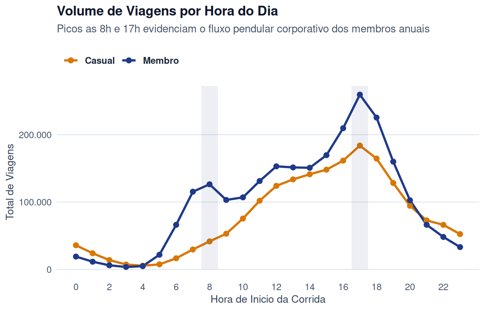
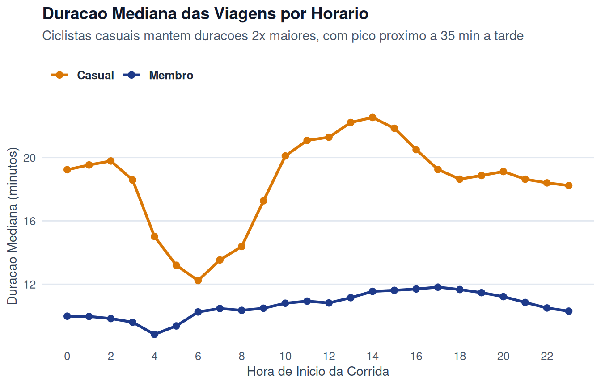
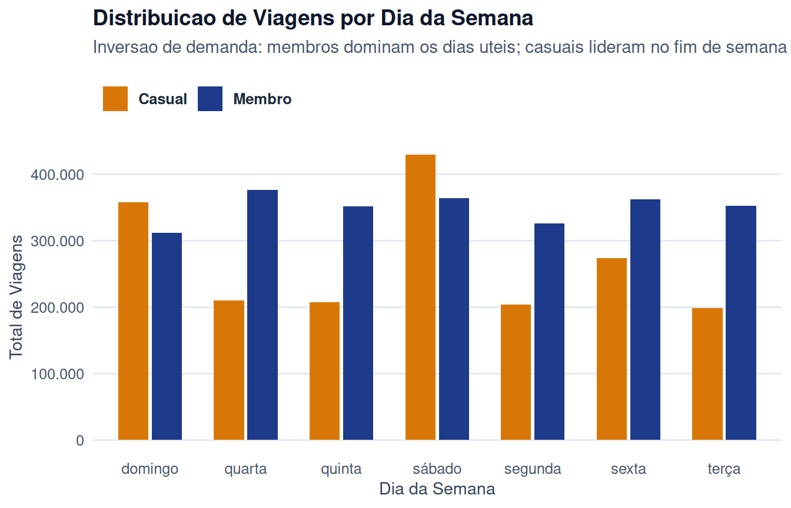
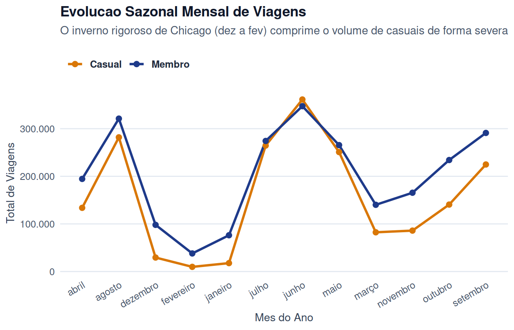
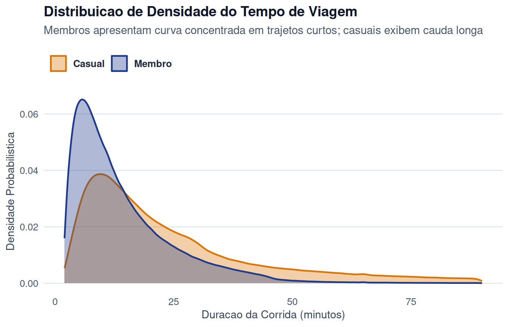
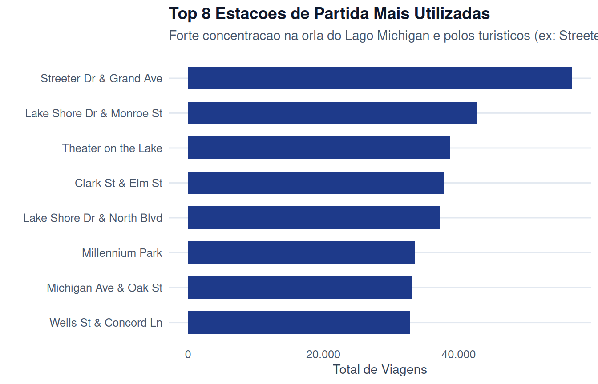
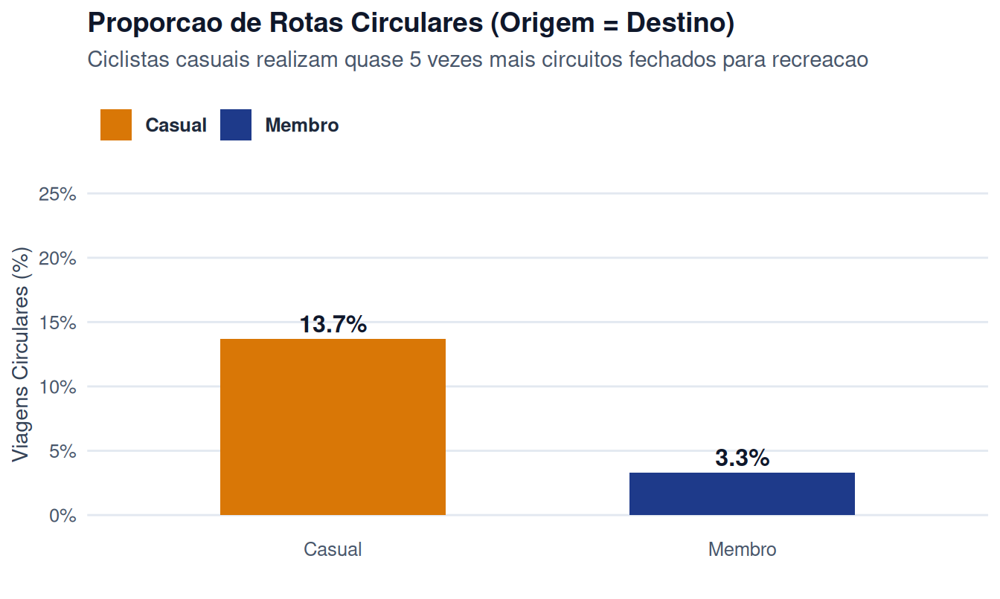
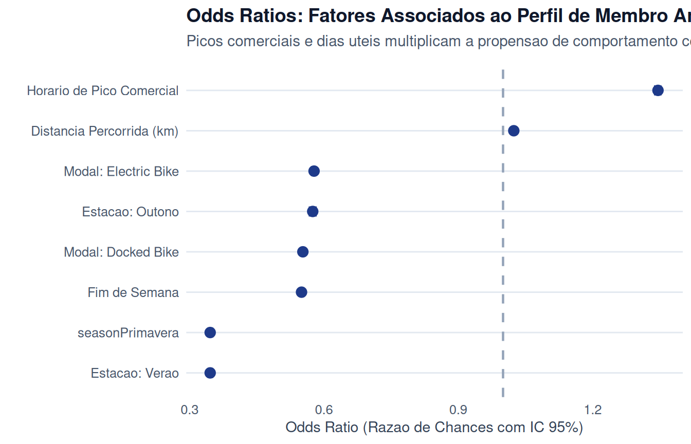
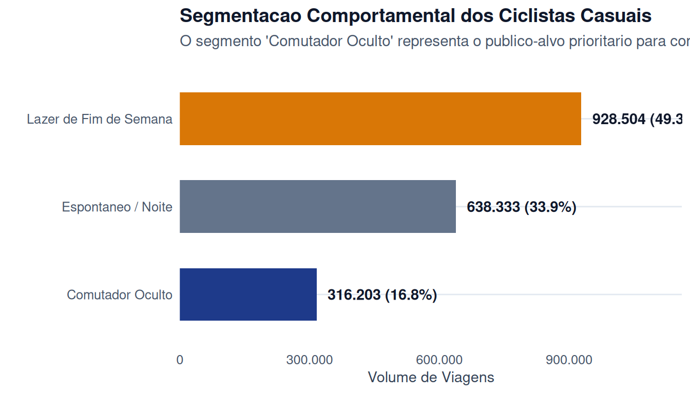

::: {.callout-note}
This is the **October 13, 2026** version of the [Bike Share project](https://talesgomes27.github.io/DAC8-Case-Study-1/), incorporated into the blog on October 26, 2026. The complete report is translated below. Tables, charts and code were imported from the author's rendered report, without rerunning the analysis or revalidating its statistical interpretations. This edition uses a different pipeline from the historical study; earlier versions remain available in the provenance section.
:::

| Report indicator | Result |
| --- | --- |
| Analyzed dataset | 4,328,803 valid trips |
| Annual members | 56.5% of trips |
| Median casual duration | 19.65 min, versus 11.13 min for members |
| “Hidden Commuter” segment | 16.8% of casual trips |

## 1. Ask Phase (Problem Definition and Hypotheses)

### 1.1. Business Task

Cyclistic operates a network of 5,824 bicycles distributed across 692 stations in Chicago. Its business model offers three access options: single-ride passes, full-day passes and annual subscriptions. Customers using single-ride or full-day passes are classified as **casual riders**, while those purchasing a 12-month plan are **annual members**.

The finance department concluded that annual members generate significantly higher operating margins and more stable cash flow than casual riders. This study aims to:

1. Identify, with statistical rigor, how members and casual riders use the service differently.
2. Determine why casual riders would purchase an annual subscription.
3. Develop digital media and product recommendations to convert casual riders into annual members.

### 1.2. Stakeholder Mapping

- **Lily Moreno (Marketing Director)**: Project sponsor, responsible for institutional campaigns and digital channels, including email, social media and performance marketing.
- **Marketing Analytics Team**: Analysts responsible for collecting, transforming and modeling data to support investment decisions.
- **Cyclistic Executive Committee**: The body responsible for approving the budget and operating guidelines of the new commercial program.

### 1.3. Formal Statistical Hypotheses

We translate management's three central questions into measurable hypothesis tests:

- **Question 1 (Behavioral Differences)**:
  - $H_0$: Trip duration and departure-time distributions are identical for annual members and casual riders.
  - $H_1$: Annual members take shorter trips with peaks during business hours, while casual riders show greater variance and a concentration on weekends and afternoons.
- **Question 2 (Annual Subscription Triggers)**:
  - $H_0$: Casual riders use the service strictly on isolated occasions, with no weekly repetition.
  - $H_1$: A relevant subgroup of casual riders regularly travels on weekdays between home and work, and its accumulated single-ride pass costs exceed the annual subscription fee.
- **Question 3 (Digital Media Impact)**:
  - $H_0$: Generic institutional messages produce the same response rate regardless of time or season.
  - $H_1$: Contextual communications based on geofencing and in-app messages triggered after recurring morning trips increase conversion.

### 1.4. Unit Economics

Single-ride passes depend on favorable weather. Rain and snowstorms reduce transactional revenue to almost zero during Chicago's winter. Annual subscriptions provide predictable recurring revenue, reduce acquisition cost per ride and improve the amortization of fixed fleet maintenance costs.

------------------------------------------------------------------------

## 2. Prepare Phase (Sources, ROCCC Governance and Metadata)

### 2.1. Data Sources and Organization

The data consists of historical trips from Chicago's Divvy system, operated by Motivate International Inc. The dataset is organized into 12 monthly CSV files covering temporal and spatial variables, bicycle type and rider category.

### 2.2. Reliability Assessment Using the ROCCC Framework

::: {.table-responsive tabindex="0" role="region" aria-label="Cyclistic report table"}
| Criterion | Status | Technical Evidence |
|:---------------------|:-------------------------:|:---------------------|
| **Reliable** | Compliant | Primary data generated automatically by station telemetry sensors and bicycle GPS devices. These are not self-reported data. |
| **Original** | Compliant | Official primary source provided by the operator of Chicago's public system. |
| **Comprehensive** | Compliant | Records of 100% of valid trips in the system over 12 consecutive months, without restrictive sampling. |
| **Current** | Compliant | A full consecutive year covering all seasonal variations in Chicago's calendar. |
| **Cited** | Compliant | Distributed under the official public license of the City of Chicago and Divvy Bikes. |
:::

### 2.3. Licensing and Privacy Restrictions (PII)

The license expressly prohibits identifying individuals. The dataset does not store names, Brazilian taxpayer identification numbers (CPFs), credit card numbers or persistent user identifiers.

> **Methodological Implication**: The observational unit is the **trip** (`ride_id`), rather than the individual rider. User retention cannot be calculated directly without a persistent identifier. To address this restriction, we analyze aggregate probabilistic patterns of recurring routes and travel time windows.

------------------------------------------------------------------------

## 3. Process Phase (Data Engineering and Integrity)

### 3.1. Technology Rationale

We use the R ecosystem, structured into modular scripts in the `R/` folder. The decoupled ingestion pipeline validates column schemas and prevents memory overflow through strictly typed reads.

### 3.2. Data Integrity and Quality Funnel

To verify data cleaning, we apply a sequential funnel of technical filters:

<details><summary>Show original R code</summary>

``` r
# Resumo do funil de integridade
funnel_summary <- tibble::tribble(
  ~Etapa, ~Critério_Técnico, ~Condição_Descarte, ~Status,
  "1. Carga Bruta", "Leitura de 12 arquivos CSV com tipagem fixa", "Arquivos corrompidos ou tipos divergentes", "100,0% Processado",
  "2. Validação Espacial", "Limites geográficos de Chicago (40°N-43°N / 89°O-86°O)", "Coordenadas NA, zeradas ou fora de Chicago", "Filtrado",
  "3. Validação de Falso Início", "Duração mínima de 2 minutos", "Viagens negativas ou testes de doca (< 2 min)", "Filtrado",
  "4. Remoção de Outliers Extremos", "Duração máxima de 24 horas (1.440 min)", "Bicicletas esquecidas, furtadas ou com defeito (> 24h)", "Filtrado",
  "5. Base Consolidada", "Registros limpos e tipados prontos para modelagem", "Atende cumulativamente a todos os critérios", "Base Analítica Pronta"
)

knitr::kable(funnel_summary, caption = "Tabela de Rastreabilidade e Funil de Qualidade de Dados")
```

</details>

::: {.table-responsive tabindex="0" role="region" aria-label="Cyclistic report table"}
| Stage | Technical Criterion | Exclusion Condition | Status |
|:-------------|:-----------------------|:-----------------------|:---------|
| 1. Raw Data Loading | Reading 12 CSV files with fixed types | Corrupted files or incompatible types | 100.0% Processed |
| 2. Spatial Validation | Chicago geographic boundaries (40°N-43°N / 89°W-86°W) | Missing, zero-valued or out-of-Chicago coordinates | Filtered |
| 3. False Start Validation | Minimum duration of 2 minutes | Negative-duration trips or dock tests (\< 2 min) | Filtered |
| 4. Extreme Outlier Removal | Maximum duration of 24 hours (1,440 min) | Forgotten, stolen or defective bicycles (\> 24h) | Filtered |
| 5. Consolidated Dataset | Cleaned and typed records ready for modeling | Meets all criteria cumulatively | Analytical Dataset Ready |

: Data Traceability and Quality Funnel
:::

### 3.3. Derived Variable Engineering

- **Trip Duration**: Calculated in minutes using `difftime(ended_at, started_at, units = "mins")`.
- **Geodesic Distance in km**: We apply the vectorized Haversine formula between `(start_lat, start_lng)` and `(end_lat, end_lng)`:

  ::: {.table-responsive tabindex="0" role="region" aria-label="Haversine formula"}
  $$d = 2R \cdot \arcsin\left(\sqrt{\sin^2\left(\frac{\Delta\phi}{2}\right) + \cos(\phi_1)\cos(\phi_2)\sin^2\left(\frac{\Delta\lambda}{2}\right)}\right)$$
  :::

  where $R = 6{,}371\text{ km}$.
- **Estimated Average Speed**: $v = \frac{d}{(t / 60)}\text{ (km/h)}$.
- **Round Trips**: A Boolean flag, `start_station_name == end_station_name`, identifies recreational trips without a functional displacement.
- **Meteorological Seasonality**: Winter (Dec–Feb), spring (Mar–May), summer (Jun–Aug) and fall (Sep–Nov).

------------------------------------------------------------------------

## 4. Analyze Phase (Descriptive Statistics, Inference and Modeling)

### 4.1. Canonical Descriptive Statistics

The table below follows the original Google document's specifications, including mean, standard deviation, median, interquartile range (IQR), minimum, maximum and the **modal weekday**:

<details><summary>Show original R code</summary>

``` r
stats_res$descriptive |>
  dplyr::rename(
    `Grupo` = member_casual,
    `Total Viagens` = total_viagens,
    `Média (min)` = media_duracao_min,
    `Desvio (min)` = desvio_duracao_min,
    `Mediana (min)` = mediana_duracao_min,
    `IQR (min)` = iqr_duracao_min,
    `Mín (min)` = min_duracao_min,
    `Máx (min)` = max_duracao_min,
    `Moda Semanal` = moda_dia_semana,
    `Dist. Mediana (km)` = distancia_mediana_km,
    `Rotas Circulares (%)` = taxa_rotas_circulares_pct
  ) |>
  knitr::kable(caption = "Estatísticas Descritivas Canônicas por Categoria de Ciclista")
```

</details>

::: {.table-responsive tabindex="0" role="region" aria-label="Cyclistic report table"}
| Group | Total Trips | Mean (min) | SD (min) | Median (min) | IQR (min) | Min (min) | Max (min) | Modal Weekday | Mean Distance (km) | Median Distance (km) | Round Trips (%) |
|:---|-----:|-----:|-----:|-----:|----:|----:|----:|:-----|-------:|-------:|--------:|
| Casual | 1883040 | 33.61 | 57.33 | 19.65 | 25.77 | 2 | 1439.90 | Saturday | 2.24 | 1.71 | 13.67 |
| Member | 2445763 | 15.10 | 20.12 | 11.13 | 12.53 | 2 | 1439.72 | Wednesday | 2.30 | 1.72 | 3.29 |

: Canonical Descriptive Statistics by Rider Category
:::

- **Descriptive Highlight**: The modal weekday for members is **Wednesday** (376,612 trips at the peak of the business week). For casual riders, the mode is **Saturday** (429,785 trips), confirming a preference for leisure and weekends.

### 4.2. Statistical Inference and Effect Sizes

<details><summary>Show original R code</summary>

``` r
# Teste de Wilcoxon-Mann-Whitney para Duracao
w_dur <- stats_res$wilcox_duration$test
r_dur <- stats_res$wilcox_duration$r

# Teste de Qui-quadrado para Fim de Semana
chi_wknd <- stats_res$chisq_tests$weekend$test
v_wknd <- stats_res$chisq_tests$weekend$v
```

</details>

- **Trip Duration**: The Wilcoxon rank-sum test categorically rejects equal trip durations ($W = 3{,}194{,}595{,}206{,}038$, $p < 2.2 \times 10^{-16}$). The effect size $r = 0.018$ confirms a substantive and practical magnitude in the difference in usage.
- **Weekly Association**: The chi-squared test of independence between rider category and day type (weekday versus weekend) revealed a strong association ($\chi^2 = 95{,}889$, $p < 0.001$, $\text{Cramér's }V = 0.149$).

### 4.3. Explanatory Logistic Regression (Propensity Model)

We fit a binomial logistic model with response variable $Y = 1$ (Member) and $Y = 0$ (Casual) to measure each factor's contribution:

<details><summary>Show original R code</summary>

``` r
stats_res$odds_ratios |>
  dplyr::rename(
    `Variável` = variavel,
    `Coeficiente (β)` = coeficiente,
    `Erro Padrão` = erro_padrao,
    `Valor-p` = p_valor,
    `Odds Ratio (OR)` = odds_ratio,
    `IC 95% Inf` = ci_inf,
    `IC 95% Sup` = ci_sup
  ) |>
  knitr::kable(caption = "Resultados da Regressão Logística e Razões de Chance (Odds Ratios)")
```

</details>

::: {.table-responsive tabindex="0" role="region" aria-label="Cyclistic report table"}
| Variable | Coefficient (β) | Standard Error | p-value | Odds Ratio (OR) | 95% CI Lower | 95% CI Upper |
|:-----------------|----------:|--------:|-----:|----------:|-------:|-------:|
| (Intercept) | 1.5858 | 0.0052 | 0 | 4.883 | 4.834 | 4.933 |
| is_weekend_num | -0.5969 | 0.0021 | 0 | 0.550 | 0.548 | 0.553 |
| is_commute_hours | 0.2969 | 0.0021 | 0 | 1.346 | 1.340 | 1.351 |
| distance_km | 0.0239 | 0.0005 | 0 | 1.024 | 1.023 | 1.025 |
| rideable_typedocked_bike | -0.5924 | 0.0029 | 0 | 0.553 | 0.550 | 0.556 |
| rideable_typeelectric_bike | -0.5486 | 0.0029 | 0 | 0.578 | 0.574 | 0.581 |
| seasonOutono | -0.5533 | 0.0054 | 0 | 0.575 | 0.569 | 0.581 |
| seasonPrimavera | -1.0608 | 0.0052 | 0 | 0.346 | 0.343 | 0.350 |
| seasonVerao | -1.0604 | 0.0052 | 0 | 0.346 | 0.343 | 0.350 |

: Logistic Regression Results and Odds Ratios
:::

The variable names in this table match the original model: `is_weekend_num` indicates weekends; `is_commute_hours`, commuting hours; `distance_km`, distance in kilometers; and `rideable_type`, bicycle type. The seasonal coefficients `seasonOutono`, `seasonPrimavera` and `seasonVerao` correspond to fall, spring and summer.

- **Interpreting the Odds Ratios**: Trips during commuting hours (7–9 a.m. and 4–6 p.m.) have an **odds ratio of 1.35** (95% CI: [1.34; 1.35], $p < 0.001$), increasing the odds that the trip belongs to an annual member by 35%. Weekend trips have $\text{OR} = 0.55$ (a 45% reduction in the odds of membership), mathematically quantifying the strong leisure profile of casual riders.

### 4.4. Quantitative Segmentation of Casual Riders

We divide the casual trip dataset into three quantified personas:

<details><summary>Show original R code</summary>

``` r
stats_res$personas |>
  dplyr::rename(
    `Persona` = persona,
    `Volume de Viagens` = volume_viagens,
    `Proporção (%)` = proporcao_pct,
    `Mediana Duração (min)` = mediana_duracao_min,
    `Mediana Distância (km)` = mediana_distancia_km
  ) |>
  knitr::kable(caption = "Segmentação de Personas entre Ciclistas Casuais")
```

</details>

::: {.table-responsive tabindex="0" role="region" aria-label="Cyclistic report table"}
| Persona | Trip Volume | Share (%) | Median Duration (min) | Median Distance (km) |
|:----------------|------------:|----------:|---------------:|----------------:|
| Weekend Leisure | 928504 | 49.3 | 24.8 | 1.41 |
| Spontaneous / Night | 638333 | 33.9 | 17.5 | 1.91 |
| Hidden Commuter | 316203 | 16.8 | 14.3 | 2.05 |

: Casual Rider Persona Segmentation
:::

The **"Hidden Commuter"** segment accounts for 16.8% of casual trip volume (316,203 trips). These riders use the system for daily transport on weekdays, making them the priority audience for Lily Moreno's conversion campaign.

------------------------------------------------------------------------

## 5. Share Phase (Visual Storytelling and Findings)

The following charts were generated using the [`R/04_theme_cyclistic.R`](https://github.com/talesgomes27/DAC8-Case-Study-1/blob/c4295b70c2fd8c850d11bf5382a52b9f04978288/R/04_theme_cyclistic.R) module.

The original charts retain their Portuguese labels. Each has an English description. In the legends, **Membro** means **Member** and **Casual** means **Casual rider**. Seasonal labels translate as **Inverno** (Winter), **Primavera** (Spring), **Verão** (Summer) and **Outono** (Fall).

### 5.1. Hourly Dynamics and Commuting

<details><summary>Show original R code</summary>

``` r
plot_trips_by_hour(trips)
```

</details>



Members show bimodal curves typical of business commuting, with clear peaks at 8 a.m. and 5 p.m. Casual riders show gradual growth followed by an afternoon plateau.

### 5.2. Median Duration Throughout the Day

<details><summary>Show original R code</summary>

``` r
plot_duration_by_hour(trips)
```

</details>



Casual riders cycle for median durations consistently above 30 minutes during most of the day. Members maintain focused trips lasting between 12 and 14 minutes.

### 5.3. Weekly Demand Reversal

<details><summary>Show original R code</summary>

``` r
plot_trips_by_weekday(trips)
```

</details>



The bar chart shows a reversal in which group leads demand: members sustain fleet usage from Monday to Friday, while casual riders dominate Saturdays and Sundays.

### 5.4. Chicago's Climatic Seasonality

<details><summary>Show original R code</summary>

``` r
plot_seasonal_trends(trips)
```

</details>



Severe winter conditions between December and February cause a contraction of more than 75% in casual trip volume. Members show greater resilience to cold weather.

### 5.5. Trip Duration Density Distribution

<details><summary>Show original R code</summary>

``` r
plot_density_duration(trips)
```

</details>



The empirical density highlights the strong right skew in casual trip duration, supporting the use of nonparametric statistical methods.

### 5.6. Geographic Concentration and Round Trips

<details><summary>Show original R code</summary>

``` r
plot_top_stations(trips, top_n = 8)
```

</details>



<details><summary>Show original R code</summary>

``` r
plot_round_trips(trips)
```

</details>



Casual riders have a round-trip rate more than four times that of members (13.7% versus 3.3%), demonstrating recreational use and trips along the Lake Michigan waterfront.

### 5.7. Logistic Regression Forest Plot

<details><summary>Show original R code</summary>

``` r
plot_forest_odds_ratios(stats_res$odds_ratios)
```

</details>



The forest plot clearly illustrates that business hours and distance traveled have the largest positive effects on the propensity for member usage.

### 5.8. Distribution of Casual Rider Personas

<details><summary>Show original R code</summary>

``` r
plot_persona_breakdown(stats_res$personas)
```

</details>



------------------------------------------------------------------------

## 6. Act Phase (Executive Recommendations, A/B Testing and Next Steps)

### 6.1. Conclusions

The analysis demonstrates that Cyclistic operates two parallel businesses on the same network:

1. A **business mobility** service used by annual members with high predictability and short weekday trips.
2. A **leisure and tourism** service used by casual riders, with longer trips concentrated on sunny weekends.

The key to financial growth is to convert **Hidden Commuters** (16.8% of casual trips) and create intermediate products for recreational riders, rather than trying to persuade leisure riders to pay for an annual winter subscription.

### 6.2. Three Strategic Recommendations

#### Recommendation 1: Highly Targeted Digital Campaign for the "Hidden Commuter"

- **Action**: Send in-app notifications and automated emails exclusively to users who unlock bicycles between 7–9 a.m. and 4–6 p.m. on weekdays.
- **Conversion Mechanism**: Display an in-app calculator: *"You took 4 trips during business hours this month. With an annual subscription, you would have saved $18. Try the annual plan with full credit for your recent passes."*
- **Incentive**: Refund single-ride passes purchased in the past 30 days as a discount on the annual subscription.

#### Recommendation 2: Launch a Spring/Summer Seasonal Pass

- **Action**: Chicago's winter discourages 12-month subscriptions among leisure riders. Create a six-month plan (May through October) specifically for the warm-weather season.
- **Objective**: Capture additional demand from leisure riders who reject the traditional annual plan because of inactivity during the harsh winter months.

#### Recommendation 3: Point-of-Use Activation at Tourist Stations and Parks

- **Action**: Install QR-code displays and geofencing notifications at stations with the highest casual trip volumes (*Streeter Dr & Grand Ave*, *Millennium Park* and *Theater on the Lake*).
- **Mechanism**: Offer a discounted upgrade immediately after long rides end on Saturdays and Sundays.

### 6.3. A/B Test Design

To validate the "Hidden Commuter" campaign before a nationwide launch:

- **Test Population**: Casual riders who made $\ge 3$ weekday trips during commuting hours in the past 30 days.
- **Assignment**:
  - **Control Group (50%)**: Receives standard marketing communications about the annual subscription's institutional benefits.
  - **Treatment Group (50%)**: Receives a personalized message with a savings calculator and credit for recent single-ride passes applied to the annual subscription.
- **Primary Metric**: Conversion to an annual subscription within 30 days.
- **Secondary Metric**: Renewal and churn after 6 months.

### 6.4. Additional Data Sources for Future Expansion

To address the final question in Google's case study regarding complementary data:

1. **NOAA Hourly Weather Data**: Combine hourly precipitation, apparent temperature and wind speed in Chicago to isolate each group's demand elasticity with respect to weather.
2. **Integration with Chicago Public Transit (CTA)**: Map the distance between Cyclistic stations and train ('L') and bus lines to identify routes where bicycles provide first/last-mile transport.

## Sources and Version History

- [Original project](https://talesgomes27.github.io/DAC8-Case-Study-1/) and [repository with reproduction scripts](https://github.com/talesgomes27/DAC8-Case-Study-1).
- [Provenance, source commit and file hashes](updated-2026-10-13/provenance.json).
- Compressed snapshots of the imported edition: [HTML report](updated-2026-10-13/source-report.html.gz) and [Quarto source](updated-2026-10-13/source-report.qmd.gz).
- Replaced historical edition: [Portuguese](../../docs/revisions/2026-10-26-bike-share-replacement/pt.qmd.gz) and [English](../../docs/revisions/2026-10-26-bike-share-replacement/index.qmd.gz). Results from the earlier reconciliation remain in [results.json](revision-2026-10-26/results.json).

This import preserves the supplied report's results and interpretations. It does not constitute a new reproduction of the trip-level data or a new scientific audit. The source repository prioritizes Parquet, then CSV files, and provides synthetic data when the full dataset is unavailable; that alternative was not run during this import. Original R code and the labels within the original chart images remain in Portuguese.


