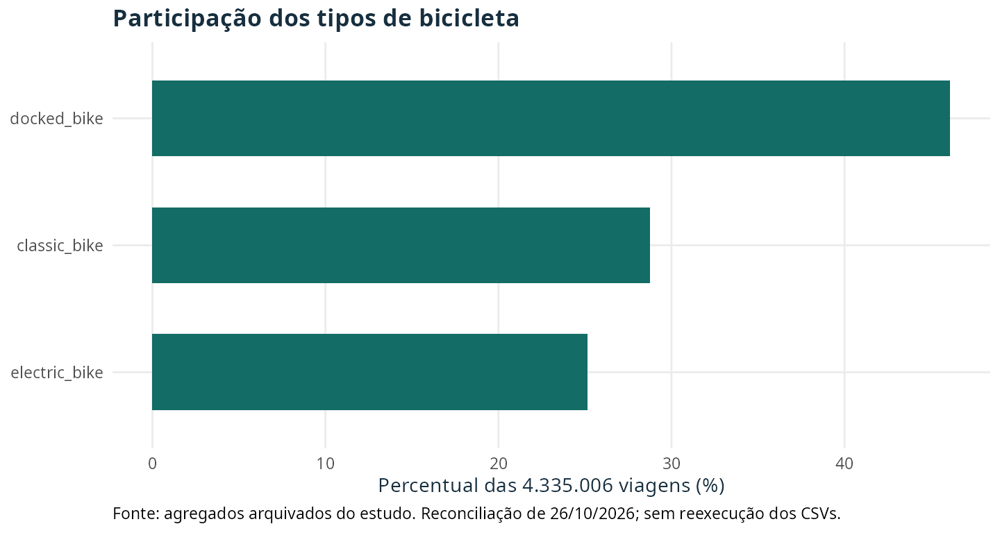
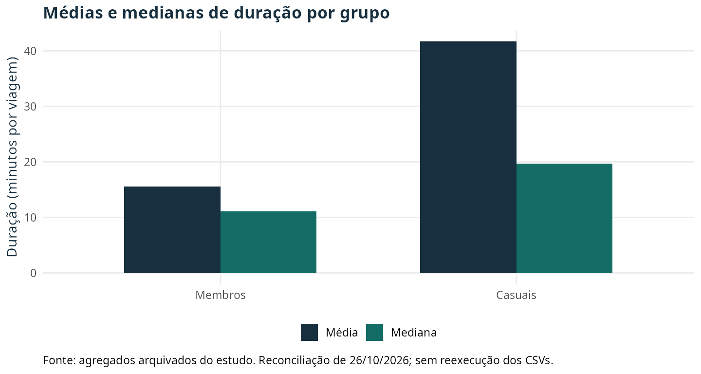
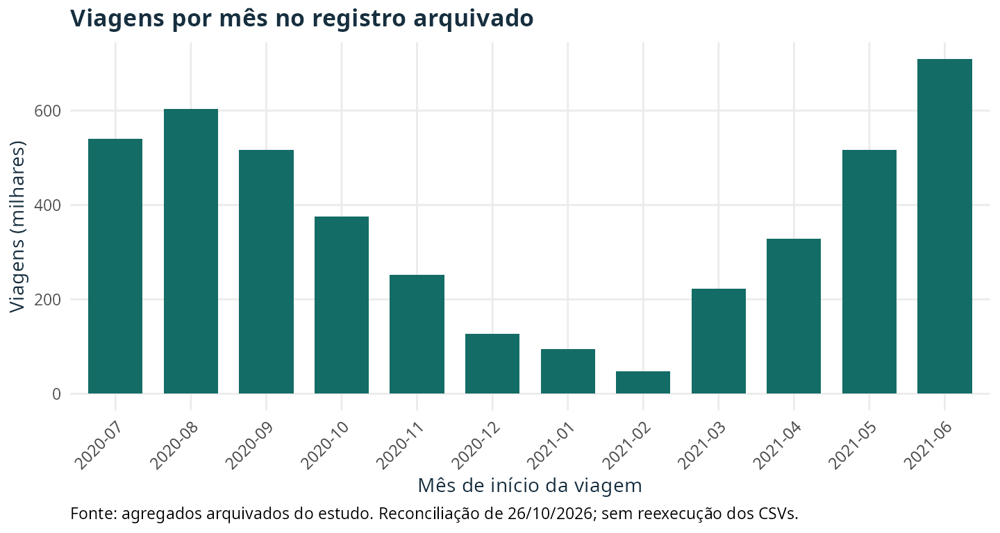

::: {.callout-note}
Revisão de **26/10/2026** do estudo publicado em 2021. A narrativa e os gráficos abaixo foram reconciliados com os agregados arquivados; os CSVs originais não foram reexecutados. A versão anterior, o código original e os hashes estão disponíveis na seção de rastreabilidade. Os valores históricos foram preservados, com correção de sua apresentação e interpretação.
:::

## Pergunta e contexto

Como as viagens de membros e usuários casuais diferem em um sistema de bicicletas compartilhadas? O estudo foi desenvolvido no contexto do caso Cyclistic, do certificado Google Data Analytics. A pergunta comercial era identificar padrões que pudessem orientar hipóteses de campanhas de adesão.

A unidade observada é uma **viagem**. O registro não contém um identificador persistente de pessoa que permita medir frequência individual, retorno ou conversão em assinatura. Por isso, a análise descreve diferenças entre categorias de viagens e não explica por que uma pessoa decide assinar.

## Dados e processamento histórico

A fonte declarada é o [arquivo público de viagens Divvy](https://divvy-tripdata.s3.amazonaws.com/index.html), de **julho de 2020 a junho de 2021**. O resultado arquivado registra 4.460.151 linhas na carga e **4.335.006 viagens** após o filtro `trip_duration > 2`, em minutos. Viagens de exatamente dois minutos também foram excluídas. O limiar foi uma decisão analítica; ele não demonstra que toda viagem mais curta seja um erro.

O processamento histórico calculou duração, mês, dia da semana, hora, faixa do dia e par de estações de origem/destino. Campos de localização ausentes foram mantidos na base geral. Os antigos rankings de estações/pares usavam apenas os registros com localização observada; não é possível afirmar que essa ausência não afetou sua representatividade. Usar R e RStudio, por si só, também não constitui uma verificação de integridade dos arquivos.

Esta revisão usa os agregados preservados no resultado computacional, com hash SHA-256 verificado pelo script de reconciliação. Os microdados de viagem não estão neste checkout. Assim, não foram refeitos testes de duplicidade, perdas por grupo ou outros controles que dependem dos CSVs completos. Não há mistura com a versão mais recente do repositório: ela tem outros filtros, inclusive teto de duração e tratamento de coordenadas, e dispõe de uma alternativa sintética de execução.

## Categorias de viagem e tipos de bicicleta

Das viagens preservadas, **56,46%** são de membros e **43,54%** de casuais. A bicicleta `docked_bike` lidera o total, seguida por `classic_bike` e `electric_bike`.

::: {.table-responsive tabindex="0" role="region" aria-label="Tabela: Categorias de viagem e tipos de bicicleta"}

| Tipo | Viagens | Participação (%) |
| --- | --- | --- |
| docked_bike | 1.998.627 | 46,10 |
| classic_bike | 1.247.162 | 28,77 |
| electric_bike | 1.089.217 | 25,13 |

:::

{fig-alt="Barras: docked 46,10%, classic 28,77% e electric 25,13% das viagens."}

A composição também precisa ser comparada dentro de cada grupo:

::: {.table-responsive tabindex="0" role="region" aria-label="Tabela: Categorias de viagem e tipos de bicicleta"}

| Grupo | Tipo | Viagens | Percentual dentro do grupo (%) |
| --- | --- | --- | --- |
| Membros | docked_bike | 1.043.233 | 42,63 |
| Membros | electric_bike | 602.335 | 24,61 |
| Membros | classic_bike | 801.776 | 32,76 |
| Casuais | docked_bike | 955.394 | 50,61 |
| Casuais | electric_bike | 486.882 | 25,79 |
| Casuais | classic_bike | 445.386 | 23,59 |

:::

Membros: docked > classic > electric. Casuais: docked > electric > classic. A participação de docked é maior entre casuais, mas seu número absoluto de viagens docked é menor que o dos membros. Percentual e volume respondem a perguntas diferentes.

## Duração: média, mediana e extremos

::: {.table-responsive tabindex="0" role="region" aria-label="Tabela: Duração: média, mediana e extremos"}

| Grupo | Viagens | Participação (%) | Média (min) | Mediana (min) | Q1–Q3 (min) | Máximo (min) |
| --- | --- | --- | --- | --- | --- | --- |
| Membros | 2.447.344 | 56,46 | 15,59 | 11,13 | 6,57–19,13 | 33.421,37 |
| Casuais | 1.887.662 | 43,54 | 41,73 | 19,70 | 11,03–37,00 | 55.944,15 |

:::

A média geral arquivada é aproximadamente **26,97 minutos**. Usando as médias por grupo já arredondadas, a razão casual/membro é **2,68**; a razão entre medianas é **1,77**. Os intervalos interquartis são aproximadamente **12,57 minutos** para membros e **25,97 minutos** para casuais. A comparação de média, mediana e quartis mostra a assimetria que a média sozinha omite.

{fig-alt="Membros: média 15,59 e mediana 11,13 minutos. Casuais: média 41,73 e mediana 19,70 minutos."}

O maior valor casual arquivado é 55.944,15 minutos, aproximadamente **38,85 dias**; entre membros, o máximo é aproximadamente **23,21 dias**. O processamento histórico não aplicou um teto. Esses valores limitam interpretações de médias por mês ou hora. Não há evidência para atribuir sua causa a erro de sistema, furto, manutenção ou lazer.

Comparar média e mediana é uma verificação descritiva de sensibilidade, não uma reestimação após excluir extremos. A base agregada não permite calcular o efeito de novos tetos ou filtros. Por isso, esta revisão retira as antigas conclusões sobre maior duração em fevereiro ou na madrugada e não propõe campanhas noturnas com base nelas. Os gráficos antigos com título de contagem para uma média ou eixo mensal rotulado como hora foram substituídos pelos gráficos auditáveis desta versão.

## Quando as viagens ocorreram

### Meses com ano explícito

::: {.table-responsive tabindex="0" role="region" aria-label="Tabela: Meses com ano explícito"}

| Mês | Viagens |
| --- | --- |
| 2020-07 | 540.120 |
| 2020-08 | 604.137 |
| 2020-09 | 516.748 |
| 2020-10 | 375.308 |
| 2020-11 | 251.678 |
| 2020-12 | 127.450 |
| 2021-01 | 93.893 |
| 2021-02 | 48.012 |
| 2021-03 | 222.701 |
| 2021-04 | 328.578 |
| 2021-05 | 516.940 |
| 2021-06 | 709.441 |

:::

{fig-alt="Junho de 2021 tem 709.441 viagens, seguido por agosto de 2020 com 604.137 e julho de 2020 com 540.120."}

O total mensal é maior em **junho de 2021**, seguido por agosto de 2020, julho de 2020, maio de 2021 e setembro de 2020. Junho também lidera os dois grupos: 347.389 viagens de membros e 362.052 casuais. Entre membros, a sequência seguinte é agosto, setembro e julho; entre casuais, agosto, julho e maio. Os anos e a duração dos meses importam: estes são totais observados, não taxas normalizadas nem uma estimativa isolada de sazonalidade.

### Trimestres civis, não estações meteorológicas

::: {.table-responsive tabindex="0" role="region" aria-label="Tabela: Trimestres civis, não estações meteorológicas"}

| Trimestre civil | Viagens |
| --- | --- |
| 2020-Q3 | 1.661.005 |
| 2020-Q4 | 754.436 |
| 2021-Q1 | 364.606 |
| 2021-Q2 | 1.554.959 |

:::

Os rótulos antigos `winter`, `spring`, `summer` e `fall` agrupavam jan–mar, abr–jun, jul–set e out–dez. Nesta revisão, esses mesmos agregados são corretamente nomeados **trimestres civis**, preservando sua composição. Não representam as [estações meteorológicas](https://www.ncei.noaa.gov/news/meteorological-versus-astronomical-seasons). Para estudar essas estações, seria necessário reagrupar os registros ou os meses com uma definição explícita e conferir os resultados afetados.

### Dias da semana e horários

::: {.table-responsive tabindex="0" role="region" aria-label="Tabela: Dias da semana e horários"}

| Grupo | Viagens no fim de semana | Percentual dentro do grupo (%) |
| --- | --- | --- |
| Membros | 676.393 | 27,64 |
| Casuais | 789.897 | 41,85 |

:::

Fins de semana representam uma parcela maior das viagens casuais que das viagens de membros. Isso não significa que a maioria das viagens casuais ocorra no fim de semana: os dias úteis somam 1.097.765 viagens casuais. Comparar atividade típica por dia exigiria considerar a quantidade de dias e a exposição correspondente.

O pico semanal geral é sábado e o menor total é segunda-feira. Para membros, os três maiores totais são quarta-feira, sábado e sexta-feira; para casuais, sábado, domingo e sexta-feira. Por hora, os maiores volumes gerais são 17h, 18h e 16h. As faixas do dia seguem tarde > noite > manhã > madrugada. São contagens de viagens, sem demonstração de motivação individual, deslocamento para o trabalho ou efeito de uma campanha.

## Conclusões e hipóteses comerciais

As viagens casuais apresentam duração média e mediana maiores e maior concentração relativa no fim de semana que as de membros. Esses padrões podem orientar hipóteses de comunicação ou oferta, a serem avaliadas com dados e desenho adequados.

A análise não mede probabilidade de conversão, elasticidade a preço, fidelidade ou efeito de descontos. Um teste comercial precisaria de desfecho de adesão, dados de exposição e critério de comparação. Antes de interpretar padrões de duração, também seria necessário verificar os extremos, a cobertura e a estabilidade dos resultados sob regras documentadas de limpeza.

## Rastreabilidade e reprodução

- [Resultados e hashes desta reconciliação](revision-2026-10-26/results.json): contagens, percentuais, médias/medianas, trimestres e hashes dos novos gráficos.
- [Script de reconciliação e geração dos gráficos](../../scripts/reconcile_bikeshare.R): execute `Rscript --vanilla scripts/reconcile_bikeshare.R` na raiz do projeto. O script confere o hash do resultado histórico e a conservação das contagens. Requer os pacotes já usados nesta revisão: ggplot2, jsonlite e digest; não baixa dados nem executa a análise de viagens.
- [Evidência dos agregados históricos](../../docs/reviews/evidence/bike-share-audit.json).
- [Fonte original EN antes da correção](../../docs/revisions/2026-10-26/before/posts/bike-share-navigate/index.qmd.gz) e [tradução PT anterior](../../docs/revisions/2026-10-26/before/posts/bike-share-navigate/pt.qmd.gz), comprimidas, com o processo completo preservado.
- [Resultado computacional original preservado](../../docs/revisions/2026-10-26/before/_freeze/posts/bike-share-navigate/index/execute-results/html.json.gz) e [manifesto de hashes anterior à revisão](../../docs/revisions/2026-10-26/before-manifest.json).
- [Repositório informado, no commit consultado](https://github.com/talesgomes27/DAC8-Case-Study-1/tree/5c21b988e46548d7592245d1937cee0c8af6993c): versão posterior, com escolhas analíticas diferentes. Seus números não são usados como substitutos dos resultados históricos aqui apresentados.

Os gráficos novos foram calculados a partir de agregados arquivados; os gráficos anteriores permanecem como material histórico e não são apresentados como saídas atualizadas. A data original do estudo foi mantida e a data de revisão está separada. Uma reprodução dos CSVs completos continua pendente.
