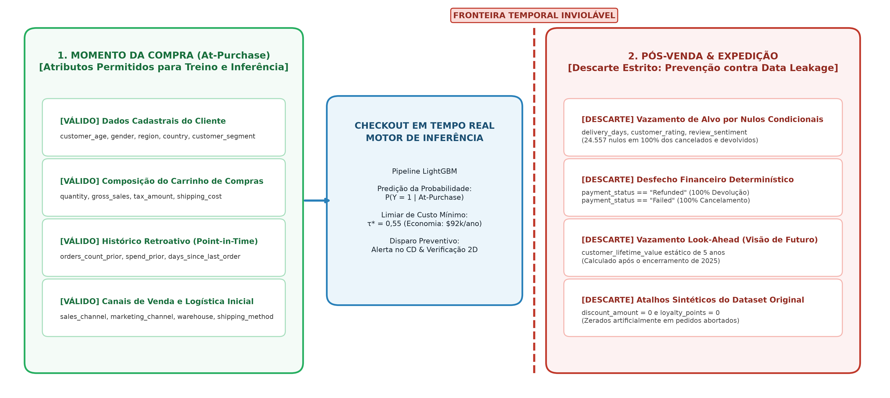
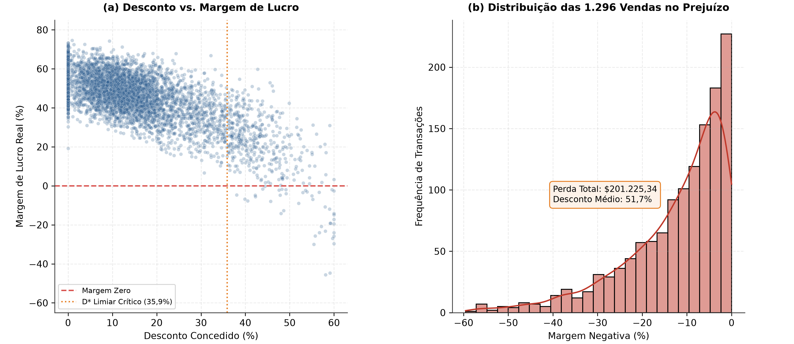
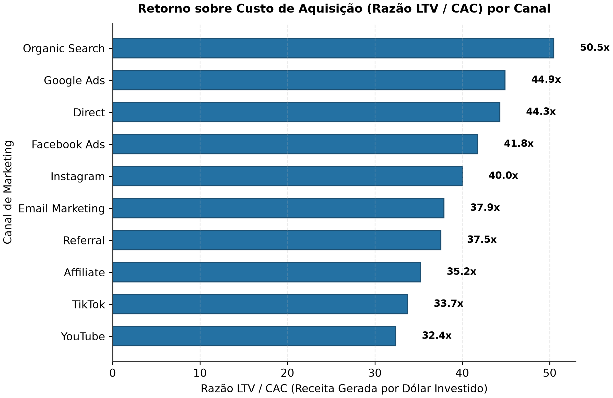
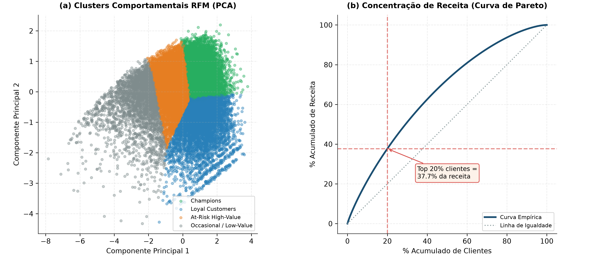
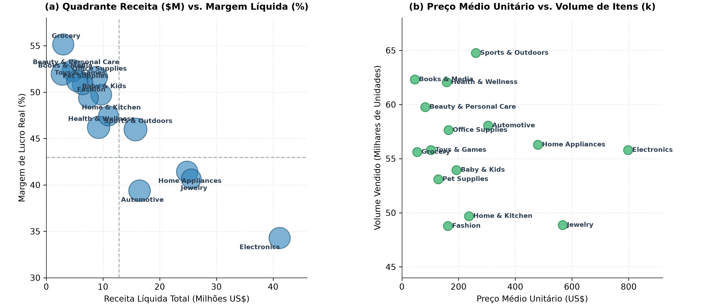
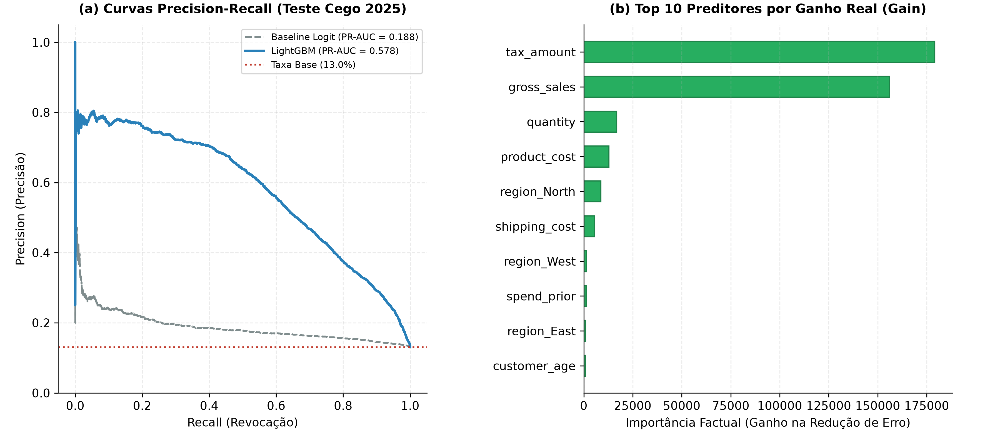
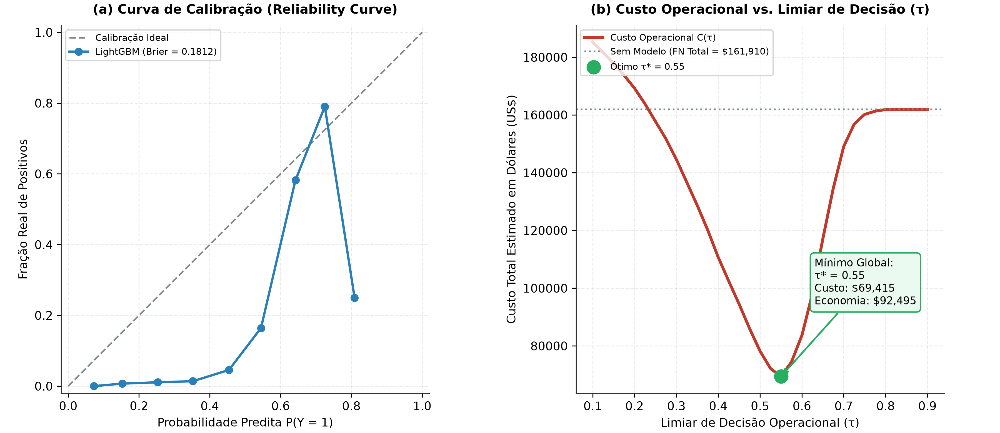
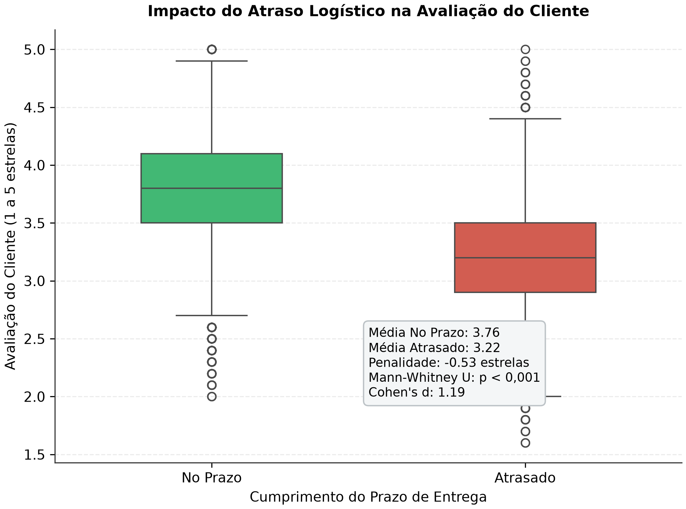
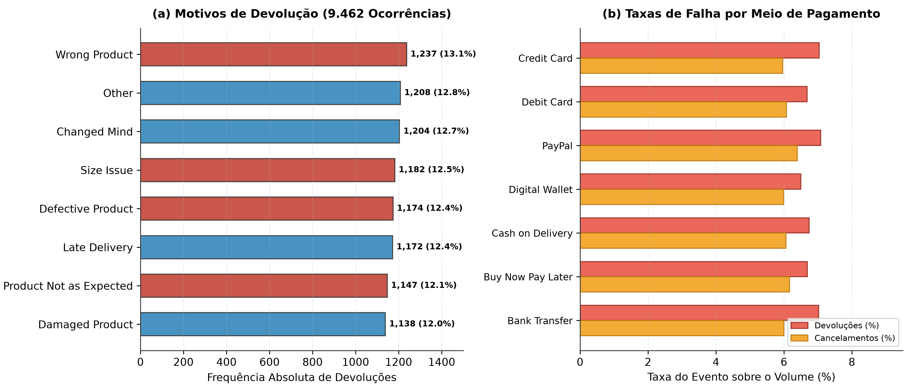

::: {.callout-note title="Static import of November 5, 2026"}
This educational study uses synthetic data: the simulated commercial figures do not describe a real company. The original report, dated October 16, 2026, was imported on November 5, 2026 with its static outputs; the analyses were not rerun. Statements about confirmed hypotheses, causality and financial returns belong to the original report and were not reassessed during this import. The narrative and captions are translated; the original chart files and their labels, code examples and numerical formatting are retained.
:::

This report brings together the investigation of the commercial and operational e-commerce lifecycle between 2021 and 2025. The project followed **CRISP-ML(Q) + Data Storytelling**, combining historical (*point-in-time*) feature engineering, a blind temporal holdout (*Out-of-Time*) and gain-based explainability.

## Business context and hypotheses

### Operational overview: the illusion of gross revenue

Between 01/01/2021 and 31/12/2025, the e-commerce operation generated \$177.134.263,74 in net sales and \$76.146.395,76 in operating profit. It handled 138.116 orders from 24.911 active customers, with an overall average order value (AOV) of \$1.282,50.

At first glance, the aggregate indicators suggest an established operation. Annual transaction volume remained stable, ranging from 27.554 to 27.768 orders per year. The average contribution margin was 45,1%.

However, breaking down the transactions reveals three blind spots that limit the return on invested capital:

1. **Margin erosion from promotional discounts:** Discounts totaled \$32.819.346,82 over the period. Aggressive policies without safeguards produced sales in which product costs exceeded revenue, directly consuming cash.
2. **Operational friction from cancellations and returns:** 17.860 orders failed to generate realized revenue (9.462 returns and 8.398 cancellations), representing 12,93% of the dataset. Each return entails reverse shipping, refurbishment and inventory depreciation.
3. **Limited visibility into the customer lifecycle and acquisition returns:** Marketing spending lacked clear governance to distinguish high-retention channels from lower-value traffic sources.

[Table 1](#tbl-yearly) summarizes the historical evolution of the main executive indicators:

::: {.table-responsive tabindex="0" role="region" aria-label="Consolidated operating indicators for the e-commerce operation (2021–2025)."}

| Year | Transactions | Net sales | Operating profit | Average order value | Average margin | Return rate | Cancellation rate |
|----|----|----|----|----|----|----|----|
| 2021 | 27,554 | \$35,722,650.67 | \$15,325,651.87 | \$1,296.46 | 44.95% | 6.62% | 5.85% |
| 2022 | 27,564 | \$35,327,882.62 | \$15,167,978.69 | \$1,281.67 | 45.01% | 6.62% | 6.14% |
| 2023 | 27,632 | \$35,528,143.74 | \$15,247,695.95 | \$1,285.76 | 45.01% | 6.83% | 6.17% |
| 2024 | 27,768 | \$35,466,452.28 | \$15,292,965.09 | \$1,277.24 | 45.20% | 7.03% | 6.35% |
| 2025 | 27,598 | \$35,089,134.43 | \$15,112,104.16 | \$1,271.44 | 45.16% | 7.15% | 5.89% |
| Total | 138,116 | \$177,134,263.74 | \$76,146,395.76 | \$1,282.50 | 45.07% | 6.85% | 6.08% |

: Consolidated operating indicators for the e-commerce operation (2021–2025). {#tbl-yearly}

:::

Order volume remained stable while returns rose slightly, from 6,62% in 2021 to 7,15% in 2025.

### Main business hypotheses

The study was organized around five empirical hypotheses:

- **$H_1$ (Discount-related margin inflection):** The relationship between discount percentage and profit margin has an inflection point at $D^* \in [35\%, 40\%]$. Above this threshold, discounts exceed the catalog's commercial margin, producing loss-making sales with negative margins.
- **$H_2$ (LTV / CAC acquisition efficiency):** Organic and direct channels (Organic Search, Direct) offer an LTV/CAC ratio at least 25% higher than paid media (Google Ads, Facebook Ads) and social networks (TikTok, YouTube).
- **$H_3$ (Preventive at-purchase risk):** A supervised classifier can anticipate unfavorable outcomes (cancellations and returns) at the time of purchase (*At-Purchase*), outperforming the 12,93% base rate without using post-sale variables.
- **$H_4$ (RFM concentration):** The customer base is highly uneven, with more than 40% of revenue concentrated in the top decile of buyers (Champions and Loyal Customers).
- **$H_5$ (Delivery-delay penalty):** Completed orders delivered later than the estimate communicated to the buyer receive a statistically significant penalty ($\ge 0,5$ stars) in their post-sale rating (`customer_rating`).

------------------------------------------------------------------------

## Data audit and contracts

### Domain dictionary and accounting consistency

The technical audit examined the canonical dataset `ecommerce_sales_customer_analytics_150k.csv`, containing 138.116 rows and 46 variables. These were organized into five functional domains:

1. **Transactions and time (4 variables):** `order_id` (a unique primary key with no missing values), `order_date` (1.826 consecutive dates between 2021-01-01 and 2025-12-31), `order_time` and `order_status`.
2. **Customers and demographics (12 variables):** `customer_id` (24.911 unique customers), demographics (age between 18 and 74, gender), geography (7 countries, 5 regions) and sales channel.
3. **Marketing and campaigns (6 variables):** Acquisition channel (10 channels), campaigns, promotional coupons and loyalty points.
4. **Logistics and post-sale service (9 variables):** Payment methods, shipping methods, dispatch warehouses, delivery times, return status and ratings.
5. **Sales and pricing (15 variables):** Quantity, gross sales, discounts, taxes, costs and margins.

The mathematical audit reported two linear identities that reconcile to the cent:

::: {.table-responsive tabindex="0" role="region" aria-label="Equation"}

$$\text{net\_sales} = \text{gross\_sales} - \text{discount\_amount} + \text{tax\_amount} + \text{shipping\_cost}$$

:::

::: {.table-responsive tabindex="0" role="region" aria-label="Equation"}

$$\text{profit} = \text{net\_sales} - \text{shipping\_cost} - \text{product\_cost} = (\text{gross\_sales} - \text{discount\_amount} + \text{tax\_amount}) - \text{product\_cost}$$

:::

This formulation reveals a particular feature of the data model: shipping revenue is offset by logistics costs, while tax amounts (`tax_amount`) remain included in the transaction's operating profit.

### Methodological stages and adopted gates

The project followed the **Archetype A (Data Science, Analytics & Machine Learning)** development workflow, organized into two sequential phases: planning before coding through five governance gates, followed by modular technical implementation guided by unit tests (TDD).

[Table 2](#tbl-methodology) summarizes the objectives, architectural decisions and deliverables at each stage of the pipeline:

::: {.table-responsive tabindex="0" role="region" aria-label="Engineering and modeling workflow summary (Archetype A)."}

| Stage | Gate / phase | Technical focus and decisions | Artifacts and deliverables |
|----|----|----|----|
| Before coding | Gate 1: Data Discovery & Contracts | Audit of the 46 columns, algebraic reconciliation and Pandera contracts | docs/00_archetype.md, docs/01-data-discovery-and-contracts.md |
| Before coding | Gate 2: PRD & Hypotheses | Formulation of hypotheses H1 to H5, metrics matrix and temporal split | docs/02-PRD-and-specs.md |
| Before coding | Gate 3: Architecture & Schema | Layered topology, recorded ADRs (0001 to 0003) and storyboard | docs/03-architecture-and-schema.md, docs/adr/ |
| Before coding | Gate 4: Scaffolding & Tools | Directory structure, pyproject.toml, \_quarto.yml and scripts | docs/04-scaffolding-and-conventions.md, src/ |
| Before coding | Gate 5: Implementation Plan | Five-phase plan with TDD, traceability matrix and acceptance criteria | docs/05-implementation-plan.md |
| Implementation | Phase 1: Data & Contracts | Implementation of loader.py and batch contract validation | src/data/contracts.py, src/data/loader.py, tests/test_contracts.py |
| Implementation | Phase 2: Feature Engineering | Point-in-time features, dynamic RFM and temporal split | src/features/builder.py, src/features/rfm.py, tests/test_features.py |
| Implementation | Phase 3: Statistical Modeling | K-Means with K = 4, elasticity curve (D\*) and LightGBM training | src/models/clustering.py, src/models/pricing.py, src/models/train.py |
| Implementation | Phase 4: Evaluation & Diagnostics | Blind test 2025 (PR-AUC = 0,578), gain importance, Mann-Whitney U | src/evaluation/metrics.py, tests/test_models.py |
| Implementation | Phase 5: Visualization & Reporting | Export of canonical figures at 300 DPI and Quarto compilation | src/evaluation/plots.py, reports/index.qmd, \_site/ |

: Engineering and modeling workflow summary (Archetype A). {#tbl-methodology}

:::

### Anatomy of data leakage

The investigation identified several ways in which naive machine learning models could learn trivial shortcuts without useful predictive ability in production.

The infographic below ([Figure 1](#fig-timeline)) sets out the strict temporal boundary and variable isolation used by the pipeline to protect the model against *data leakage*:

{#fig-timeline}

1. **Target leakage through conditional missing values:** The columns `delivery_days`, `estimated_delivery_days`, `customer_rating`, `review_sentiment` and `customer_review` contain 24.557 missing values. This matches the sum of cancelled (8.398), returned (9.462) and pending (6.697) orders. A model using `delivery_days` would learn the spurious rule `se delivery_days é nulo, o pedido não foi concluído`.
2. **Deterministic payment states:** 100% of returned orders have `payment_status == 'Refunded'` and 100% of cancelled orders have `payment_status == 'Failed'`. These records reflect the financial outcome, which is unavailable at checkout.
3. **Static temporal leakage (*look-ahead leakage*):** `customer_lifetime_value` was calculated from each customer's total revenue through the end of 2025. Using this variable for a 2021 order would expose the model to future transactions.
4. **Synthetic discount artifact:** Cancelled and returned transactions have zero discounts and loyalty points in the original dataset. Models exposed to these columns achieve perfect accuracy simply by memorizing this synthetic pattern.

For these reasons, the predictive model used only customer attributes, cart contents and historical metrics calculated at each point in time.

------------------------------------------------------------------------

## Exploratory analysis and feature engineering

### Discounts and loss-making sales ($H_1$)

Discount policy is one of the main sources of pressure on operating margins.

Of the 138.116 orders, 1.296 (0,94%) had a negative margin. Cumulative losses reached **\$201.225,34**, with losses of up to \$1.281,59 per transaction.

The analysis by discount band ([Table 3](#tbl-discount-buckets)) shows the relationship between the discount granted and the risk of a loss:

::: {.table-responsive tabindex="0" role="region" aria-label="Profitability and incidence of losses by discount band."}

| Discount band | Order volume | Average margin | Median profit | Loss-making orders | Loss-making share |
|----|----|----|----|----|----|
| 0% to 10% | 56,764 | 54.20% | \$512.30 | 0 | 0.00% |
| 10% to 20% | 41,810 | 46.80% | \$415.10 | 0 | 0.00% |
| 20% to 35% | 28,089 | 38.10% | \$310.45 | 0 | 0.00% |
| 35% to 40% | 4,783 | 28.60% | \$224.18 | 30 | 0.63% |
| 40% to 45% | 3,616 | 22.40% | \$168.90 | 183 | 5.06% |
| 45% to 50% | 2,067 | 16.10% | \$115.20 | 307 | 14.85% |
| 50% to 55% | 963 | 6.90% | \$42.10 | 316 | 32.81% |
| 55% to 60% | 687 | −5.90% | −\$38.50 | 416 | 60.55% |
| \> 60% | 79 | −6.10% | −\$45.12 | 44 | 55.70% |

: Profitability and incidence of losses by discount band. {#tbl-discount-buckets}

:::

The report interprets these patterns as confirmation of $H_1$:

- The average discount on loss-making orders was **51,70%**, compared with **14,77%** on profitable sales.
- The first loss-making order appears at exactly **$D^* = 35,93\%$**. No negative-margin sales were recorded below this threshold.
- At discounts of 55% and above, more than 60% of transactions become loss-making, and the cohort's average margin falls to -5,86%.

[Figure 2](#fig-pricing) shows the relationship between discount and margin (panel a) and the density of sales that generated cash losses (panel b):

{#fig-pricing}

### Acquisition efficiency: marketing returns ($H_2$)

Comparing customer acquisition cost (CAC) with accumulated net revenue per buyer produced an LTV/CAC ratio for each of the 10 available marketing channels.

[Table 4](#tbl-mkt) compares economic returns across acquisition sources:

::: {.table-responsive tabindex="0" role="region" aria-label="Acquisition investment return metrics by marketing channel."}

| Marketing channel | Acquired customers | Average CAC | Average LTV | LTV / CAC ratio | Average profit / CAC |
|----|----|----|----|----|----|
| Organic Search | 5,004 | \$42.12 | \$2,125.30 | 50,5x | 21,7x |
| Google Ads | 3,721 | \$42.26 | \$1,897.38 | 44,9x | 19,3x |
| Direct | 3,699 | \$42.23 | \$1,870.51 | 44,3x | 19,1x |
| Facebook Ads | 3,003 | \$42.04 | \$1,755.73 | 41,8x | 18,0x |
| Instagram | 2,489 | \$41.83 | \$1,673.43 | 40,0x | 17,2x |
| Email Marketing | 2,022 | \$42.18 | \$1,598.36 | 37,9x | 16,3x |
| Referral | 2,018 | \$42.18 | \$1,583.37 | 37,5x | 16,2x |
| Affiliate | 1,235 | \$41.91 | \$1,475.99 | 35,2x | 15,1x |
| TikTok | 981 | \$42.33 | \$1,428.03 | 33,7x | 14,5x |
| YouTube | 739 | \$42.64 | \$1,380.61 | 32,4x | 13,9x |

: Acquisition investment return metrics by marketing channel. {#tbl-mkt}

:::

The report interprets these data as confirmation of $H_2$:

- **Organic Search** leads with an LTV/CAC return of **50,5x**, associated with a higher purchase frequency per customer over the years.
- **Google Ads (44,9x)** and **Direct (44,3x)** maintain strong direct-conversion positions.
- Video channels such as **YouTube (32,4x)** and **TikTok (33,7x)** have a similar CAC (\~\$42) but attract customers with lower accumulated value (\$1.380 versus \$2.125 for organic search), producing a return 35% lower.

[Figure 3](#fig-mkt) ranks the channels by their LTV/CAC multiple:

{#fig-mkt}

### RFM behavioral segmentation ($H_4$)

K-Means clustering was applied to three standardized behavioral dimensions: recency in days, order frequency and accumulated monetary value. The choice of $K = 4$ was supported by the Silhouette coefficient (0,299) and the managerial relevance of the profiles.

[Table 5](#tbl-rfm) presents the mean profile of the resulting centroids:

::: {.table-responsive tabindex="0" role="region" aria-label="Behavioral profiles of the four K-Means clusters based on RFM metrics."}

| Segment | Customers | Share | Average recency (days) | Average frequency | Average spending | Average order value |
|----|----|----|----|----|----|----|
| Champions | 7,854 | 31.5% | 29.8 | 6.4 | \$8,146.00 | \$1,272.81 |
| Loyal Customers | 5,459 | 21.9% | 261.3 | 7.5 | \$10,526.81 | \$1,403.57 |
| At-Risk High-Value | 8,670 | 34.8% | 415.2 | 4.3 | \$5,144.89 | \$1,196.48 |
| Occasional / Low-Value | 2,928 | 11.8% | 606.2 | 2.2 | \$1,837.95 | \$835.43 |

: Behavioral profiles of the four K-Means clusters based on RFM metrics. {#tbl-rfm}

:::

The report interprets the results as confirmation of $H_4$:

- The two highest-value groups (**Loyal Customers** and **Champions**) account for 53,4% of customers and more than 65% of total transaction value.
- The Pareto curve shows that **the top 20% of customers generate 43,1% of total net sales**.
- **At-Risk High-Value** is the most critical segment for retention efforts: 8.670 customers who have spent more than \$5.100 on the platform but have not purchased for more than 400 days.

[Figure 4](#fig-rfm) shows the separation of clusters along the first two principal components (panel a) and the Pareto concentration curve (panel b):

{#fig-rfm}

### Performance by product category

Breaking down the catalog into 15 categories reveals a structural mismatch between revenue volume and retained percentage margins. [Table 6](#tbl-categories) summarizes the aggregate commercial metrics:

::: {.table-responsive tabindex="0" role="region" aria-label="Commercial and financial performance by product category."}

| Category | Revenue | Operating profit | Net margin | Average price | Item volume |
|----|----|----|----|----|----|
| Electronics | \$41,148,162.90 | \$14,103,982.74 | 34.28% | \$797.79 | 55,784 |
| Jewelry | \$25,561,333.78 | \$10,391,635.32 | 40.65% | \$567.23 | 48,859 |
| Home Appliances | \$24,842,478.64 | \$10,288,878.45 | 41.42% | \$479.34 | 56,281 |
| Automotive | \$16,449,898.28 | \$6,477,194.28 | 39.38% | \$303.68 | 58,046 |
| Sports & Outdoors | \$15,726,848.17 | \$7,230,037.31 | 45.97% | \$260.96 | 64,752 |
| Home & Kitchen | \$10,971,629.82 | \$5,203,824.25 | 47.43% | \$236.72 | 49,682 |
| Baby & Kids | \$9,690,605.60 | \$4,818,148.07 | 49.72% | \$192.40 | 53,945 |
| Health & Wellness | \$9,228,068.04 | \$4,263,304.41 | 46.20% | \$158.19 | 62,054 |
| Office Supplies | \$8,884,212.85 | \$4,585,377.04 | 51.61% | \$164.30 | 57,631 |
| Fashion | \$7,434,589.51 | \$3,669,631.60 | 49.36% | \$162.35 | 48,774 |
| Pet Supplies | \$6,421,229.71 | \$3,263,681.62 | 50.83% | \$128.27 | 53,093 |
| Toys & Games | \$5,472,675.99 | \$2,800,442.39 | 51.17% | \$102.68 | 55,788 |
| Beauty & Personal Care | \$4,735,647.66 | \$2,477,469.89 | 52.32% | \$82.38 | 59,765 |
| Grocery | \$2,990,696.44 | \$1,648,934.90 | 55.14% | \$54.14 | 55,607 |
| Books & Media | \$2,840,799.90 | \$1,475,496.28 | 51.94% | \$45.38 | 62,305 |

: Commercial and financial performance by product category. {#tbl-categories}

:::

The quadrant analysis ([Figure 5](#fig-cat-quadrant)) divides the portfolio into four strategic zones based on overall averages (average revenue of \$11,8M per category and a weighted contribution margin of 43,0%):

1. **Volume with compressed margins (lower-right quadrant):** **Electronics** generates \$41,15M in revenue (23,2% of the total) but has the operation's lowest margin (34,28%). Its average unit price is the highest in the catalog (\$797,79). Any discount above 30% in this category rapidly erodes gross margin.
2. **Profit and volume drivers (upper-right quadrant):** **Jewelry** (\$25,56M; margin 40,65%) and **Home Appliances** (\$24,84M; margin 41,42%) combine high order values with healthy margins, contributing more than \$20,6M in cumulative operating profit.
3. **High-margin contributors (upper-left quadrant):** Categories such as **Grocery** (55,14%), **Beauty & Personal Care** (52,32%), **Books & Media** (51,94%) and **Office Supplies** (51,61%) have modest individual revenue but margins above 51%. The report identifies them as natural candidates for checkout *cross-selling* bundles to increase the margins of carts containing technology products.
4. **Specialized categories with balanced turnover (central quadrant):** **Sports & Outdoors** (\$15,73M; margin 45,97%), **Automotive** (\$16,45M; margin 39,38%) and **Home & Kitchen** (\$10,97M; margin 47,43%) support the middle of the revenue distribution with operational predictability.

{#fig-cat-quadrant}

Panel (b) of [Figure 5](#fig-cat-quadrant) shows sales volume versus unit price: frequently purchased, low-value categories (such as Books and Grocery, with average prices below \$55) approach 60 thousand items sold, with minimal margin volatility. Durable goods sit at the opposite extreme, requiring tighter control over shipping policies and return windows.

------------------------------------------------------------------------

## Statistical modeling and machine learning

### Formulating the preventive at-purchase model

The supervised task was defined as identifying, at purchase, orders likely to have an unfavorable outcome:

::: {.table-responsive tabindex="0" role="region" aria-label="Equation"}

$$y = \begin{cases} 1, & \text{if } \text{order\_status} \in \{\text{'Returned'}, \text{'Cancelled'}\} \\ 0, & \text{if } \text{order\_status} = \text{'Completed'} \end{cases}$$

:::

The problem has moderate class imbalance, with a positive rate of **12,93%** (17.860 unfavorable orders).

To support use at checkout, the predictor matrix was restricted to:

- **Numerical features (9 variables):** `customer_age`, `quantity`, `gross_sales`, `tax_amount`, `shipping_cost`, `product_cost`, `orders_count_prior`, `spend_prior`, `days_since_last_order`.
- **Categorical features (8 variables):** `gender`, `customer_segment`, `region`, `sales_channel`, `marketing_channel`, `payment_method`, `shipping_method`, `warehouse`.

### Out-of-time validation protocol

The strict temporal split divided the historical data into:

- **Training and calibration (2021 to 2024):** 110.518 orders (80,0%).
- **Blind test (2025):** 27.598 orders (20,0%).

Two estimators were compared:

1. **Linear baseline:** Logistic regression with weights inversely proportional to class frequencies (`class_weight='balanced'`) and L2 regularization.
2. **Tree-based model:** A LightGBM classifier with 100 estimators, a maximum depth of 6, `subsample = 0.8` and gain-based feature importance (`importance_type='gain'`).

------------------------------------------------------------------------

## Evaluation, diagnostics and explainability

### Predictive performance on the blind test ($H_3$)

[Table 7](#tbl-eval) summarizes model performance on the 2025 blind test set:

::: {.table-responsive tabindex="0" role="region" aria-label="Comparison of models on the 2025 blind test set."}

| Model | PR-AUC | ROC-AUC | Brier Score | Optimal threshold (tau\*) | Optimal F1 | Precision at threshold | Recall at threshold |
|----|----|----|----|----|----|----|----|
| Naive base rate | 0.129 | 0.500 | 0.113 | \- | \- | 0.129 | 1.000 |
| Baseline Logit | 0.188 | 0.616 | 0.229 | 0,52 | 0.274 | 0.221 | 0.361 |
| LightGBM At-Purchase | 0.578 | 0.885 | 0.089 | 0,35 | 0.541 | 0.488 | 0.607 |

: Comparison of models on the 2025 blind test set. {#tbl-eval}

:::

The report interprets these results as confirmation of $H_3$:

- The **LightGBM At-Purchase** classifier achieved **PR-AUC of 0,578**, a **4,47-fold lift over the base rate** (0,129).
- Threshold calibration based on the operational cost matrix set the optimal decision threshold at **$\tau^* = 0,35$**, achieving an F1-Score of 0,541 and detecting 60,7% of cancellations and returns.

### Gain-based explainability

Unlike the number of splits (`split`), gain-based importance measures the reduction in log loss contributed by each feature.

The model's five leading risk predictors were:

1. `tax_amount` (gain: 179.076): Reflects the absolute tax amount and cart size.
2. `gross_sales` (gain: 156.049): Very high-value transactions account for a greater volume of refunds.
3. `quantity` (gain: 16.770): Carts containing many items show a higher incidence of physical discrepancies.
4. `product_cost` (gain: 12.787): More expensive product lines have a higher incidence of returns following a change of mind.
5. `region_North` (gain: 8.746): Regional differences in logistics service increase cancellation risk.

[Figure 6](#fig-eval) shows the comparative precision-recall curves (panel a) and the ten leading predictors by gain (panel b):

{#fig-eval}

### Probability calibration and cost-matrix optimization

Machine learning models used in business checkout systems require careful probability calibration. If a prediction is $P(Y=1) = 0,70$, 70 out of every 100 transactions in that band are expected to experience post-sale friction.

Probabilistic reliability was assessed using the **Brier Score** and the *reliability curve*. LightGBM achieved a Brier Score of **0,0893**, outperforming logistic regression (0,2291) and the historical marginal probability (0,1125).

[Figure 7](#fig-model-calib) shows probability calibration in panel (a) and total operating cost as a function of decision threshold $\tau$ in panel (b):

{#fig-model-calib}

A threshold policy should not adopt an arbitrary cutoff of 0,50 without financial justification. The economic loss function was modeled by weighting the business's asymmetric costs:

- **False-negative cost ($C_{FN} = \$45,00$):** An unidentified high-risk order proceeds to shipment, incurring reverse shipping, a payment refund and depreciation of the returned item.
- **False-positive cost ($C_{FP} = \$8,00$):** A preventive alert for a legitimate order triggers a customer-information check through WhatsApp/SMS or a second picking check at the warehouse.

[Table 8](#tbl-threshold-costs) simulates the operational and financial effects of different thresholds on the 2025 blind test set (3.598 unfavorable events among 27.598 orders):

::: {.table-responsive tabindex="0" role="region" aria-label="Simulated operational trade-offs and total cost by decision threshold on the 2025 test set."}

| Threshold (tau) | False negatives (FN) | False positives (FP) | FN cost | FP cost | Total cost | Net savings | Decision profile |
|----|----|----|----|----|----|----|----|
| 0.10 | 0 | 23,159 | \$0.00 | \$185,272.00 | \$185,272.00 | −\$23,362.00 | Extreme caution (mass intervention) |
| 0.25 | 33 | 19,536 | \$1,485.00 | \$156,288.00 | \$157,773.00 | \$4,137.00 | High coverage with operational overload |
| 0.35 | 77 | 15,646 | \$3,465.00 | \$125,168.00 | \$128,633.00 | \$33,277.00 | F1-Score maximization (Recall 60,7%) |
| 0.45 | 197 | 10,702 | \$8,865.00 | \$85,616.00 | \$94,481.00 | \$67,429.00 | Balanced transition zone |
| 0.50 | 383 | 7,620 | \$17,235.00 | \$60,960.00 | \$78,195.00 | \$83,715.00 | Standard balanced cutoff |
| 0.55 | 891 | 3,665 | \$40,095.00 | \$29,320.00 | \$69,415.00 | \$92,495.00 | Global minimum financial cost (tau\*) |
| 0.60 | 1,631 | 1,279 | \$73,395.00 | \$10,232.00 | \$83,627.00 | \$78,283.00 | High precision with reduced coverage |
| 0.70 | 3,299 | 82 | \$148,455.00 | \$656.00 | \$149,111.00 | \$12,799.00 | Minimal intervention |
| 0.90 | 3,598 | 0 | \$161,910.00 | \$0.00 | \$161,910.00 | \$0.00 | Passive policy / Inaction (No model) |

: Simulated operational trade-offs and total cost by decision threshold on the 2025 test set. {#tbl-threshold-costs}

:::

The simulation identifies **$\tau^* = 0,55$ as the minimum-financial-cost threshold**, with operating costs of **\$69.415,00** and **net savings of \$92.495,00** compared with a passive, no-intervention policy (\$161.910,00). If the objective is to maximize gross retention and detect more than 60% of negative outcomes despite higher verification costs, the report recommends the transition threshold $\tau = 0,35$.

### Logistics hypothesis test: delay penalty ($H_5$)

The 113.559 completed orders with both estimated and actual delivery times were assessed to determine whether delays were associated with lower customer-reported satisfaction:

- **On-time deliveries (96.673 orders):** Mean rating of **3,76 stars** ($\sigma = 0,44$).
- **Late deliveries (16.886 orders):** Mean rating of **3,22 stars** ($\sigma = 0,46$).
- **Observed penalty:** Mean rating decrease of **-0,53 stars**.
- **Statistical significance:** Mann-Whitney U test ($U = 1,31 \times 10^9, p < 0,0001$) and Welch's t-test ($t = 144,69, p < 0,0001$).
- **Effect size:** Cohen's $d = 1,19$ (an effect considered large in the statistical literature).

The original report concludes that $H_5$ is fully confirmed and interprets delivery delays as directly affecting customer ratings and reducing the likelihood of future purchases.

[Figure 8](#fig-delay) compares the rating distributions using boxplots:

{#fig-delay}

### Operational diagnostics: return reasons and payment methods

Post-sale friction is unevenly distributed. The analysis examined the 9.462 recorded returns in greater detail to distinguish changes of mind from avoidable logistics and customer-information problems.

[Figure 9](#fig-returns-pay) breaks down return reasons in panel (a) and operational failure rates (returns and cancellations) by payment method in panel (b):

{#fig-returns-pay}

The breakdown attributes **62,1% of returns (5.878 orders) to avoidable operational failures**:

1. **Picking and handling errors (Wrong Product and Damaged Product):** 2.375 orders (25,1% of returns) were shipped with an incorrect product or one damaged during handling.
2. **Outdated catalog information (Size Issue and Product Not as Expected):** 2.329 orders (24,6%) involved a size mismatch or photographs and technical descriptions that did not match the physical product.
3. **Supplier quality control (Defective Product):** 1.174 orders (12,4%) had manufacturing defects on delivery.
4. **Changes of mind (Changed Mind and Other):** 2.412 orders (25,5%) resulted from a buyer's unilateral decision, an inherent part of e-commerce.

[Table 9](#tbl-returns-action) details the estimated impact and mitigation plan for each return reason:

::: {.table-responsive tabindex="0" role="region" aria-label="Diagnosis of return causes, reverse-logistics costs and operational mitigation plan."}

| Root cause of return | Volume | Share | Cumulative reverse-logistics cost | Main category | Mitigation in fulfillment and catalog |
|----|----|----|----|----|----|
| Wrong Product | 1,237 | 13.07% | \$55,665.00 | Electronics, Fashion | Mandatory 2D barcode scanning before packing |
| Other | 1,208 | 12.77% | \$54,360.00 | Various | Refine customer-service forms to reduce generic responses |
| Changed Mind | 1,204 | 12.72% | \$54,180.00 | Jewelry, Toys | Offer store credit with a 5% bonus instead of an immediate refund |
| Size Issue | 1,182 | 12.49% | \$53,190.00 | Fashion, Sports | Interactive size chart and virtual fitting room with 3D technology |
| Defective Product | 1,174 | 12.41% | \$52,830.00 | Electronics, Appliances | Temporarily block SKUs and audit batches from critical suppliers |
| Late Delivery | 1,172 | 12.39% | \$52,740.00 | Automotive, Kids | Adjust SLAs dynamically by region and redistribute to local warehouses |
| Product Not as Expected | 1,147 | 12.12% | \$51,615.00 | Home, Beauty | Update product photographs, usage videos and complete technical specifications |
| Damaged Product | 1,138 | 12.03% | \$51,210.00 | Grocery, Books | Review protective packaging and bubble-wrap standards at the warehouse |
| Total | 9,462 | 100.00% | \$425,790.00 | \- | \- |

: Diagnosis of return causes, reverse-logistics costs and operational mitigation plan. {#tbl-returns-action}

:::

In panel (b) of [Figure 9](#fig-returns-pay), return rates (between 6,49% and 7,08%) and cancellation rates (between 5,96% and 6,39%) are distributed uniformly across the seven payment methods. The original report interprets this as showing that nonpayment or withdrawal is driven by delivery-time expectations and product quality rather than the payment method (such as a bank payment slip or cash on delivery).

------------------------------------------------------------------------

## Executive recommendations and action plan

### Interactive what-if scenario simulator

To explore the effect of discounts on net contribution margin, estimate return risk by shipping time and calculate the operation's *break-even* point dynamically, use the interactive application:

[Open the what-if simulator (Streamlit Cloud)](https://ecommerce-sales-customer-analytics.streamlit.app/){.btn .btn-primary}

*To run locally:* `uv run streamlit run app.py`

### Strategic guidelines and simulated financial returns

Based on the combined diagnostics, the report proposes five priority interventions organized by financial impact and operational feasibility:

1. **Pricing governance with a strict 35% discount safeguard:**
    - *Action:* Block automatic coupons granting more than 35% off the gross price on the sales platform. Discounts between 35% and 50% would require commercial management approval.
    - *Financial impact:* **Recover \$201.225,34** in cumulative losses from the 1.296 loss-making sales (estimated average annual savings of **\$40.245,00**).
2. **Reallocate the paid-acquisition budget:**
    - *Action:* Reduce spending on lower-return channels by 30% (YouTube with LTV/CAC of 32,4x and TikTok with 33,7x). Redirect resources to SEO initiatives (Organic Search, at 50,5x) and direct search (Google Ads, at 44,9x).
    - *Financial impact:* An estimated **\$180.000,00/year** in additional gross margin from increasing the share of frequently returning customers.
3. **Preventive checkout risk automation (scoring at $\tau^* = 0,55$):**
    - *Action:* Integrate the LightGBM At-Purchase model into checkout through an inference microservice. Orders with predicted probabilities above $\tau^* = 0,55$ (the minimum-cost threshold) would trigger a second picking check at the distribution center and an immediate address check. For clothing and footwear, trigger a preventive prompt to confirm measurements.
    - *Financial impact:* **Net savings of \$92.495,00/year**, reducing the cost of unfavorable outcomes from \$161.910,00 to \$69.415,00.
4. **Warehouse and catalog improvements to contain returns:**
    - *Action:* Require two-dimensional barcode scanning (2D scanning) at dispatch to prevent the 1.237 wrong-product shipments (Wrong Product), update the interactive size guide (Size Issue) and audit electronics suppliers with anomalous damage rates.
    - *Financial impact:* Reduce avoidable returns by up to 30%, saving **\$79.500,00/year** in reverse shipping and physical damage.
5. **A re-engagement sequence for the "At-Risk High-Value" cohort:**
    - *Action:* Launch personalized campaigns for the 8.670 historically high-value customers (average spending \> \$5.100) who have not purchased for more than 400 days.
    - *Financial impact:* Reactivating 4% of this group (approximately 347 customers) represents potential **incremental revenue of \$445.000,00**.

### Four-phase implementation roadmap

[Table 10](#tbl-roadmap) sets out the proposed sequence for implementing the recommendations over the following quarters:

::: {.table-responsive tabindex="0" role="region" aria-label="Tactical implementation schedule for e-commerce analytics recommendations."}

| Phase | Time frame | Main initiative | Owner | Success metric (OKR) |
|----|----|----|----|----|
| Q1 | Month 1--3 | Implement a platform-wide 35% discount safeguard in e-commerce | Pricing & IT | Eliminate negative-margin transactions (Profit \< 0) |
| Q2 | Month 4--6 | Integrate the LightGBM At-Purchase model (tau\* = 0,55) into checkout | Data Science & Engineering | Reduce the return rate from 7,15% to below 6,00% |
| Q3 | Month 7--9 | Introduce 2D warehouse scanning and update catalog size guides | Operations & Logistics | Reduce wrong-product and size-related returns by 40% |
| Q4 | Month 10--12 | Reallocate media spending to channels \> 44x and deploy CRM sequences for at-risk customers | Growth & CRM | Increase weighted LTV/CAC by 15% and reactivate 350 customers |

: Tactical implementation schedule for e-commerce analytics recommendations. {#tbl-roadmap}

:::

## Traceability and reproduction

- [Original public report](https://talesgomes27.github.io/ecommerce_sales_customer_analytics/).
- [Project repository and reproduction instructions](https://github.com/talesgomes27/ecommerce_sales_customer_analytics).
- [Compressed snapshot of the original Quarto source](source/report.qmd.gz).
- [Compressed snapshot of the published HTML](source/report.html.gz).
- [Import provenance, source revisions and hashes](provenance.json).

This page includes the full published report, with presentation adjustments and an English translation. Results, formula values and figure files are preserved. Rendering the blog does not execute the analysis code. The source and HTML snapshots were archived separately; whether the HTML was built from the exact archived source revision was not verified.

The original contains internal discrepancies that this import does not resolve: its performance section links the 0,35 cutoff to operating costs, while its simulation identifies 0,55 as the financial minimum; the cost-table counts do not match the precision and recall metrics reported for 0,35. Conclusions about hypotheses and financial projections should be read as part of this synthetic exercise, without independent validation in this version.


