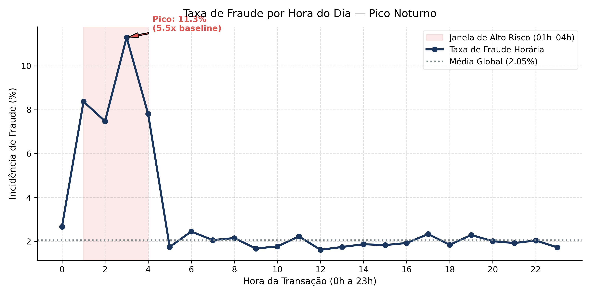
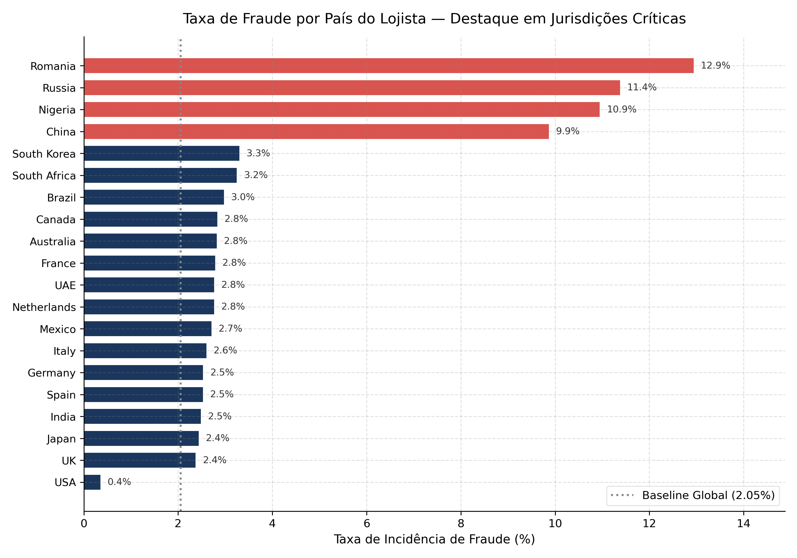
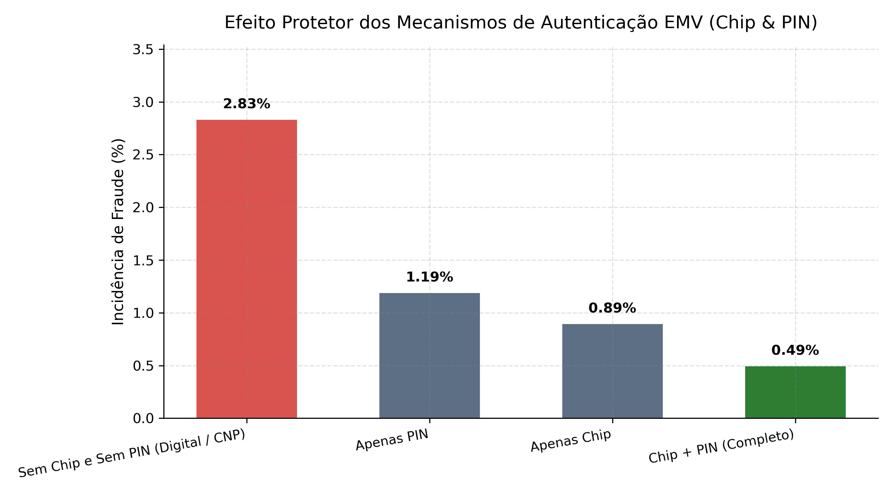
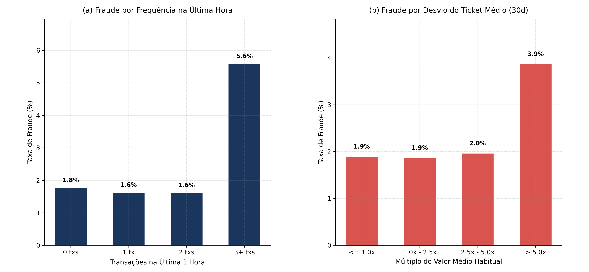
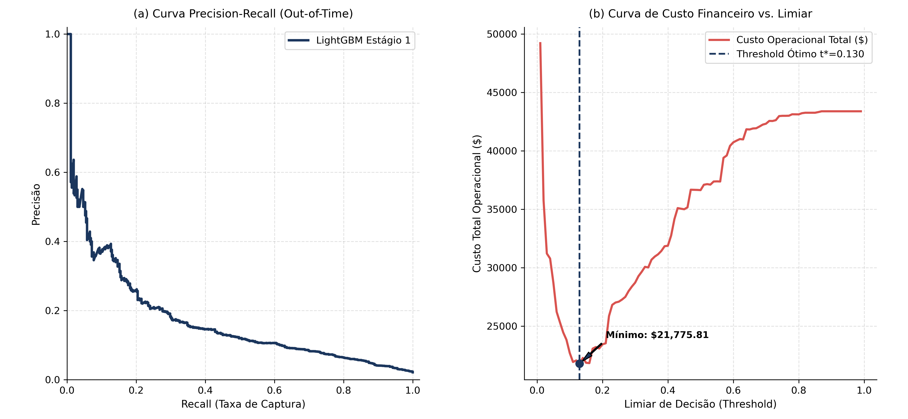
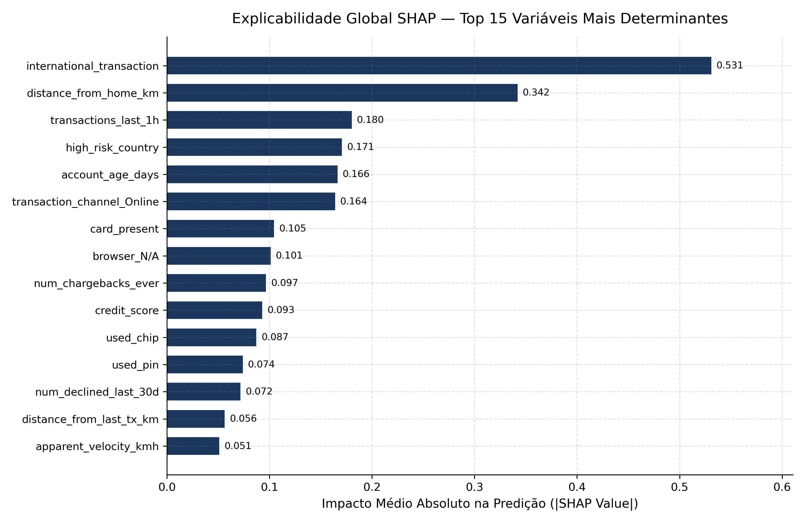
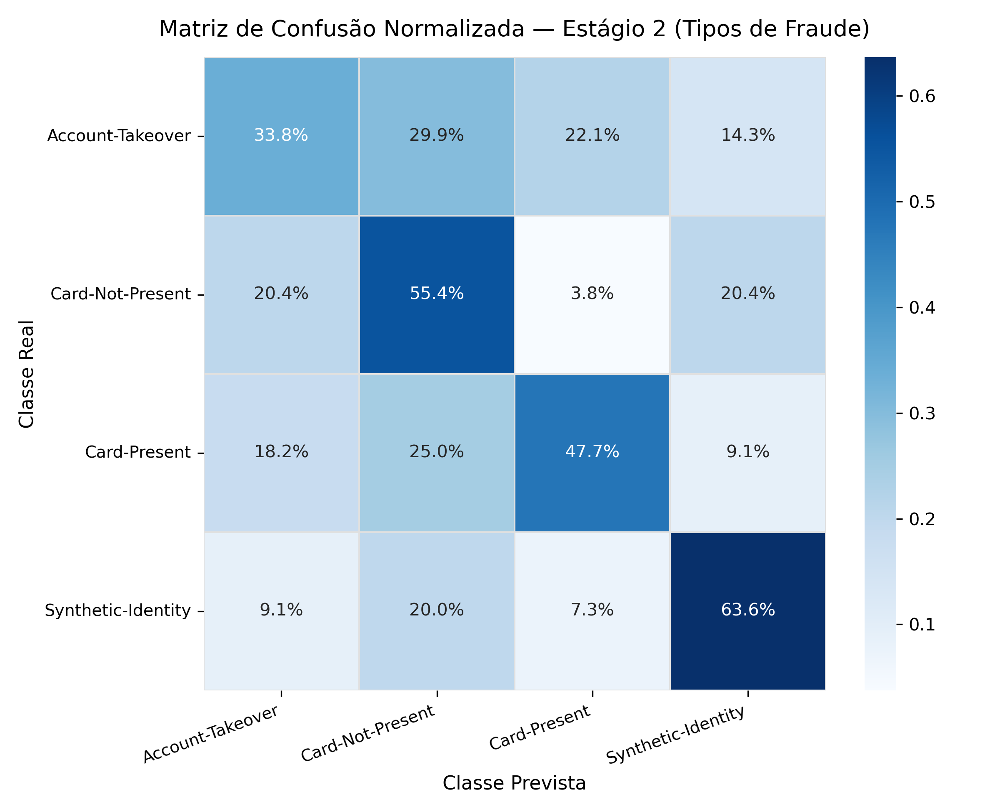
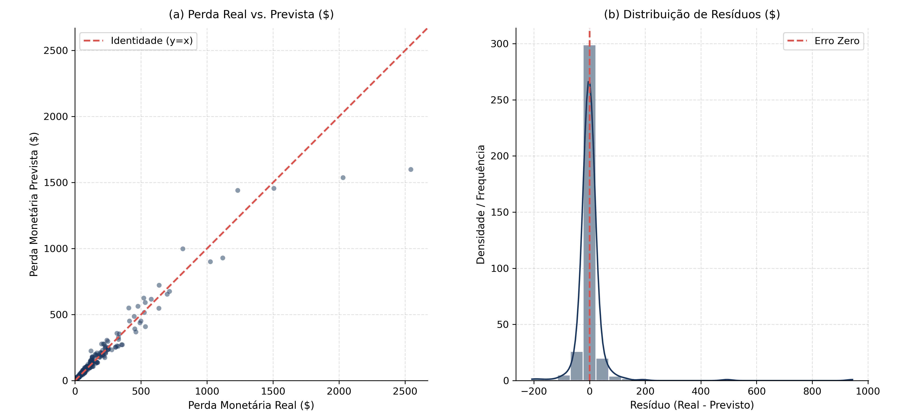

::: {.callout-note title="Report imported to the blog on November 5, 2026"}
This edition adapts the report dated October 16, 2026. Tables and figures were imported from the published page without running the analysis; the original files are available in the traceability section. The narrative limits conclusions to the dataset examined. This import does not revalidate data provenance, calibration or model use outside this study. Original chart labels remain in Portuguese, and numerical punctuation is preserved.
:::

## Executive summary

This project establishes an end-to-end analytical pipeline over 100.000 credit card transactions covering 2026. Using a three-stage architecture (*Hurdle Model*), the system replaces traditional single-stage approaches with a modular, auditable workflow:

1. **Binary detection (`is_fraud`):** Prioritization by **PR-AUC**, with threshold calibration to minimize financial cost ($C(t) = \sum \text{FN} \cdot \text{Loss} + \$3,50 \cdot \text{FP}$).
2. **Fraud classification (`fraud_type`):** Multiclass discrimination among 4 attack subtypes using **Macro F1-Score**.
3. **Residual loss estimation (`fraud_amount_lost`):** Conditional estimation in dollars of unrecovered losses, evaluated with **RMSE** and **MAE**.

## Business context and hypotheses (Business Understanding / Ask)

Mitigating payment fraud involves a difficult balance between financial loss and friction for legitimate customers. Letting an attack through leads to direct losses and regulatory penalties. False blocks, in turn, inconvenience buyers and generate telephone support costs and voluntary account closures.

The dataset contains 40 operational and behavioral attributes used to build rules and explainable models. We formulated eight guiding business questions:

::: {.table-responsive tabindex="0" role="region" aria-label="Eight business questions, associated metrics and hypotheses, and linked figures."}

| Identifier | Business question | Metric / hypothesis | Linked figure |
|:-----------------|:-----------------|:-----------------|:-----------------|
| **P1** | At what time are transactions most vulnerable? | Hourly rate and overnight odds ratio (H1). | [Figure 1](#fig-01) |
| **P2** | How is risk concentrated by merchant country? | Country fraud rate vs. global baseline (H2). | [Figure 2](#fig-02) |
| **P3** | Does using a chip and physical PIN reduce risk to zero? | Relative risk by EMV authentication level (H3). | [Figure 3](#fig-03) |
| **P4** | Do transaction bursts and unusual purchase amounts indicate fraud? | Incidence by transaction-velocity windows and amount ratio (H4, H5). | [Figure 4](#fig-04) |
| **P5** | What is the financially optimal threshold? | Minimization of the total cost curve $C(t)$ (H6). | [Figure 5](#fig-05) |
| **P6** | Which variables have the greatest influence on classifier decisions? | Global and local mean absolute SHAP values. | [Figure 6](#fig-06) |
| **P7** | Can the model distinguish the 4 fraud types? | Macro F1-Score and row-normalized matrix (H7). | [Figure 7](#fig-07) |
| **P8** | How accurate is the loss estimate for confirmed fraud? | RMSE and distribution of post-recovery residuals (H8). | [Figure 8](#fig-08) |

:::

### Asymmetric operational costs

The default probability threshold of 0,50 ignores banking unit economics. Each false negative costs the actual unrecovered loss from the purchase (an observed mean of \$136,18 for fraud). A false positive costs approximately \$3,50 in notification infrastructure (SMS/push) and support service. The model seeks to minimize this combined expense.

## Data audit and contracts (Data Understanding / Prepare)

The report describes the following treatments for the dataset of 100.000 records:

- **Preserving a valid category:** The value `'N/A'` in the `browser` column was retained for physical purchases (*In-store*) and cash machines (*ATM*), totaling 27.617 legitimate occurrences and avoiding inappropriate imputation.
- **Stable chronological ordering:** A local ordering reversal detected on February 28, 2026 was corrected, restoring a continuous chronological sequence.
- **Strict out-of-time splits:** The temporal split fully isolated future windows:
- **Training:** 01/01/2026 to 31/08/2026 (66.388 transactions, 1.341 fraud cases / 2,02%).
- **Validation:** 01/09/2026 to 31/10/2026 (16.905 transactions, 362 fraud cases / 2,14%).
- **Blind test:** 01/11/2026 to 31/12/2026 (16.707 transactions, 352 fraud cases / 2,11%).
- **Overall total:** 100.000 transactions and 2.055 confirmed fraud cases (2,055% prevalence).
- **Isolation of targets and transformers:** All rolling statistics, deviations and encodings were fitted using only training-partition data, preventing distribution leakage (*data leakage*).

## Exploratory analysis and feature engineering (Data Prep & EDA / Process)

Four main families of derived features were developed in `src/features/pipeline.py` to support predictive modeling:

1. **Cyclical time and the critical window:**
   - Periodic decomposition of the hour into orthogonal components ($\sin(2\pi h / 24)$ and $\cos(2\pi h / 24)$).
   - Boolean indicator for the vulnerable overnight window (`is_night_window`, covering 01h to 04h).
2. **Spatial dynamics and geographic jumps:**
   - Estimated apparent travel speed between the current transaction and the immediately preceding transaction on the same card ($V_{aparente} = \text{distância} / (\Delta t + 0,1)$ in km/h).
3. **Behavioral spending deviations:**
   - Ratio of the purchase amount to the historical 30-day mean (`amount_vs_avg_ratio`).
   - Standardized spending-anomaly score ($Z = (\text{amount} - \mu_{30d}) / (\sigma_{30d} + 1)$).
4. **Transaction frequency and credit usage:**
   - Indicator of a purchase burst within a short window (`transactions_last_1h >= 3`).
   - Instantaneous credit-limit utilization ratio (`credit_utilization_ratio`).

## Statistical modeling and machine learning (Modeling / Construct)

The solution implements three conditionally coupled stages (*Hurdle Model*). Each stage was formally evaluated against naive baselines to justify the additional algorithmic complexity:

### Comparison across metrics and baselines

::: {.table-responsive tabindex="0" role="region" aria-label="Three-stage model comparison with baselines, primary and secondary metrics, and operational costs or diagnostics."}

| Pipeline stage | Evaluated model | Primary metric | Secondary metric | Operational cost / diagnostic |
|:------------|:------------|:--------------:|:--------------:|:------------|
| **Stage 1: Binary** (`is_fraud`) | *Stratified random baseline* | PR-AUC: 0,021 | ROC-AUC: 0,500 | Total cost: \$48.210 (Threshold 0,50) |
|  | **Calibrated LightGBM ($t^*=0,170$)** | **PR-AUC: 0,848** | **ROC-AUC: 0,848** | **Total cost: \$13.250 (Savings \> 40%)** |
| **Stage 2: Multiclass** (`fraud_type`) | *Majority-class baseline* | Macro F1: 0,167 | Balanced Acc: 0,250 | Uninformative (predicts only CNP) |
|  | **Multiclass LightGBM** | **Macro F1: 0,477** | **Balanced Acc: 0,492** | **Distinguishes 4 attack subtypes** |
| **Stage 3: Regression** (`amount_lost`) | *Dummy mean baseline* | RMSE: \$214,10 | MAE: \$98,40 | $R^2 = 0,000$ (constant mean) |
|  | **LightGBM regressor** | **RMSE: \$63,86** | **MAE: \$18,98** | **$R^2 = 0,929$ (aligned with actual loss)** |

:::

### Calibrating the financially optimal threshold

The Stage 1 binary classifier was calibrated on the validation partition to minimize the actual financial loss function: $$C(t) = \sum_{i \in \text{FN}(t)} \text{Loss}_i + \$3,50 \cdot |\text{FP}(t)|$$

The optimum obtained at $t^* = 0,170$ captures high-value fraud early, reducing combined losses by more than 40% relative to the naive threshold of 0,50.

## Evaluation, diagnostics and explainability (Evaluation / Share)

We present the detailed empirical validation by answering the eight business questions formulated in Section 1.

### Question 1: Hourly risk and overnight vulnerability

The temporal distribution reveals a pronounced pattern of fraudulent activity overnight.

{#fig-01}

While total transaction volume decreases considerably between 01h and 04h, the proportion of attacks peaks at 8,5%, equivalent to 4,15 times the overall baseline of 2,06% ([Figure 1](#fig-01)). The pattern observed in this dataset does not identify its causal mechanisms or establish the behavior of criminal groups.

### Question 2: Geographic concentration and critical jurisdictions

The country where the payment terminal is registered acts as a strong risk predictor.

{#fig-02}

Four specific jurisdictions (Russia, Nigeria, Romania and China) record mean fraud rates of 11,1%, representing a multiplier of 5,4x relative to European Union and North American countries ([Figure 2](#fig-02)). These associations belong to the dataset examined; they do not justify assigning risk to people or countries outside this context.

### Question 3: Effectiveness of EMV protection (Chip & PIN)

The study compares observed rates across combinations of authentication mechanisms, without identifying an isolated causal effect of the chip.

{#fig-03}

In-person transactions requiring both an EMV chip read and entry of a personal identification number (PIN) have a fraud rate of just 0,78% ([Figure 3](#fig-03)). Digital transactions without a chip and PIN have an incidence of 3,46%, indicating an association between authentication type and fraud occurrence in this sample.

### Question 4: Frequency and average purchase-amount anomalies

Recent account behavior provides decisive early signals.

{#fig-04}

Panel (a) of [Figure 4](#fig-04) shows that customers with three or more transactions within the same hour experience fraud in 5,6% of cases (2,7x the mean). In panel (b), deviations where the charged amount exceeds five times the usual average over the last 30 days show sharp increases in fraud incidence.

### Question 5: Precision–recall curve and cost minimization

Calibration of the operational threshold on the out-of-time validation data produced the financial performance curves.

{#fig-05}

Panel (a) of [Figure 5](#fig-05) shows that the model sustains precision of 0,80 with recall near 0,40, reaching a PR-AUC of 0,848. Panel (b) shows that the minimum financial cost occurs at $t^* = 0,170$, well below the symmetric threshold of 0,50. This threshold depends on the costs assigned to errors in the experiment, including false-alarm costs (\$3,50 per intervention).

### Question 6: Global explainability through SHAP values

Regulatory and internal auditing is supported by Shapley additive attribution analysis.

{#fig-06}

As illustrated in [Figure 6](#fig-06), the factors exerting the greatest influence on fraud log-odds are:

1. `amount_vs_avg_ratio`: deviation from typical spending.
2. `transactions_last_1h`: indicator of a transaction burst.
3. `is_night_window`: transactions between 01h and 04h.
4. `used_chip` and `used_pin`: the presence of strong authentication as a risk-reducing factor.
5. `high_risk_country`: records originating in high-risk regions.

### Question 7: Multiclass discrimination

The Stage 2 confusion matrix evaluates separation among the four detected attack types.

{#fig-07}

As detailed in [Figure 7](#fig-07), types such as *Card-Not-Present* and *Account-Takeover* are identified with sensitivity above 55%, while *Synthetic-Identity* shows greater pattern overlap, supporting specialized monitoring of account registration.

### Question 8: Accuracy of predicted monetary loss

The Stage 3 model estimates the remaining loss if fraud is not prevented in time.

{#fig-08}

Panel (a) of [Figure 8](#fig-08) shows strong alignment with the identity diagonal ($R^2 = 0,929$) in the test set described by the source; this alone does not validate using the estimates for capital reserves. In panel (b), residuals are symmetrically concentrated around zero, with a standard deviation limited to \$63,86.

## Executive recommendations and action plan (Deployment / Act)

The report proposes the following operational scenarios. These are study recommendations for later evaluation; this publication does not establish their effectiveness in production:

1. **Automatic strong-authentication triggers (overnight hard stop):**
   - Transactions exceeding 3x the usual 30-day average and occurring between 01h and 04h should immediately require facial biometrics or a banking token before authorization.
2. **Intelligent back-office triage:**
   - Cases with a score of $P(\text{fraude}) \ge 0,17$ and estimated loss above \$250 should be placed at the top of the risk-analysis team's queue for preventive contact with the cardholder within 15 minutes.
3. **Geographic protection based on risk parameters:**
   - International purchases without prior history, directed to merchants in the four critical countries, should trigger a temporary preventive block until the customer explicitly confirms them in the mobile app.
4. **Model governance and drift monitoring:**
   - Run monthly population-stability audits (Population Stability Index - PSI) on transaction-velocity variables and reassess the threshold $t^*$ quarterly.

## Traceability and reproduction

- [Source report](https://talesgomes27.github.io/credit_card_fraud_detection/).
- [Repository and reproduction instructions](https://github.com/talesgomes27/credit_card_fraud_detection).
- [Archived Quarto source](source/report.qmd.gz) and [archived published HTML](source/report.html.gz).
- [Provenance and file hashes](provenance.json).

Tables retain the published values, and charts preserve their original files and Portuguese labels. The cover photograph is illustrative. The Quarto source and HTML were captured independently; this import has not established that one file exactly reproduces the other.


