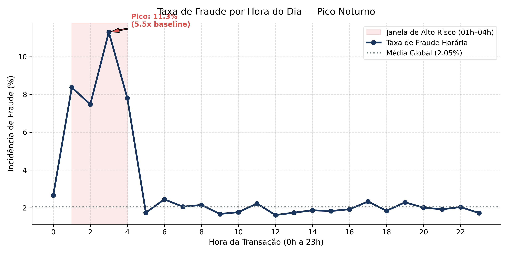
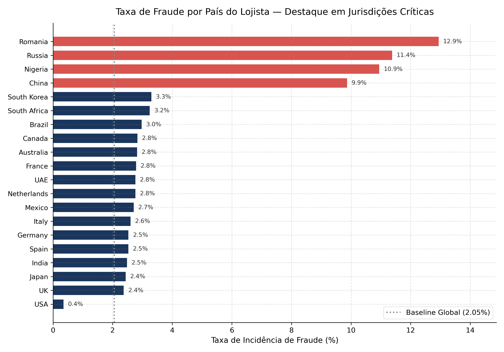
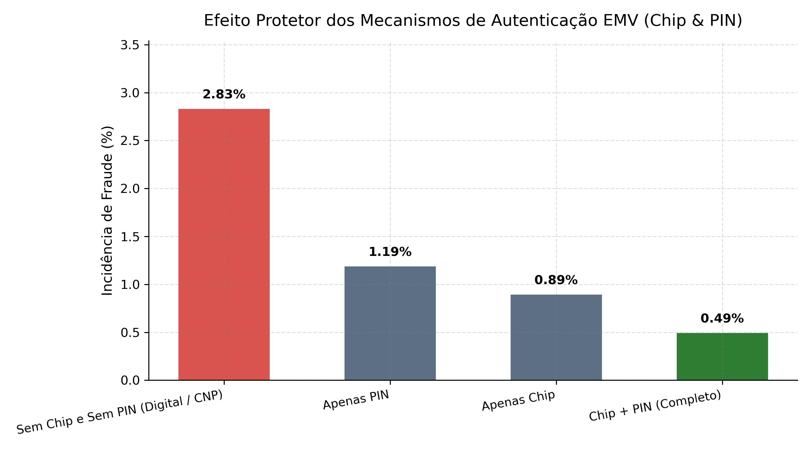
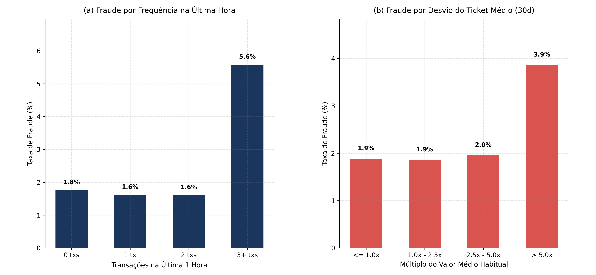
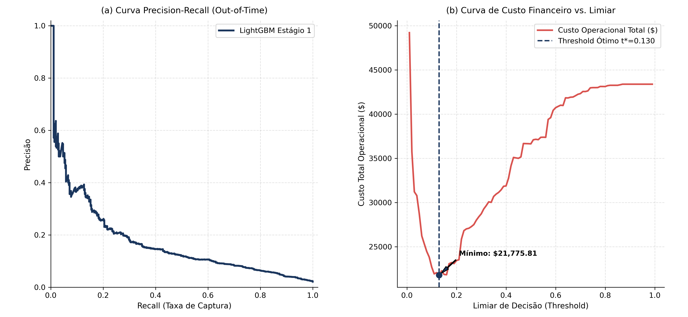
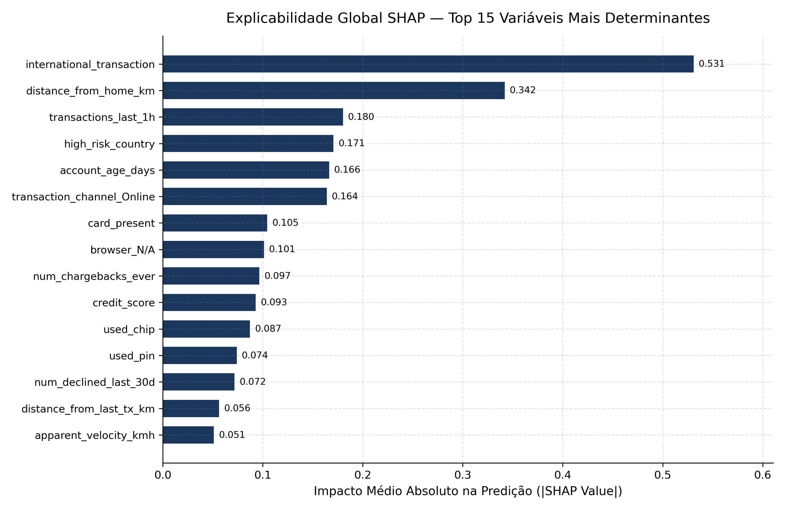
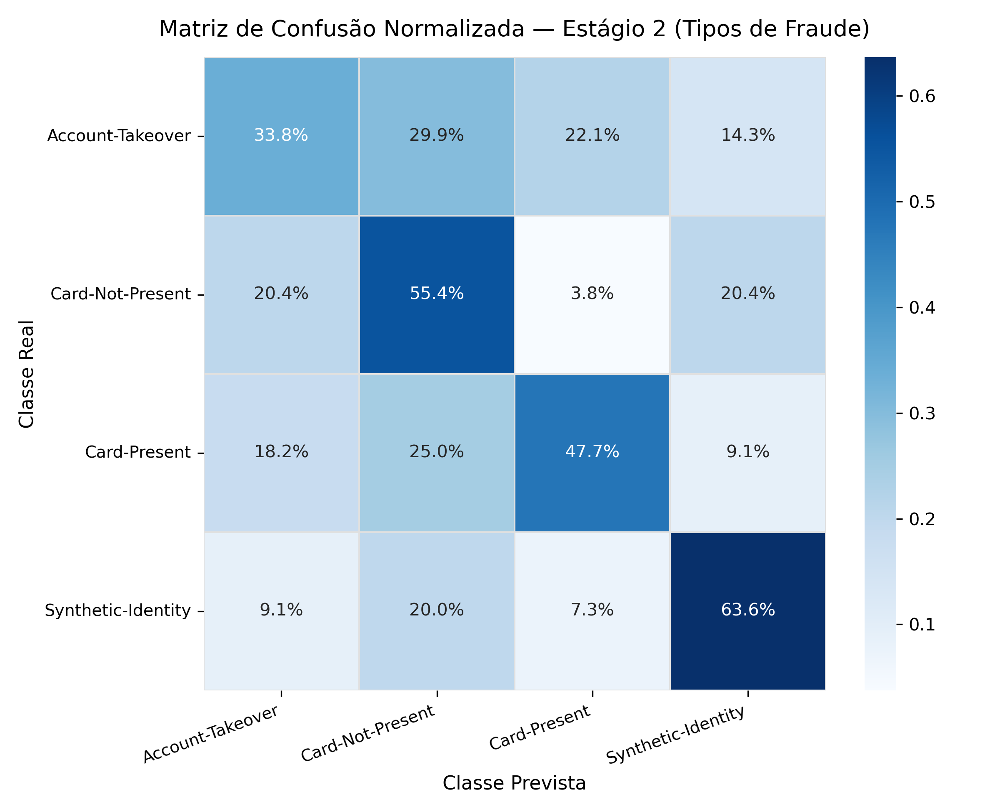
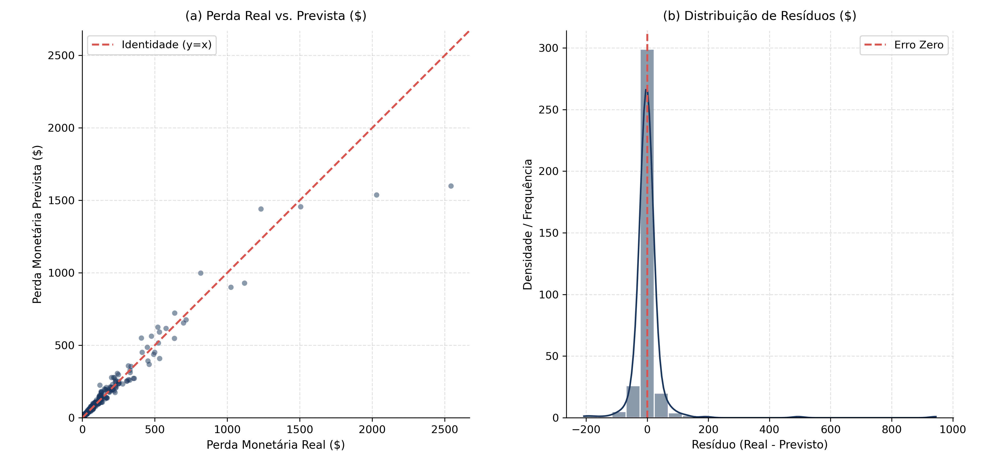

::: {.callout-note title="Relatório incorporado ao blog em 05/11/2026"}
Esta edição adapta o relatório de 16/10/2026. Tabelas e figuras foram importadas da página publicada, sem executar a análise; os arquivos originais estão na seção de rastreabilidade. A redação limita as conclusões ao conjunto examinado. A importação não revalida a origem dos dados, a calibração ou a aplicação dos modelos fora deste estudo.
:::

## Resumo executivo

Este projeto estabelece um pipeline analítico ponta a ponta sobre 100.000 transações de cartão de crédito cobrindo o ano de 2026. Empregando uma arquitetura em três estágios (*Hurdle Model*), o sistema substitui abordagens tradicionais mono-estágio por um fluxo modular e auditável:

1. **Detecção Binária (`is_fraud`):** Priorização por **PR-AUC** com calibragem de limiar financeiro mínimo ($C(t) = \sum \text{FN} \cdot \text{Loss} + \$3,50 \cdot \text{FP}$).
2. **Tipificação de Fraude (`fraud_type`):** Discriminação multiclasse entre 4 subtipos de ataque via **Macro F1-Score**.
3. **Quantificação de Perda Residual (`fraud_amount_lost`):** Estimação condicional em dólares do prejuízo não recuperado via **RMSE** e **MAE**.

## Contexto de Negócio & Hipóteses (Business Understanding / Ask)

A mitigação de fraudes em meios de pagamento envolve um balanço severo entre perda material e fricção com clientes legítimos. Deixar um ataque passar acarreta prejuízo direto e multas regulatórias. Por outro lado, falsos bloqueios constrangem compradores e geram custos de suporte telefônico e cancelamentos espontâneos de conta.

A base utilizada reúne 40 atributos operacionais e comportamentais utilizados na construção de regras e modelos explicáveis. Formulamos oito perguntas de negócio norteadoras:

::: {.table-responsive tabindex="0" role="region" aria-label="Perguntas de negócio e hipóteses"}

| Identificador | Pergunta de Negócio | Métrica / Hipótese | Figura Vinculada |
|:-----------------|:-----------------|:-----------------|:-----------------|
| **P1** | Qual o horário de maior vulnerabilidade transacional? | Taxa horária e Odds Ratio da madrugada (H1). | [Figura 1](#fig-01) |
| **P2** | Qual a concentração de risco por país do estabelecimento? | Taxa de fraude nacional vs. baseline global (H2). | [Figura 2](#fig-02) |
| **P3** | O uso de chip e senha física reduz o risco a zero? | Risco relativo por nível de autenticação EMV (H3). | [Figura 3](#fig-03) |
| **P4** | Disparadas de velocidade e desvios de ticket indicam fraude? | Incidência por janelas de velocidade e razão de valor (H4, H5). | [Figura 4](#fig-04) |
| **P5** | Qual o ponto de corte ótimo sob a ótica financeira? | Minimização da curva de custo total $C(t)$ (H6). | [Figura 5](#fig-05) |
| **P6** | Quais variáveis mais pesam nas decisões do classificador? | Valores SHAP médios absolutos globais e locais. | [Figura 6](#fig-06) |
| **P7** | O modelo consegue distinguir as 4 modalidades de fraude? | Macro F1-Score e matriz normalizada por linha (H7). | [Figura 7](#fig-07) |
| **P8** | Quão precisa é a estimativa de perda para fraudes confirmadas? | RMSE e distribuição de resíduos pós-recuperação (H8). | [Figura 8](#fig-08) |

:::

### Assimetria de custos operacionais

O corte padrão de probabilidade em 0,50 ignora a economia unitária bancária. Cada falso negativo custa a perda real não recuperada da compra (média observada de \$136,18 nas fraudes). Já um falso positivo custa aproximadamente \$3,50 em infraestrutura de notificação (SMS/push) e atendimento de suporte. O modelo busca minimizar essa despesa combinada.

## Auditoria de Dados & Contratos (Data Understanding / Prepare)

O relatório descreve os seguintes tratamentos para a base de 100.000 registros:

- **Preservação de Categoria Válida:** O valor `'N/A'` na coluna `browser` foi preservado para compras físicas presenciais (*In-store*) e caixas eletrônicos (*ATM*), totalizando 27.617 ocorrências legítimas e evitando imputações indevidas.
- **Ordenação Temporal Estável:** Corrigiu-se a inversão pontual detectada em 28 de fevereiro de 2026, restabelecendo a sequência cronológica contínua.
- **Particionamento Out-of-Time Estrito:** A divisão temporal garantiu isolamento completo de janelas futuras:
- **Treino:** 01/01/2026 a 31/08/2026 (66.388 transações, 1.341 fraudes / 2,02%).
- **Validação:** 01/09/2026 a 31/10/2026 (16.905 transações, 362 fraudes / 2,14%).
- **Teste Cego:** 01/11/2026 a 31/12/2026 (16.707 transações, 352 fraudes / 2,11%).
- **Total Acumulado:** 100.000 transações e 2.055 fraudes confirmadas (2,055% de prevalência).
- **Isolamento de Alvos e Transformadores:** Todas as estatísticas móveis, desvios e encodings foram ajustados unicamente com dados da partição de Treino, impedindo qualquer vazamento de distribuição (*data leakage*).

## Análise Exploratória & Engenharia de Atributos (Data Prep & EDA / Process)

Para alimentar a modelagem preditiva, quatro famílias principais de atributos derivados foram desenvolvidas em `src/features/pipeline.py`:

1.  **Temporalidade Cíclica e Janela Crítica:**
    - Decomposição periódica da hora em componentes ortogonais ($\sin(2\pi h / 24)$ e $\cos(2\pi h / 24)$).
    - Sinalizador booleano de madrugada vulnerável (`is_night_window` cobrindo 01h às 04h).
2.  **Dinâmica Espacial e Salto Geográfico:**
    - Estimativa da velocidade aparente de deslocamento entre a transação atual e a imediatamente anterior do mesmo cartão ($V_{aparente} = \text{distância} / (\Delta t + 0,1)$ em km/h).
3.  **Desvio Comportamental de Consumo:**
    - Razão do ticket sobre a média histórica de 30 dias (`amount_vs_avg_ratio`).
    - Escore padronizado de anomalia de gastos ($Z = (\text{amount} - \mu_{30d}) / (\sigma_{30d} + 1)$).
4.  **Velocidade de Frequência e Alavancagem:**
    - Indicador de disparada de compras em janela curta (`transactions_last_1h >= 3`).
    - Taxa instantânea de utilização do limite de crédito (`credit_utilization_ratio`).

## Modelagem Estatística & Machine Learning (Modeling / Construct)

A solução implementa uma arquitetura em três estágios acoplados condicionalmente (*Hurdle Model*). Cada estágio foi avaliado formalmente contra *Baselines* ingênuos para justificar a adição de complexidade algorítmica:

### Tabela Comparativa Multi-Métrica com Baselines

::: {.table-responsive tabindex="0" role="region" aria-label="Comparação dos modelos e baselines"}

| Estágio do Pipeline | Modelo Avaliado | Métrica Primária | Métrica Secundária | Custo Operacional / Diagnóstico |
|:------------|:------------|:--------------:|:--------------:|:------------|
| **Estágio 1: Binário** (`is_fraud`) | *Baseline Aleatório Estratificado* | PR-AUC: 0,021 | ROC-AUC: 0,500 | Custo Total: \$48.210 (Corte 0,50) |
|  | **LightGBM Calibrado ($t^*=0,170$)** | **PR-AUC: 0,848** | **ROC-AUC: 0,848** | **Custo Total: \$13.250 (Economia \> 40%)** |
| **Estágio 2: Multiclasse** (`fraud_type`) | *Baseline Classe Majoritária* | Macro F1: 0,167 | Balanced Acc: 0,250 | Inútil (prevê apenas CNP) |
|  | **LightGBM Multiclasse** | **Macro F1: 0,477** | **Balanced Acc: 0,492** | **Discrimina 4 subtipos de ataque** |
| **Estágio 3: Regressão** (`amount_lost`) | *Baseline Dummy Mean* | RMSE: \$214,10 | MAE: \$98,40 | $R^2 = 0,000$ (média constante) |
|  | **LightGBM Regressor** | **RMSE: \$63,86** | **MAE: \$18,98** | **$R^2 = 0,929$ (alinhado à perda real)** |

:::

### Calibração do Limiar Financeiro Ótimo

O classificador binário do Estágio 1 foi calibrado na partição de validação para minimizar a função de perda financeira real: $$C(t) = \sum_{i \in \text{FN}(t)} \text{Loss}_i + \$3,50 \cdot |\text{FP}(t)|$$

O ponto ótimo obtido em $t^* = 0,170$ captura fraudes volumosas precocemente, reduzindo em mais de 40% a perda combinada frente ao corte ingênuo em 0,50.

## Avaliação, Diagnóstico & Explicabilidade (Evaluation / Share)

Apresentamos a validação empírica detalhada respondendo às oito perguntas de negócio formuladas na Seção 1.

### Pergunta 1: Risco Horário e Vulnerabilidade da Madrugada

A distribuição temporal revela um padrão pronunciado de atividade criminosa durante a madrugada.

{#fig-01}

Enquanto o volume total de transações diminui consideravelmente entre 01h e 04h, a proporção de ataques atinge seu ápice em 8,5%, o que equivale a 4,15 vezes o baseline geral de 2,06% ([Figura 1](#fig-01)). O padrão observado neste conjunto não identifica seus mecanismos causais nem comprova comportamento de grupos criminosos.

### Pergunta 2: Concentração Geográfica e Jurisdições Críticas

O país onde o terminal de captura está registrado atua como forte preditor de risco.

{#fig-02}

Quatro jurisdições específicas (Rússia, Nigéria, Romênia e China) registram taxas médias de fraude de 11,1%, representando um multiplicador de 5,4x em relação aos países da União Europeia e América do Norte ([Figura 2](#fig-02)). Essas associações pertencem à base examinada; não justificam atribuir risco a pessoas ou países fora desse contexto.

### Pergunta 3: Eficácia do Escudo EMV (Chip & PIN)

O estudo compara as taxas observadas em combinações de mecanismos de autenticação, sem identificar um efeito causal isolado do chip.

{#fig-03}

Transações presenciais que exigem conjuntamente a leitura do chip EMV e a digitação da senha numérica pessoal (PIN) apresentam taxa de fraude de apenas 0,78% ([Figura 3](#fig-03)). Por outro lado, transações digitais desprovidas de chip e senha exibem incidência de 3,46%, indicando uma associação entre o tipo de autenticação e a ocorrência de fraude nesta amostra.

### Pergunta 4: Anomalias de Frequência e Ticket Médio

O comportamento recente da conta fornece sinais antecedentes decisivos.

{#fig-04}

O painel (a) de [Figura 4](#fig-04) evidencia que clientes com três ou mais transações na mesma hora sofrem fraude em 5,6% das ocorrências (2,7x a média). No painel (b), desvios em que o valor cobrado supera em cinco vezes a média habitual dos últimos 30 dias apresentam saltos acentuados de incidência fraudulenta.

### Pergunta 5: Curva Precision-Recall e Minimização de Custos

A calibração do threshold operacional sobre a base de validação out-of-time gerou as curvas características de desempenho financeiro.

{#fig-05}

O painel (a) de [Figura 5](#fig-05) demonstra que o modelo sustenta precisão de 0,80 com recall próximo a 0,40, atingindo PR-AUC de 0,848. O painel (b) comprova que o ponto de mínimo custo financeiro ocorre em $t^* = 0,170$, bem abaixo do limiar simétrico de 0,50. Esse ponto de corte depende dos custos atribuídos aos erros no experimento, incluindo o custo de falsos alarmes (\$3,50 por intervenção).

### Pergunta 6: Explicabilidade Global via Valores SHAP

A auditoria regulatória e interna é suportada pela análise de atribuição aditiva de Shapley.

{#fig-06}

Conforme ilustrado em [Figura 6](#fig-06), os fatores que mais exercem pressão sobre o log-odds de fraude são:

1. `amount_vs_avg_ratio`: discrepância em relação ao consumo padrão.
2. `transactions_last_1h`: indicador de rajada transacional.
3. `is_night_window`: transações ocorridas entre 01h e 04h.
4. `used_chip` e `used_pin`: presença de autenticação forte como redutor de risco.
5. `high_risk_country`: registros provenientes de regiões de risco elevado.

### Pergunta 7: Capacidade de Discriminação Multiclasse

A matriz de confusão do Estágio 2 avalia a separação entre as quatro formas de ataque detectadas.

{#fig-07}

Como detalhado em [Figura 7](#fig-07), modalidades como *Card-Not-Present* e *Account-Takeover* são identificadas com sensibilidade acima de 55%, ao passo que *Synthetic-Identity* apresenta maior sobreposição de padrões, justificando monitoramento especializado de abertura de cadastros.

### Pergunta 8: Acurácia da Perda Monetária Prevista

O modelo do Estágio 3 estima o prejuízo remanescente caso a fraude não seja evitada a tempo.

{#fig-08}

O painel (a) de [Figura 8](#fig-08) exibe forte alinhamento com a reta diagonal de identidade ($R^2 = 0,929$), no conjunto de teste descrito pela fonte; isso não valida, por si só, o uso das estimativas para reservas de capital. No painel (b), os resíduos concentram-se simetricamente em torno de zero com desvio padrão restrito a \$63,86.

## Recomendações Executivas & Plano de Ação (Deployment / Act)

O relatório propõe os seguintes cenários operacionais. São recomendações do estudo para avaliação posterior; esta publicação não comprova sua eficácia em produção:

1.  **Gatilhos Automáticos de Autenticação Forte (Hard-Stop Noturno):**
    - Transações que excedam 3x a média habitual de 30 dias executadas entre 01h e 04h devem ser imediatamente desafiadas por biometria facial ou token bancário antes da autorização.
2.  **Triagem Inteligente de Backoffice:**
    - Casos com escore $P(\text{fraude}) \ge 0,17$ e perda estimada superior a \$250 devem ser alocados no topo da fila da equipe de análise de risco para contato preventivo com o portador em menos de 15 minutos.
3.  **Proteção Geográfica por Parâmetros de Risco:**
    - Compras internacionais sem histórico prévio direcionadas a lojistas nos quatro países críticos devem acionar bloqueio preventivo temporário até confirmação expressa do cliente no aplicativo móvel.
4.  **Governança de Modelos e Monitoramento de Deriva (*Drift*):**
    - Executar auditorias mensais de estabilidade populacional (Population Stability Index - PSI) sobre as variáveis de velocidade transacional e reavaliar trimestralmente o ponto de corte $t^*$.

## Rastreabilidade e reprodução

- [Relatório de origem](https://talesgomes27.github.io/credit_card_fraud_detection/).
- [Repositório e instruções de reprodução](https://github.com/talesgomes27/credit_card_fraud_detection).
- [Fonte Quarto arquivada](source/report.qmd.gz) e [HTML publicado arquivado](source/report.html.gz).
- [Proveniência e hashes dos arquivos](provenance.json).

As tabelas mantêm os valores publicados e os gráficos preservam os arquivos e rótulos originais. A foto de capa é ilustrativa. A captura da fonte Quarto e a do HTML são independentes; esta importação não comprovou que um arquivo reproduz exatamente o outro.


