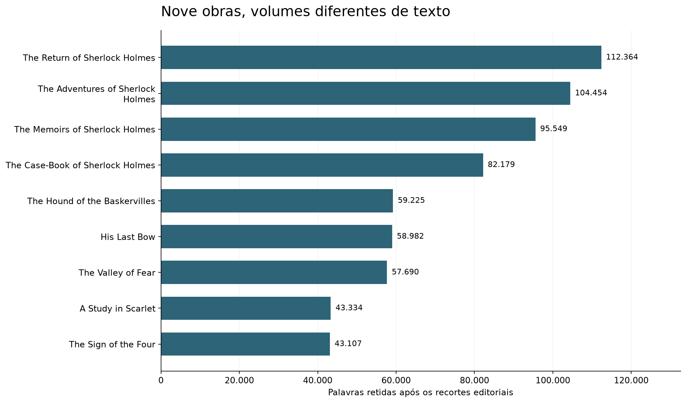
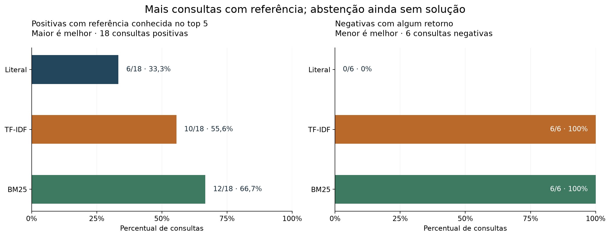
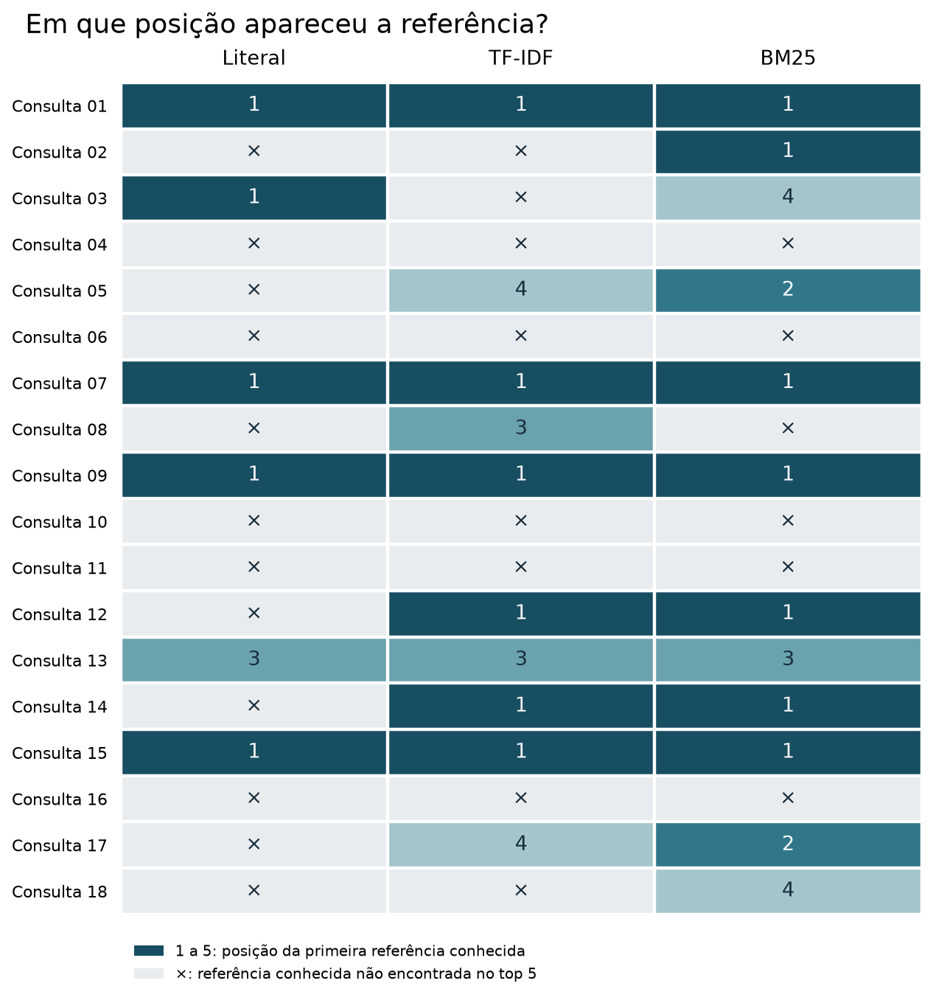

::: {.callout-note title="Report dated October 25, 2026, imported to the blog on November 5, 2026"}
This is a static import of the public report, without rerunning the analysis or performing new searches. Tables and figures preserve the published results. The narrative, captions and alternative text are translated; original figure labels remain in Portuguese, and numerical punctuation is preserved. The Quarto source and published HTML were archived separately, without verifying whether that HTML was generated from this exact source revision.
:::

The project locates passages and reports their source file and line numbers so readers can check them. In the v2 test, positive queries are those with known references; BM25 found these references for more queries than the other methods. Negative queries ask for plausible details that do not appear in the inspected context. TF-IDF and BM25 returned passages for all of them.

The project demonstrates how to locate references when reading a collection and how a passage related to a topic can still fail to provide the requested detail. This workflow could help small teams that need to return to source documents when looking up information. The portfolio covers text preparation, method comparison and evaluation; the literature experiment does not measure performance on client documents.

## From TXT files to verifiable references

The collection comes from the [Sherlock Holmes Series dataset on Kaggle](https://www.kaggle.com/datasets/talesgomes27/sherleck-books). The nine TXT files identify Arthur Conan Doyle and declare English in their headers. A list of identifiers calculated from the files, called hashes, makes it possible to check which files were used, as described in the [provenance documentation](https://github.com/talesgomes27/sherlock-document-search/blob/main/docs/provenance.md).

Preparation reads the files as UTF-8, handles the BOM marker (which can appear at the beginning of a file) and line endings in memory, and preserves the originals. Editorial cuts remove credits, prefaces, tables of contents and footers identified during review. Each paragraph retains the work, file and source line range, including both endpoints. Line counting starts at 1 in the original TXT file. Internal editorial notes and some headings may remain because the project has no general routine for separating every story or chapter.

::: {.table-responsive tabindex="0" role="region" aria-label="Counts from the preparation report; word counts follow the Unicode rule recorded in the source."}

| Measure                            | Count |
|-----------------------------------|------------|
| TXT files                      | 9          |
| Retained paragraphs                | 15.598     |
| Retained words                  | 656.884    |
| Words excluded by editorial cuts | 29.566     |

: Counts from the preparation report; word counts follow the Unicode rule recorded in the source. {#tbl-corpus}

:::

{#fig-corpus fig-alt="Horizontal bar chart of retained words in the nine works. The Return of Sherlock Holmes has the largest volume, with 112.364 words, and The Sign of the Four the smallest, with 43.107."}

[Figure 1](#fig-corpus) compares the text volume of each work. [Table 1](#tbl-corpus) summarizes the prepared material. The number of excluded words does not measure all editorial interference or search quality.

## Three methods over the same paragraphs

Each method can return up to five paragraphs, with their locations. Literal search looks for an exact sequence. TF-IDF turns terms into vectors and ranks paragraphs by cosine similarity, a measure of similarity between vectors. The implementation uses `TfidfVectorizer(stop_words="english")`, following the [scikit-learn documentation](https://scikit-learn.org/stable/modules/feature_extraction.html#tfidf-term-weighting). BM25 considers term frequency and paragraph length. The parameter `k1=1,2` controls how much repeating a term increases its weight; `b=0,75` controls length normalization. The [Lucene documentation](https://lucene.apache.org/core/10_3_1/core/org/apache/lucene/search/similarities/BM25Similarity.html) describes these parameters and the IDF formula used as a reference for the project's own implementation.

::: {.table-responsive tabindex="0" role="region" aria-label="Comparison of the three search methods and their limits."}

| Method | Ranking signal | Relevant limit |
|------------------------|------------------------|------------------------|
| Literal | Occurrences of the exact sequence | A paraphrase may not match. |
| TF-IDF | Cosine similarity between term vectors | A shared term may produce an insufficient result. |
| BM25 | Term weights, frequency and length | A high score may reflect only a topical relationship. |

:::

TF-IDF and BM25 use `min_score=0,0`, but discard results with a zero score. Any match between terms with positive weight can enter the top five results. Scores have different scales and are not probabilities of an answer.

## A test set separated before execution

During v2 development, 36 queries were assembled: 27 positive and nine negative. A different curator created the 24 final queries. Positive references come from different regions of the text, and a review checked for overlapping intents. The author approved both groups in the chat before freezing them. This record does not establish an individual human audit of each query.

The final evaluation uses 18 positive queries, divided equally among exact questions, paraphrases and context questions, plus six negative queries. A positive query has known references, although that list may be incomplete. A negative query asks for a plausible detail that does not appear in the inspected context. This review does not prove that the detail is absent from the entire collection.

The [freeze at `14a0913`](https://github.com/talesgomes27/sherlock-document-search/commit/14a0913) took place before the final run. Parameters, labels and editorial cuts were not changed afterward. The [configuration decision](https://github.com/talesgomes27/sherlock-document-search/blob/main/evaluation/v2/configuration_decision.json) records that a BM25 threshold of 32 was rejected during development: it eliminated all 12 known positive hits. In the final evaluation, BM25 only ranked the results, without an additional rule for declining to answer when evidence is insufficient.

## More references retrieved, with unwanted results

[Table 2](#tbl-results) compares the methods on the same 24 queries. For positive queries, a hit means that at least one known reference appears among the top five results. This result may provide only partial evidence. For negative queries, any returned passage counts as a false positive.

::: {.table-responsive tabindex="0" role="region" aria-label="Final v2 test: denominators of 18 positive and six negative queries, evaluated separately."}

| Method | Positive queries with a reference in the top 5 | Negative queries with a result | MRR@5 on positive queries |
|------------------|------------------|------------------|------------------|
| Literal | 6/18 | 0/6 | 0,2963 |
| TF-IDF | 10/18 | 6/6 | 0,3981 |
| BM25 | 12/18 | 6/6 | 0,4907 |

: Final v2 test: denominators of 18 positive and six negative queries, evaluated separately. {#tbl-results}

:::

MRR@5 is the mean of a score calculated for the 18 positive queries: it is 1 if the first known reference appears in the first position, 1/2 if it appears in the second, 1/3 in the third, and so on through the fifth. A query receives zero if no known reference appears among the top five. The score reflects the available annotations, which may not include every reference.

{#fig-comparison fig-alt="Two horizontal bar charts. For positive queries, literal search finds a known reference in 6 of 18 queries, TF-IDF in 10 and BM25 in 12. For the six negative queries, returned results are zero, six and six, respectively."}

In [Figure 2](#fig-comparison), BM25 finds known references for two more positive queries than TF-IDF and has a higher MRR@5. Both methods returned passages for all six negative queries. Literal search found fewer references and returned no passages for those questions. Information expressed in different words may go undetected by literal search. The test is small and curated; its results do not establish general superiority.

### For which queries did a reference appear?

[Figure 3](#fig-positions) allows readers to follow each question rather than looking only at totals. A number shows the position of the first known reference; the × mark means that it did not appear among the top five results. This does not rule out the relevance of other passages or confirm that all requested evidence was retrieved.

{#fig-positions fig-alt="Matrix with 18 queries and three methods. Five queries have no known reference retrieved by any method. For query 08, TF-IDF finds the reference in third position and BM25 does not find it among the top five. The totals of queries with a reference are six, ten and twelve."}

Five queries had no known reference in the top five for any of the three methods. Query 08 shows a loss for BM25 relative to TF-IDF; queries 02 and 18 have known references retrieved only by BM25. Full IDs and questions are available in the [published final queries](https://github.com/talesgomes27/sherlock-document-search/blob/main/evaluation/v2/final.json). The matrix describes this test, without using it to tune the search.

### Why a question without an answer receives a result

[Table 3](#tbl-negatives) shows the scores already calculated for the six negative queries. The descriptions summarize the [published final queries](https://github.com/talesgomes27/sherlock-document-search/blob/main/evaluation/v2/final.json). Values come from the report, not from a new search.

::: {.table-responsive tabindex="0" role="region" aria-label="Six negative queries: top-result scores and number of literal-search results. TF-IDF and BM25 scales are not comparable."}

| ID | Requested detail | TF-IDF top 1 | BM25 top 1 | Literal-search results |
|---------------|---------------|---------------|---------------|---------------|
| v2-final-19 | Ages of Jefferson Hope's horses | 0,5001 | 29,1164 | 0 |
| v2-final-20 | Price of the coffin delivered to Poultney Square | 0,3204 | 12,8802 | 0 |
| v2-final-21 | Railway fare from Reading to Eyford | 0,3152 | 14,7155 | 0 |
| v2-final-22 | Name of the ship expected for Selden | 0,3733 | 13,5115 | 0 |
| v2-final-23 | Exact weight of the empty Agra strongbox | 0,3430 | 16,9264 | 0 |
| v2-final-24 | Caliber of the ammunition that killed Menzies | 0,3241 | 17,2732 | 0 |

: Six negative queries: top-result scores and number of literal-search results. TF-IDF and BM25 scales are not comparable. {#tbl-negatives}

:::

The [top-result diagnosis](https://github.com/talesgomes27/sherlock-document-search/blob/main/docs/v2-no-answer-analysis.md) compares the passage's topic with the requested attribute. Mentions of horses and a place do not provide ages; a delivery and an address do not indicate a price. Passages about a journey, South America, treasure or an attack may likewise fail to provide the fare, ship name, weight or caliber. These relationships help explain why the methods returned the passages even though they do not answer the questions.

A future version would need to treat ranking and the decision to decline an answer separately. It could test whether passages cover the requested attributes, whether there is a sufficient margin between candidates, or use an evaluator of question–passage pairs. Before tuning the methods, a new independent test would have to be reserved because the v2 sets have already been examined and published.

## Reproducing and checking the evidence

The source report reads existing JSON files and checks their hashes before generating the tables. Rendering the source page does not fit models or run searches. The two summary figures come from approved artifacts; the query-level matrix was assembled from the same saved results. The code and results allow readers to check the steps connecting the data to the conclusions:

- [v2 notebook for reading and Kaggle](https://github.com/talesgomes27/sherlock-document-search/blob/main/notebooks/portfolio/sherlock_document_search_v2.ipynb) and [v1 notebook for reading and Kaggle](https://github.com/talesgomes27/sherlock-document-search/blob/main/notebooks/portfolio/sherlock_document_search_v1.ipynb), with code to run after attaching the dataset. These are presentation editions; the [original validated notebooks](https://github.com/talesgomes27/sherlock-document-search/tree/main/notebooks) remain preserved.
- [Final v2 results by query](https://github.com/talesgomes27/sherlock-document-search/blob/main/reports/v2/final.json), [corpus counts](https://github.com/talesgomes27/sherlock-document-search/blob/main/reports/m1_quality.json) and [v2 validation](https://github.com/talesgomes27/sherlock-document-search/blob/main/reports/v2/validation.json).
- [Reproduction protocol and commands](https://github.com/talesgomes27/sherlock-document-search/blob/main/docs/v2-final-evaluation.md), using a new output location to preserve the original snapshot.

The results and notebooks have recorded local validation; execution of the notebook hosted on Kaggle has not yet been verified. The delivered material is an evidence report, and the interactive application remains a future stage. The page publishes counts, metadata and paraphrases of the queries. The provenance documentation still lists verification of the terms of use and attribution for displaying passages from the works as pending.

### v1 history: another set, different denominators

The [v1 preserved at `8f17985`](https://github.com/talesgomes27/sherlock-document-search/commit/8f179855a8c1c445afb122bf70ef4dd8512f9e7f) evaluated 20 queries: 16 positive queries with known references and four negative queries containing anachronistic questions, which include elements from another period. [Table 4](#tbl-history) shows the original v1 results. Their percentages should not be combined or directly compared with the v2 evaluation, which used 24 queries.

::: {.table-responsive tabindex="0" role="region" aria-label="v1 history: 16 positive and four negative queries, according to the original report."}

| Method  | Positive queries with a reference in the top 5 | Negative queries with a result |
|---------|-----------------------------------|-----------------------|
| Literal | 7/16                              | 0/4                   |
| TF-IDF  | 8/16                              | 4/4                   |

: v1 history: 16 positive and four negative queries, according to the original report. {#tbl-history}

:::

[Original v1 report](https://github.com/talesgomes27/sherlock-document-search/blob/main/reports/m4_final.json).

## Import traceability

- [Original public report](https://talesgomes27.github.io/sherlock-document-search/).
- [Project repository](https://github.com/talesgomes27/sherlock-document-search).
- [Compressed original Quarto source](source/report.qmd.gz).
- [Compressed original published HTML](source/report.html.gz).
- [Provenance, dates and hashes of imported files](provenance.json).


