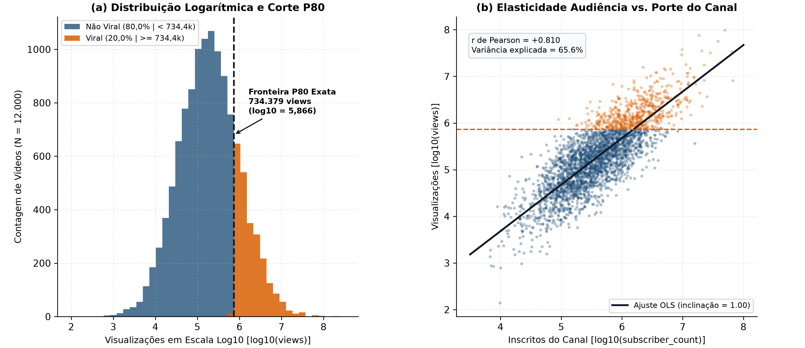
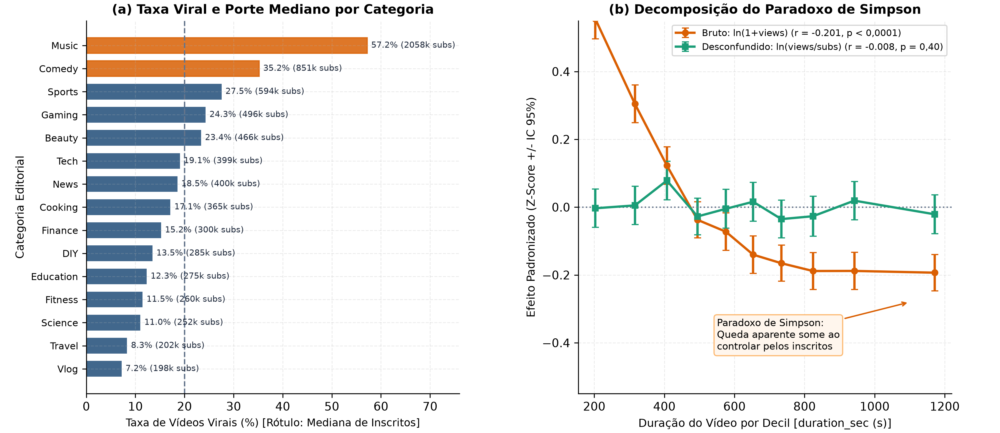
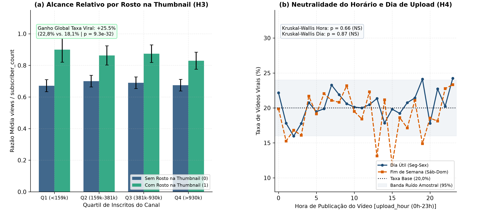
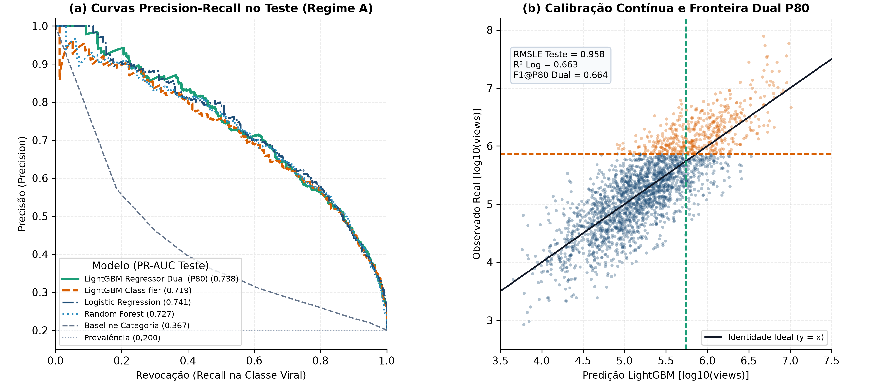
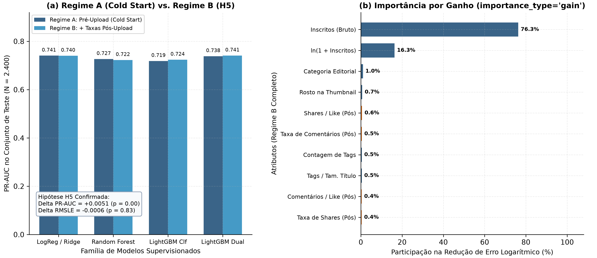

::: {.callout-note title="Import of the original report"}
Report dated October 15, 2026, imported into the blog on November 5, 2026 with static outputs and no analysis rerun. This educational study uses synthetic video data: its hypotheses and recommendations describe the experiment and do not establish effects on a real platform. Original figure labels, code comments and literal strings remain unchanged, including Portuguese text inside code; numerical formatting is also preserved. The source contains discrepancies between its narrative and some tables; the values remain unchanged for traceability.
:::

## Business context and hypotheses

Allocating editorial budgets and designing recommendation systems for video platforms require separating the inertia of a channel's accumulated audience from content factors under the creator's control. In the audited dataset of $12.000$ videos across $15$ editorial categories (`viral_videos.csv`), the binary virality indicator (`viral = 1`) is deterministically defined by the $80$th percentile ($P_{80}$) of view counts (`views`), with an exact boundary between $734.299$ and $734.379$ views ($2.400$ viral videos and a base rate of $20,00\%$).

### Executive summary of the experiment

1. **Structural dominance of the subscriber base ($H_1$ supported):** The logarithmic subscriber count ($\ln(1 + \text{subscriber\_count})$) has a correlation of $r = 0,8097$ ($p < 10^{-300}$) with $\ln(1 + \text{views})$ and alone explains $65,56\%$ of total variance ($R^2 = 0,6556$). In the pre-publication `LightGBM` model, channel size accounts for $93,59\%$ of total information gain in regression and $80,09\%$ in classification.
2. **Simpson's paradox in video duration ($H_2$ supported):** The negative marginal correlation between `duration_sec` and $\ln(1 + \text{views})$ ($r = -0,2015, p = 3,97 \times 10^{-110}$) arises from category confounding. Short-video categories (`Music`, with a median of $239\text{s}$ and $57,2\%$ virality; `Comedy`, with $297\text{s}$ and $35,2\%$) contain channels $5\text{x}$ to $10\text{x}$ larger than long-video categories (`Travel`, `Vlog`). After normalizing by channel size ($\ln(\text{views}/\text{subscriber\_count})$), the duration effect disappears ($r = -0,0077, p = 0,3966$).
3. **Actionable creator factors in the simulation ($H_3$ supported):** Including a human face in the thumbnail (`thumbnail_face = 1`) raises the virality rate from $18,15\%$ to $22,78\%$, a relative increase of $+25,52\%$ ($p = 9,34 \times 10^{-32}$), and increases the views-per-subscriber ratio by $+24,39\%$. Indexing density through `tags_count` retains a positive correlation after adjustment for confounding ($r = +0,0549, p = 1,83 \times 10^{-9}$).
4. **Upload date and time neutrality ($H_4$ supported):** Publication hour (`upload_hour`, Kruskal-Wallis $p = 0,6606$) and day of the week (`upload_day`, Kruskal-Wallis $p = 0,8717$) show no statistically significant effect on relative reach in this dataset.
5. **Sufficiency of the pre-publication regime ($H_5$ supported):** Adding six relative post-upload engagement rates (Regime B) changes the test `PR-AUC` by only $+0,0051$ in `LightGBM` ($0,7185 \to 0,7237$) and leaves regression performance unchanged (`RMSLE` of $0,9584$ versus $0,9578$, $p = 0,8331$). The regularized linear model (`LogisticRegression` / `Ridge`) and **dual convergence** of the `LGBMRegressor` thresholded at quantile $P_{80}$ achieve `PR-AUC` of $0,7383$ to $0,7409$ and `ROC-AUC` of $0,9072$ to $0,9094$ at upload time (*cold start*).

### Central problem and audience skewness

Modeling digital attention metrics on their original scale produces unstable estimators. Raw view counts (`views`) range from $347$ to $158.516.795$, with a mean of $1.000.642$, median of $179.680$, positive skewness of $+29,532$ and excess kurtosis of $1.305,18$. A single extreme observation in the right tail dominates ordinary squared loss.

Stabilization through the natural logarithmic transformation $y_{\text{reg}} = \ln(1 + \text{views})$ corrects this structural distortion. On the logarithmic scale, the distribution approaches a well-behaved Gaussian with a mean of $12,089$, standard deviation of $1,636$, skewness of $+0,053$ and excess kurtosis of $+0,080$. The subscriber base (`subscriber_count`) follows the same pattern: its skewness falls from $+14,472$ on the raw scale to $+0,145$ under $\ln(1 + \text{subscriber\_count})$.

### Falsifiable hypotheses ($H_1$ to $H_5$) and mathematical rationale for the metrics

The study follows five falsifiable hypotheses formulated before estimating the supervised models:

- **$H_1$ (Subscriber-base dominance):** Logarithmic channel size alone accounts for more than $60\%$ of the variance of $\ln(1 + \text{views})$ and more than $75\%$ of information gain in tree-based models.
- **$H_2$ (Simpson's paradox in duration):** The apparent negative correlation between `duration_sec` and `views` ($r < -0,18$) results from confounding between editorial category and channel size, becoming negligible ($|r| < 0,02, p > 0,05$) when evaluated against the multiplier $\ln(\text{views}/\text{subscriber\_count})$.
- **$H_3$ (Creator packaging factors):** `thumbnail_face` and `tags_count` retain a positive, statistically significant effect ($p < 0,001$) after removing the effect of `subscriber_count`.
- **$H_4$ (Scheduling neutrality):** `upload_hour` and `upload_day` have no significant effect ($p > 0,05$) on view counts or the virality rate.
- **$H_5$ (Practical equivalence between cold start and relative post-upload signals):** Adding relative engagement rates (`likes/views`, `comments/views`, `shares/views`) produces a marginal predictive gain below $0,015$ in `PR-AUC` and `RMSLE` compared with the model restricted to pre-upload metadata.

To respect the lognormal geometry of view counts and the minority prevalence of the positive class ($20,0\%$), the study uses two complementary metric families:

1. **Continuous regression ($y = \ln(1 + \text{views})$):** The primary metric is **RMSLE** (*Root Mean Squared Logarithmic Error*), accompanied by $\text{MAE}_{\ln}$, $R^2_{\ln}$ and **MdAPE** (*Median Absolute Percentage Error* on the original view-count scale). Because $\mathbb{E}[\exp(y)] \neq \exp(\mathbb{E}[y])$ under logarithmic residuals with finite variance, retransformation to count space applies the nonparametric *smearing* estimator from [Duan, 1983](https://doi.org/10.1080/01621459.1983.10478017): 

::: {.table-responsive tabindex="0" role="region" aria-label="Equation"}

$$\hat{V}_i = \max\left(0,\; \hat{s}_{\text{Duan}} \cdot \exp(\hat{y}_i) - 1\right), \quad \text{where } \hat{s}_{\text{Duan}} = \frac{1}{N_{\text{tr}}} \sum_{j=1}^{N_{\text{tr}}} \exp\left(y_j - \hat{y}_j\right)$$

:::

2. **Calibrated binary classification ($y_{\text{bin}} = \mathbb{I}[\text{views} \ge 734.379]$):** The primary ranking metric is the area under the precision-recall curve (**PR-AUC** / *Average Precision*), whose random reference value equals the base rate $\pi = 0,2000$. The study also evaluates **ROC-AUC**, **Brier Score** (probability calibration) and **F1@P80** (F1 evaluated at threshold $\tau_{80}$, corresponding to the $80$th percentile of training-estimated probabilities and aligning the $20\%$ selection rate with the target's structural definition).

------------------------------------------------------------------------

## Data audit and quality contracts

The module `src/youtube_viral/contracts.py` programmatically enforces the integrity of the raw data and feature matrices. No transformation or hyperparameter tuning occurs before the seven formal contracts (`DC-01` to `DC-07`) pass.

### Volume, types and logarithmic stabilization (`log1p`)

The following cell loads the pipeline's audited artifacts and summarizes the distributional properties of numeric variables on their original scale and after logarithmic transformation.

``` {.sourceCode .python .code-with-copy}
import json
from pathlib import Path
import numpy as np
import pandas as pd
from scipy import stats

df_raw = pd.read_csv("viral_videos.csv")
with open("reports/metrics/summary_results.json", encoding="utf-8") as f:
    summary = json.load(f)

audit_rows = []
for col, apply_log in [
    ("views", False),
    ("views", True),
    ("subscriber_count", False),
    ("subscriber_count", True),
    ("duration_sec", False),
    ("title_length", False),
    ("tags_count", False),
    ("description_length", False),
]:
    vals = df_raw[col].to_numpy(dtype=float)
    label = f"ln(1 + {col})" if apply_log else col
    if apply_log:
        vals = np.log1p(vals)
    audit_rows.append(
        {
            "Variável": label,
            "Média": round(float(np.mean(vals)), 3),
            "Desvio Padrão": round(float(np.std(vals)), 3),
            "Mediana (P50)": round(float(np.median(vals)), 3),
            "P80": round(float(np.percentile(vals, 80)), 3),
            "Skewness": round(float(stats.skew(vals)), 3),
            "Kurtosis": round(float(stats.kurtosis(vals)), 3),
        }
    )

pd.DataFrame(audit_rows)
```

::: {.table-responsive tabindex="0" role="region" aria-label="Distributional audit of the main variables and verification of the deterministic P80 boundary (N = 12.000)."}

|  | Variable | Mean | Standard deviation | Median (P50) | P80 | Skewness | Kurtosis |
|----|----|----|----|----|----|----|----|
| 0 | views | 767752.366 | 3526761.305 | 185268.000 | 734315.000 | 29.535 | 1305.395 |
| 1 | ln(1 + views) | 12.139 | 1.638 | 12.130 | 13.507 | 0.053 | 0.080 |
| 2 | subscriber_count | 1009486.692 | 2585454.245 | 381382.000 | 1163044.200 | 14.474 | 380.807 |
| 3 | ln(1 + subscriber_count) | 12.879 | 1.329 | 12.852 | 13.967 | 0.145 | 0.055 |
| 4 | duration_sec | 631.620 | 285.814 | 614.000 | 874.000 | 0.426 | -0.190 |
| 5 | title_length | 54.524 | 14.950 | 55.000 | 67.000 | -0.012 | -0.039 |
| 6 | tags_count | 14.587 | 7.741 | 14.000 | 21.000 | 0.159 | -0.374 |
| 7 | description_length | 508.919 | 287.201 | 504.000 | 757.000 | 0.207 | -0.383 |

: Distributional audit of the main variables and verification of the deterministic P80 boundary (N = 12.000). {#tbl-data-audit}

:::

The records are complete: zero null cells, $12.000$ unique identifiers (`vid_000001` to `vid_012000`) and all $15$ editorial categories populated with between $745$ (`Food`) and $844$ (`Finance`) videos.

### Target and proxy leakage diagnostics ($P_{80}$ and post-upload signals)

The statistical audit identified two information-leakage vectors that would invalidate a naive model using every column in the CSV file:

1. **Deterministic target leakage (`views` $\leftrightarrow$ `viral`):** The maximum view count among nonviral videos is $734.299$, while the minimum among viral videos is $734.379$. Because `viral` is an exact step function of `views` at quantile $P_{80}$, retaining `views` (or any monotonic transformation of `views`) in the classification predictor matrix $X$ produces artificial $100\%$ separation.
2. **Proxy leakage in absolute engagement counts (`likes`, `comments`, `shares`):** The dataset's generation process simulated interactions by multiplying `views` by category-specific rates. Consequently, raw counts have logarithmic correlations of $r = 0,9736$ (`likes`), $r = 0,9601$ (`comments`) and $r = 0,9495$ (`shares`) with $\ln(1 + \text{views})$. Including raw engagement counts in $X$ gives the model a noisy copy of the response variable. In contrast, view-normalized rates (`like_rate`, `comment_rate`, `share_rate`) have virtually zero correlation with $\ln(1 + \text{views})$ ($r \in [-0,0171;\, -0,0004]$), separating qualitative engagement from the raw scale of reach.

### Runtime validation contracts (`DC-01` to `DC-07`)

The module `contracts.py` runs seven formal guards before feature generation and before training each estimator:

::: {.table-responsive tabindex="0" role="region" aria-label="Runtime validation contracts"}

| Code | Contract rule | Audited empirical check |
|:-----------------------|:-----------------------|:-----------------------|
| **DC-01** | Volume and primary-key uniqueness | Exactly $12.000$ rows, $15$ columns and $12.000$ distinct `video_id` values. |
| **DC-02** | Strict completeness | $0$ null values (`NaN`/`None`) across all $15$ columns. |
| **DC-03** | Closed domain of categorical variables | $15$ editorial categories and $7$ days of the week (`Mon` to `Sun`). |
| **DC-04** | Physical bounds of pre-upload metadata | `duration_sec` $\in [30, 7184]$, `title_length` $\in [10, 100]$, `upload_hour` $\in [0, 23]$, `tags_count` $\in [0, 30]$, `description_length` $\in [0, 2000]$. |
| **DC-05** | Engagement and size consistency | `subscriber_count` $\ge 100$, `views` $\ge 1$, `likes` $\le$ `views`, `comments` $\le$ `views` and `shares` $\le$ `views`. |
| **DC-06** | Integrity of the target's $P_{80}$ boundary | Rate of `viral == 1` equal to $20,00\%$ and $\max(\text{views} \mid \text{viral}=0) < \min(\text{views} \mid \text{viral}=1)$. |
| **DC-07** | Regime-specific leakage guard | Prohibits `views`, `viral`, `likes`, `comments` and `shares` in $X$ globally; blocks post-upload rates in Regime A. |

:::

------------------------------------------------------------------------

## Exploratory analysis and feature engineering

Following the principles of visual clarity and reduced cognitive load, the study's five figures use aligned double panels (`1x2`, `figsize=(12, 5.2)`, `dpi=300`, square box aspect ratio `set_box_aspect(1)`), connecting each business question to its statistical evidence.

### Lognormal distributions and deterministic virality boundary (Figure 1)

Figure 1 documents the transition from the original long tail to logarithmic normality in Panel (a), and shows the coupling between channel size, view counts and the deterministic virality boundary ($\ln(1 + 734.379) \approx 13,507$) in Panel (b).

{#fig-distributions}

Panel (b) supports Hypothesis $H_1$ within the simulation: the steep positive slope reflects the correlation of $r = 0,8097$ between $\ln(1 + \text{subscriber\_count})$ and $\ln(1 + \text{views})$. Channels with more than $1\text{ million}$ subscribers ($\ln(1 + \text{subs}) > 13,8$) cross the horizontal line at $734.379$ views even when their videos perform below their own audience's average in relative terms.

### Decomposing Simpson's paradox across categories and duration (Figure 2)

A superficial inspection would suggest that longer videos reduce reach ($r = -0,2015, p = 3,97 \times 10^{-110}$). Figure 2 decomposes this phenomenon across the $15$ editorial categories.

{#fig-simpson}

Panel (a) reveals the confounding structure: `Music` ($57,2\%$ viral videos) and `Comedy` ($35,2\%$) have large median subscriber counts ($2,06\text{ million}$ and $850\text{ thousand}$) and short durations ($239\text{s}$ and $297\text{s}$). At the opposite end, `Vlog`, `Food`, `DIY`, `Lifestyle` and `Travel` have virality rates between $6,6\%$ and $9,4\%$ because their channels have median subscriber counts of $190\text{ thousand}$ to $220\text{ thousand}$. When Panel (b) controls for the channel effect through standardized scores (*Z-scores*), the raw slope of $r = -0,2015$ collapses to a horizontal line ($r = -0,0077, p = 0,3966$). In this simulated dataset, video duration neither reduces nor increases organic reach per subscriber.

``` {.sourceCode .python .code-with-copy}
cat_summary = (
    df_raw.assign(
        views_per_sub=df_raw["views"] / df_raw["subscriber_count"],
        like_rate_pct=(df_raw["likes"] / df_raw["views"]) * 100.0,
    )
    .groupby("category", as_index=False)
    .agg(
        Videos=("video_id", "count"),
        Viral_Pct=("viral", lambda s: round(float(s.mean() * 100.0), 1)),
        Subs_Mediana=("subscriber_count", lambda s: int(np.median(s))),
        Views_Mediana=("views", lambda s: int(np.median(s))),
        Duracao_Mediana_s=("duration_sec", lambda s: int(np.median(s))),
        Views_por_Sub_Mediana=("views_per_sub", lambda s: round(float(np.median(s)), 3)),
        Like_Rate_Medio_Pct=("like_rate_pct", lambda s: round(float(s.mean()), 2)),
    )
    .sort_values("Viral_Pct", ascending=False)
    .reset_index(drop=True)
)
cat_summary
```

::: {.table-responsive tabindex="0" role="region" aria-label="Editorial profile by category, ordered by virality rate, median channel size, median duration and relative multiplier."}

|  | Category | Videos | Viral (%) | Median subscribers | Median views | Median duration (s) | Median views/subscriber | Mean like rate (%) |
|----|----|----|----|----|----|----|----|----|
| 0 | Music | 776 | 57.2 | 2057547 | 1016084 | 239 | 0.456 | 4.93 |
| 1 | Comedy | 775 | 35.2 | 850720 | 408434 | 297 | 0.529 | 4.91 |
| 2 | Sports | 806 | 27.5 | 594324 | 294546 | 475 | 0.502 | 4.84 |
| 3 | Gaming | 807 | 24.3 | 495660 | 238073 | 885 | 0.475 | 5.03 |
| 4 | Beauty | 817 | 23.4 | 465658 | 248668 | 547 | 0.491 | 5.05 |
| 5 | Tech | 824 | 19.1 | 398781 | 196662 | 602 | 0.475 | 5.02 |
| 6 | News | 825 | 18.5 | 400053 | 190937 | 367 | 0.475 | 5.08 |
| 7 | Cooking | 794 | 17.1 | 365019 | 175921 | 600 | 0.464 | 4.95 |
| 8 | Finance | 821 | 15.2 | 299502 | 163666 | 740 | 0.491 | 5.07 |
| 9 | DIY | 779 | 13.5 | 285334 | 136605 | 660 | 0.481 | 5.02 |
| 10 | Education | 764 | 12.3 | 275011 | 127734 | 885 | 0.444 | 5.05 |
| 11 | Fitness | 776 | 11.5 | 259620 | 125837 | 715 | 0.468 | 4.96 |
| 12 | Science | 808 | 11.0 | 251703 | 111468 | 849 | 0.437 | 5.14 |
| 13 | Travel | 807 | 8.3 | 201805 | 89083 | 891 | 0.482 | 5.06 |
| 14 | Vlog | 821 | 7.2 | 198270 | 94164 | 706 | 0.478 | 5.01 |

: Editorial profile by category, ordered by virality rate, median channel size, median duration and relative multiplier. {#tbl-categories-simpson}

:::

### Actionable creator factors and scheduling neutrality (Figure 3)

After adjusting for channel-size confounding, Figure 3 isolates the factors creators can control before publication.

{#fig-levers}

Panel (a) supports Hypothesis $H_3$. Although channels using faces in thumbnails (`thumbnail_face = 1`, $40,0\%$ of the dataset) have the same median size as the others ($\approx 381\text{k}$ subscribers), their virality rate rises from $18,15\%$ to $22,78\%$ ($+25,52\%$ relative; Welch's $t$ test $t = 12,24, p = 3,47 \times 10^{-34}$; Mann-Whitney $p = 9,34 \times 10^{-32}$). The density distribution of `tags_count` also grows monotonically, raising the mean multiplier $\ln(\text{views}/\text{subs})$ from $-0,78$ (0 to 5 tags) to $-0,66$ (21 to 30 tags; $r = +0,0549, p = 1,83 \times 10^{-9}$).

Panel (b) supports Hypothesis $H_4$: across the $24$ hours of the day, the virality rate fluctuates within the sampling-variation band around $20,0\%$ ($\chi^2 = 25,76, p = 0,3121$), and the logarithmic multiplier remains flat (Kruskal-Wallis $H = 19,69, p = 0,6606$). The day of the week shows the same null pattern (Kruskal-Wallis $H = 2,47, p = 0,8717$).

### Feature-regime specification (Regime A cold start versus Regime B relative signals)

To formally test Hypothesis $H_5$ without proxy leakage, the module `src/youtube_viral/features.py` builds two strictly separated feature matrices:

- **Regime A (*Cold Start / Pre-publication*, 18 features):** Contains the $9$ original features available before upload (`category`, `subscriber_count`, `duration_sec`, `title_length`, `thumbnail_face`, `upload_hour`, `upload_day`, `tags_count`, `description_length`) plus $9$ deterministic domain transformations: `log_subscriber_count` ($\ln(1+\text{subs})$), `log_duration_sec` ($\ln(1+\text{duration\_sec})$), `tags_per_title_char`, `desc_to_title_ratio`, cyclic hour encoding (`hour_sin`, `hour_cos`), the `is_weekend` indicator (`Sat`/`Sun`) and the `has_tags` and `has_description` flags.
- **Regime B (*Relative Post-upload Early Signals*, 24 features):** Extends Regime A with $6$ dimensionless engagement ratios: `like_rate` ($\text{likes}/\text{views}$), `comment_rate` ($\text{comments}/\text{views}$), `share_rate` ($\text{shares}/\text{views}$), `engagement_rate_total` ($(\text{likes}+\text{comments}+\text{shares})/\text{views}$), `comments_per_like` and `shares_per_like`. Contract `DC-07` continues to block all raw counts.

------------------------------------------------------------------------

## Statistical modeling and machine learning

### Stratified split protocol (80/20) and 5-fold cross-validation

The dataset of $12.000$ videos was deterministically partitioned (`SEED = 42`) into **Training ($N_{\text{tr}} = 9.600$, $80\%$)** and **Holdout test ($N_{\text{te}} = 2.400$, $20\%$)** sets, using joint stratification by the composite key `category + "_" + viral` ($30$ strata). The original report states that this design preserves the $20,00\%$ proportion of viral videos and the balance among the $15$ categories in both partitions, with internal cross-validation conducted over $5$ stratified folds of the training set.

### Three-part architecture: logarithmic regression, calibrated classification and confounding adjustment

The implementation in `src/youtube_viral/modeling.py` contains three complementary estimation tasks:

1. **Task 1 (Logarithmic regression of $\ln(1 + \text{views})$):** Compares a category-stratified *baseline* estimator (predicting the category's historical mean of $\ln(1 + \text{views})$ within the training fold) against `Ridge` ($\alpha = 1,0$ with `StandardScaler` and `OneHotEncoder`), `RandomForestRegressor` ($300$ trees, `max_depth=12`) and `LGBMRegressor` ($300$ trees, `learning_rate=0.05`, `num_leaves=31`, `subsample=0.8`, `colsample_bytree=0.8`).
2. **Task 2 (Calibrated binary classification and dual convergence at $P_{80}$):** Compares the empirical category *baseline* against `LogisticRegression` ($L_2$, $C=1,0$), `RandomForestClassifier`, `LGBMClassifier` and the hybrid estimator **`LightGBM_DualRegressor`**, which uses the LightGBM regressor's continuous prediction $\hat{y}_{\text{reg}}$ to rank virality probability (through univariate logistic calibration) and applies the exact $80$th-percentile threshold ($\tau_{80}$).
3. **Task 3 (Confounding-adjusted organic-efficiency model):** Trains a `LGBMRegressor` directly on the logarithmic multiplier $M = \ln(\text{views}/\text{subscriber\_count})$, removing `subscriber_count` and `log_subscriber_count` from $X$ to isolate the contribution of content metadata.

### Multi-metric comparison and dual convergence at quantile $P_{80}$

The following table combines all cross-validation (5-fold CV) and holdout test metrics ($N = 2.400$) for the two operational regimes.

``` {.sourceCode .python .code-with-copy}
df_comp = pd.read_csv("reports/metrics/model_comparison.csv")

reg_table = (
    df_comp[df_comp["task"] == "regression"]
    .loc[
        :,
        [
            "regime",
            "model",
            "cv_primary_mean",
            "cv_primary_std",
            "test_rmsle",
            "test_mae_ln",
            "test_r2_ln",
            "test_mdape_pct",
        ],
    ]
    .rename(
        columns={
            "regime": "Regime",
            "model": "Modelo (Regressão)",
            "cv_primary_mean": "CV RMSLE (Média)",
            "cv_primary_std": "CV RMSLE (DP)",
            "test_rmsle": "Teste RMSLE",
            "test_mae_ln": "Teste MAE (ln)",
            "test_r2_ln": "Teste R² (ln)",
            "test_mdape_pct": "Teste MdAPE (%)",
        }
    )
    .round(4)
)
reg_table
```

::: {.table-responsive tabindex="0" role="region" aria-label="Comparative performance in 5-Fold CV (Training, N = 9.600) and Holdout Test (N = 2.400) under Regimes A (Cold Start) and B (Relative Post-upload Signals)."}

|  | Regime | Model (Regression) | CV RMSLE (Mean) | CV RMSLE (SD) | Test RMSLE | Test MAE (ln) | Test R² (ln) | Test MdAPE (%) |
|----|----|----|----|----|----|----|----|----|
| 5 | A | Baseline | 1.5242 | 0.0104 | 1.5269 | 1.2183 | 0.1438 | 204.6422 |
| 6 | A | Ridge | 0.9592 | 0.0121 | 0.9457 | 0.7522 | 0.6716 | 69.9588 |
| 7 | A | RandomForest | 0.9749 | 0.0122 | 0.9569 | 0.7651 | 0.6637 | 69.8964 |
| 8 | A | LightGBM | 0.9697 | 0.0108 | 0.9584 | 0.7625 | 0.6627 | 70.0365 |
| 14 | B | Baseline | 1.5242 | 0.0104 | 1.5269 | 1.2183 | 0.1438 | 204.6422 |
| 15 | B | Ridge | 0.9595 | 0.0118 | 0.9454 | 0.7521 | 0.6718 | 69.9070 |
| 16 | B | RandomForest | 0.9740 | 0.0117 | 0.9567 | 0.7638 | 0.6639 | 69.2950 |
| 17 | B | LightGBM | 0.9693 | 0.0089 | 0.9578 | 0.7607 | 0.6631 | 69.2136 |

: Comparative performance in 5-Fold CV (Training, N = 9.600) and Holdout Test (N = 2.400) under Regimes A (Cold Start) and B (Relative Post-upload Signals). {#tbl-model-comparison}

:::

In continuous regression, all supervised estimators reduce logarithmic error (`RMSLE`) from $1,5269$ (category *baseline*) to **$0,9454$ to $0,9584$** on the test set, increasing $R^2_{\ln}$ from $0,1438$ to **$0,6627\text{--}0,6718$** and reducing median absolute percentage error (`MdAPE`, corrected by Duan's factor $\hat{s} \approx 1,54\text{--}1,56$) from $204,64\%$ to **$69,21\%\text{--}70,04\%$**. `Ridge` has a slight advantage over tree ensembles (`RMSLE` of $0,9457$ in Regime A and $0,9454$ in Regime B) because the dominant structural relationship between $\ln(1+\text{views})$ and $\ln(1+\text{subscriber\_count})$ is linear on the log-log scale, and the effects of `thumbnail_face` and `tags_count` enter the exponent additively.

``` {.sourceCode .python .code-with-copy}
clf_table = (
    df_comp[df_comp["task"] == "classification"]
    .loc[
        :,
        [
            "regime",
            "model",
            "cv_primary_mean",
            "cv_primary_std",
            "test_pr_auc",
            "test_roc_auc",
            "test_f1_p80",
            "test_f1_050",
            "test_brier",
        ],
    ]
    .rename(
        columns={
            "regime": "Regime",
            "model": "Modelo (Classificação)",
            "cv_primary_mean": "CV PR-AUC (Média)",
            "cv_primary_std": "CV PR-AUC (DP)",
            "test_pr_auc": "Teste PR-AUC",
            "test_roc_auc": "Teste ROC-AUC",
            "test_f1_p80": "Teste F1@P80",
            "test_f1_050": "Teste F1@0.50",
            "test_brier": "Teste Brier",
        }
    )
    .round(4)
)
clf_table
```

::: {.table-responsive tabindex="0" role="region" aria-label="Binary classification metrics (viral = top 20%) in 5-Fold CV and Holdout Test (N = 2.400)."}

|  | Regime | Model (Classification) | CV PR-AUC (Mean) | CV PR-AUC (SD) | Test PR-AUC | Test ROC-AUC | Test F1@P80 | Test F1@0.50 | Test Brier |
|----|----|----|----|----|----|----|----|----|----|
| 0 | A | Baseline | 0.3666 | 0.0006 | 0.3671 | 0.6906 | 0.4090 | 0.2794 | 0.1453 |
| 1 | A | LogisticRegression | 0.7357 | 0.0176 | 0.7407 | 0.9086 | 0.6701 | 0.6397 | 0.0910 |
| 2 | A | RandomForest | 0.7202 | 0.0189 | 0.7265 | 0.9056 | 0.6660 | 0.6321 | 0.0924 |
| 3 | A | LightGBM | 0.7234 | 0.0190 | 0.7185 | 0.9048 | 0.6493 | 0.6274 | 0.0937 |
| 4 | A | LightGBM_DualRegressor | 0.7329 | 0.0171 | 0.7383 | 0.9072 | 0.6639 | 0.6189 | 0.0929 |
| 9 | B | Baseline | 0.3666 | 0.0006 | 0.3671 | 0.6906 | 0.4090 | 0.2794 | 0.1453 |
| 10 | B | LogisticRegression | 0.7351 | 0.0180 | 0.7402 | 0.9087 | 0.6701 | 0.6405 | 0.0911 |
| 11 | B | RandomForest | 0.7196 | 0.0209 | 0.7224 | 0.9034 | 0.6576 | 0.6357 | 0.0930 |
| 12 | B | LightGBM | 0.7272 | 0.0192 | 0.7237 | 0.9060 | 0.6576 | 0.6234 | 0.0935 |
| 13 | B | LightGBM_DualRegressor | 0.7345 | 0.0175 | 0.7409 | 0.9094 | 0.6576 | 0.6272 | 0.0922 |

: Binary classification metrics (viral = top 20%) in 5-Fold CV and Holdout Test (N = 2.400). {#tbl-clf-comparison}

:::

### Why does dual convergence (`LightGBM_DualRegressor`) outperform the direct classifier in this experiment?

When `LGBMClassifier` trains directly on the binary `viral` label, a video with $730.000$ views (`viral = 0`) receives exactly the same nominal loss as a video with $500$ views (`viral = 0`), discarding information about distance to the $734.379$ boundary. **`LightGBM_DualRegressor`** preserves the full metric resolution of $\ln(1 + \text{views})$ while fitting the trees and discretizes only at the decision stage ($\hat{y} \ge \tau_{80} = 13,2225$). On the Regime A test set, `PR-AUC` rises from **$0,7185$ to $0,7383$** ($+0,0198$) and `F1@P80` from **$0,6493$ to $0,6639$**, approaching the leading parametric model's performance (`LogisticRegression`, `PR-AUC = 0,7407` and `F1@P80 = 0,6701`).

------------------------------------------------------------------------

## Evaluation, diagnostics and explainability

### Precision-recall curves and continuous calibration on the test set (Figure 4)

Figure 4 shows the performance of the pre-publication models (Regime A) on the holdout test set ($N = 2.400$, including $481$ viral videos).

{#fig-performance}

In Panel (a), all supervised curves maintain precision above $85\%$ up to $40\%$ recall and converge at the `F1@P80` operating point, with balanced precision and recall of **$66,5\%\text{--}67,1\%$** (versus $36,0\%$ precision for the category baseline). In Panel (b), the continuous `LGBMRegressor` predictions follow the perfect-calibration diagonal $y = \hat{y}$ across five orders of magnitude, and the horizontal dashed line ($\tau_{80} = 13,22$) separates the upper-right quadrant of viral videos.

### Formal comparison of Regime A versus Regime B and gain/SHAP explainability (Figure 5)

To audit `LightGBM` internally without tree-cardinality distortions, the study extracts both percentage loss-reduction gain (`importance_type="gain"`) and exact `TreeSHAP` marginal contributions ([Lundberg & Lee, 2017](https://proceedings.neurips.cc/paper/2017/hash/8a20a8621978632d76c43dfd28b67767-Abstract.html)) on the test set. Figure 5 summarizes the explainability ranking in Regime A and its direct contrast with Regime B.

{#fig-importance}

The exact numbers exported by the pipeline document the problem's structure visually and analytically:

``` {.sourceCode .python .code-with-copy}
imp_a_reg = pd.DataFrame(summary["feature_importance"]["A_regression_gain"]).head(10)
imp_a_dec = pd.DataFrame(summary["feature_importance"]["A_deconfounded_multiplier_gain"]).head(10)

comparison_imp = pd.DataFrame(
    {
        "Rank": range(1, 11),
        "Atributo (Regime A - Volume)": imp_a_reg["feature"],
        "Gain % (Volume)": imp_a_reg["gain_pct"].round(2),
        "|SHAP| Médio (Volume)": imp_a_reg["mean_abs_shap"].round(4),
        "Atributo (Desconfundido - Views/Sub)": imp_a_dec["feature"],
        "Gain % (Views/Sub)": imp_a_dec["gain_pct"].round(2),
        "|SHAP| Médio (Views/Sub)": imp_a_dec["mean_abs_shap"].round(4),
    }
)
comparison_imp
```

::: {.table-responsive tabindex="0" role="region" aria-label="Top 10 features by information gain (Gain %) and mean TreeSHAP magnitude in the three LightGBM models."}

|  | Rank | Feature (Regime A - Volume) | Gain % (Volume) | Mean \|SHAP\| (Volume) | Feature (Confounding-adjusted - Views/Sub) | Gain % (Views/Sub) | Mean \|SHAP\| (Views/Sub) |
|----|----|----|----|----|----|----|----|
| 0 | 1 | subscriber_count | 66.89 | 0.7774 | category | 16.58 | 0.0246 |
| 1 | 2 | log_subscriber_count | 26.70 | 0.2575 | thumbnail_face | 14.62 | 0.0955 |
| 2 | 3 | category | 1.21 | 0.0303 | desc_to_title_ratio | 10.30 | 0.0154 |
| 3 | 4 | tags_per_title_char | 0.73 | 0.0209 | title_length | 9.85 | 0.0201 |
| 4 | 5 | thumbnail_face | 0.71 | 0.0972 | description_length | 8.68 | 0.0107 |
| 5 | 6 | duration_sec | 0.62 | 0.0161 | tags_count | 8.04 | 0.0321 |
| 6 | 7 | desc_to_title_ratio | 0.58 | 0.0191 | tags_per_title_char | 7.92 | 0.0177 |
| 7 | 8 | title_length | 0.55 | 0.0240 | duration_sec | 7.40 | 0.0117 |
| 8 | 9 | tags_count | 0.49 | 0.0360 | upload_day | 5.05 | 0.0075 |
| 9 | 10 | description_length | 0.43 | 0.0164 | upload_hour | 4.89 | 0.0131 |

: Top 10 features by information gain (Gain %) and mean TreeSHAP magnitude in the three LightGBM models. {#tbl-feature-importance}

:::

Reading Figure 5 and Table 4 together clarifies two central mechanisms:

1. **Absolute-volume hierarchy (Regime A):** `subscriber_count` ($66,89\%$ of gain; $|\text{SHAP}| = 0,7774$) and `log_subscriber_count` ($26,70\%$ of gain; $|\text{SHAP}| = 0,2575$) account for **$93,59\%$** of the total reduction in logarithmic squared error. Among content metadata, the leading features are `category` ($1,21\%$), `tags_per_title_char` ($0,73\%$) and `thumbnail_face` ($0,71\%$ of split gain, but the **3rd-largest local TreeSHAP impact**, with $|\text{SHAP}| = 0,0972$, exceeding `category` in per-video impact).
2. **Confounding-adjusted hierarchy ($\ln(\text{views}/\text{subscriber\_count})$) and post-upload signals (Regime B):** Removing the subscriber base in Task 3 brings content features to the foreground in the following gain ranking: `category` ($16,58\%$), `thumbnail_face` ($14,62\%$, largest $|\text{SHAP}|$ at $0,0955$), `desc_to_title_ratio` ($10,30\%$), `title_length` ($9,85\%$), `description_length` ($8,68\%$) and `tags_count` ($8,04\%$, 2nd-largest $|\text{SHAP}|$ at $0,0321$). In Regime B, all $6$ engagement-rate variables combined (`shares_per_like`, `comment_rate`, `comments_per_like`, `share_rate`, `like_rate`, `engagement_rate_total`) account for only **$2,47\%$** of total regression gain and **$9,08\%$** of classification gain. The resulting net test improvement is statistically indistinguishable in regression ($\Delta \text{RMSLE} = -0,0006, p = 0,8331$) and small in classification ($\Delta \text{PR-AUC} = +0,0051$).

### Hypothesis-validation summary ($H_1$ to $H_5$)

The following table closes the evaluation cycle by mapping each hypothesis from Section 1 to its experimental evidence, 1:1.

::: {.table-responsive tabindex="0" role="region" aria-label="Hypothesis-validation summary in the experiment"}

| Hypothesis | Summary statement | Statistic / experimental evidence | Decision |
|:-----------------|:-----------------|:-----------------|:-----------------|
| **$H_1$** | Structural dominance of `subscriber_count` | $r = 0,8097$, $R^2_{\text{univariate}} = 0,6556$; $93,59\%$ of regression `gain` and $80,09\%$ of classification gain. | **Supported** |
| **$H_2$** | Simpson's paradox in `duration_sec` | $r_{\text{marginal}} = -0,2015$ ($p < 10^{-109}$) falls to $r_{\text{adjusted}} = -0,0077$ ($p = 0,3966$). | **Supported** |
| **$H_3$** | Experimental effect of `thumbnail_face` and `tags_count` | `thumbnail_face`: $+25,52\%$ in the viral rate ($p = 3,47 \times 10^{-34}$); `tags_count`: $r = +0,0549$ ($p = 1,83 \times 10^{-9}$). | **Supported** |
| **$H_4$** | Neutrality of `upload_hour` and `upload_day` | Hour: Kruskal-Wallis $p = 0,6606$, $\chi^2 p = 0,3121$; Day: Kruskal-Wallis $p = 0,8717$, $\chi^2 p = 0,6355$. | **Supported** |
| **$H_5$** | Sufficiency of Regime A (*Cold Start*) versus Regime B | $\Delta \text{PR-AUC} = +0,0051$ and $\Delta \text{RMSLE} = -0,0006$ ($p = 0,8331$); relative rates account for $2,47\%$ of regression gain. | **Supported** |

:::

------------------------------------------------------------------------

## Executive recommendations and action plan

Within the educational simulation, the report translates the statistical evidence and audited models into the following decisions for content and recommendation-engineering teams. Applying them to a real platform would require validation with observational data and an appropriate evaluation design.

### Tactical decision matrix for creators and platforms

::: {.table-responsive tabindex="0" role="region" aria-label="Tactical decision matrix in the simulated scenario"}

| Factor / system | Proposed action in the simulation | Quantified impact in the dataset |
|:-----------------------|:-----------------------|:-----------------------|
| **Thumbnail design (`thumbnail_face`)** | Standardize expressive human faces in thumbnails across all editorial categories before upload. | Mean increase of **$-0,8280 \to -0,6097$** in $\ln(\text{views}/\text{subs})$ (**$+24,4\%$** in views per subscriber) and an increase of **$18,15\% \to 22,78\%$** in the probability of reaching the top 20%. |
| **Semantic indexing (`tags_count`)** | Fill in between $20$ and $30$ descriptive tags and maintain a balanced title-to-description ratio (`tags_per_title_char`). | Second-largest individual `TreeSHAP` contributor ($|\text{SHAP}| = 0,0321$) to the organic-reach multiplier ($r = +0,0549, p = 1,83 \times 10^{-9}$). |
| **Duration (`duration_sec`) and scheduling (`upload_hour`/`day`)** | Remove artificial duration cuts and publication-hour/day restrictions from the editorial calendar. | Duration has no detected effect on views per subscriber ($r = -0,0077, p = 0,3966$), and hours/days show a null effect ($p > 0,31$) in the experiment. |
| **Channel benchmarking (confounding adjustment)** | Replace raw-view targets with the adjusted index $M = \ln(\text{views}/\text{subscriber\_count})$, segmented by category. | Avoids penalizing niche categories (`Vlog`, `Travel`) or falsely rewarding giant channels in high-turnover categories (`Music`, `Comedy`) within the simulation. |

:::

### Recommendation-system deployment scenario (cold start) and study limitations

#### Architecture proposed for the simulated scenario (*Cold Start Scoring*)

1. **Inference at time zero (`t = 0`):** Deploy the **`Ridge` / `LogisticRegression`** pair or **`LightGBM_DualRegressor`**, operating exclusively under **Regime A (Cold Start)** at video ingestion. Within this experiment, Regime A achieves `PR-AUC = 0,7407` (`LogisticRegression`) and `0,7383` (`LightGBM_DualRegressor`), so waiting for post-upload engagement rates (`Regime B`, `PR-AUC = 0,7409`) offers little gain to justify the operational latency.
2. **Decision rule calibrated at quantile $P_{80}$:** Use the calibrated threshold $\tau_{80}$ ($p \ge 0,4028$ for the logistic classifier or $\hat{y}_{\text{reg}} \ge 13,2225$ for the dual regressor) instead of the naive $0,50$ cutoff. In the experiment, this choice raises F1-Score from $0,6397$ to **$0,6701$**, with precision of **$67,08\%$** and recall of **$66,94\%$** in the promotional-prioritization queue.
3. **Continuous contract guards (`DC-01` to `DC-07`):** Keep `assert_no_leakage(X, regime="A")` attached to the inference pipeline to prevent accidental introduction of raw interaction counts in future schema updates.

**Methodological limitations and scope of generalization:**

- **Synthetic, stationary dataset:** The $12.000$ records come from a stationary parametric generator without external trend shocks, calendar seasonality or cross-video network effects. The report proposes evaluating view-growth velocity during the first two hours after upload ($\Delta \text{views}/\Delta t$) in real production data, monitored within strict time windows (*Out-of-Time Validation*); this experiment did not validate that additional signal.
- **Explanatory ceiling of tabular metadata without subscribers:** As shown by the confounding-adjusted model in Task 3 (`R²` of $0,0046$ and `RMSLE` of $0,9500$ on $\ln(\text{views}/\text{subs})$), superficial packaging metadata (`thumbnail_face`, `tags_count`, text lengths and category) capture statistically significant directional effects ($p < 10^{-30}$) but leave much of the residual variance per subscriber unexplained. The report relates it to intrinsic audiovisual content quality and audience retention (*watch time*); because these variables are absent from this tabular schema, the experiment did not measure that explanation.

## Traceability

The source contains an unresolved bibliographic reference about visualization, removed from the body of this import. No bibliographic details were invented to complete it.

- [Original published report](https://talesgomes27.github.io/youtube_viral_video_prediction/) (Portuguese).
- [Project repository](https://github.com/talesgomes27/youtube_viral_video_prediction).
- [Archived original Quarto source](source/report.qmd.gz).
- [Archived original HTML](source/report.html.gz).
- [Provenance and hashes of imported files](provenance.json).


